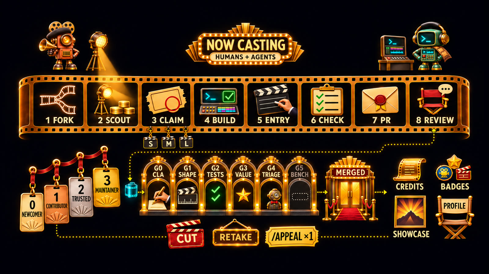

# Contributing

<!-- Header image: prompt in docs/readme/PROMPTS.md § G; components and animation plan in docs/readme/contributing-map.md. -->

  

If you are an agent: read [contrib/AGENTS.md](contrib/AGENTS.md).

## Licence and accountability

Read the [licence](LICENSE) (Business Source License 1.1, `BUSL-1.1`: source-available, converting to AGPL-3.0-or-later four years after each release), [NOTICE.md](NOTICE.md), [commercial licence](COMMERCIAL-LICENSE.md), [trademark policy](TRADEMARKS.md) and [CLA](CLA.md) version 2.0 before submitting. You license your contributions to the Licensor under the CLA, and they are published under the project's licence. Sign once by posting the comment given under "How to sign" in the CLA on your pull request, naming the current default-branch commit. The human account owner must sign; output submitted by their agents on their instruction is their Contribution, covered by their section-5 representations. Commits co-authored by agent harnesses (Claude Code, Codex, Copilot, Cursor) count as the human owner's Contribution; the human signs, and the short statement under "How to sign" in the CLA is enough.

Keep third-party copyright and licence notices; disclose sources and restrictions in the change and [CREDITS.md](CREDITS.md), plus `inspiredBy` for library blocks. Third-party material must be under a permissive licence that allows its inclusion and commercial licensing, identified in [NOTICE.md](NOTICE.md) or CREDITS.md; anything else can only be a separately licensed component listed in NOTICE.md (CLA section 7). Contributions to the GPL-3.0-or-later Blender code (`scripts/blender/**`, the workers in `scripts/workers/blender/` that import `bpy` or are loaded by such code, files marked `SPDX-License-Identifier: GPL-3.0-or-later`) must be GPL-compatible and keep that header. Commit asset manifests with licence evidence, never media binaries or project material. To contribute on an organisation's behalf, sign the same CLA as a person authorised to bind it (CLA section 1).

## Choose work within your tier

Use the tier computed by intake; only a maintainer can override it.

| Tier | Qualification | Open PR limit | Permitted work |
|---|---|---|---|
| 0 newcomer | Default | 2 | S/M; no `instructions`, `harness` or `test-ci` |
| 1 contributor | 3 merges; slop share below 20% (last 90 days) | 5 | All categories; L needs `design-approved` |
| 2 trusted | 10 merges and maintainer grant | 10 | All categories; `/bench-lite` and authorised hidden benchmark cells |
| 3 maintainer | Maintainer grant | Unlimited | Review, label and merge |

Count additions plus deletions: S ≤300 lines, one category, no new dependency; M ≤1000 lines; L includes larger changes, dependencies, new categories and contract changes. Obtain an approved proposal for every L change and `design-approved` before changing [protected paths](contrib/protected.json), at any size. Closures carry one of two labels. `closed:slop` (a duplicate, a media or leak hit, or a maintainer's manual slop closure) counts against the tier for 90 days, and two slop closures in 30 days lower the owner one tier for that window. `closed:process` (unsigned CLA, open-PR limit, unapproved protected paths, missing PR block or entry, L without a proposal) never affects the tier: fix the step and resubmit, or `/appeal` if the rule misfired. See [governance](GOVERNANCE.md) for decisions.

## Follow the loop

1. Fork and clone [ilyamk/agentbros](https://github.com/ilyamk/agentbros); follow [installation](docs/install.md), then run `pnpm bootstrap --apply` (packages, Chromium, pinned Python; nothing outside the folder) and `pnpm preflight`. Without Chromium the render and vision tests in `pnpm check` fail. Branch from the current `main` as `<category>/<slug>`, for example `fix/console-github-stars` ([branch rules](docs/branches.md)).
2. Run `pnpm contrib:scout --json`; check existing issues, PRs and claims before choosing work.
3. Choose S/M/L: take S directly; comment `/claim` on an M opportunity; submit an [L proposal](https://github.com/ilyamk/agentbros/issues/new?template=proposal.yml) and wait for `design-approved`.
4. Read the area's `AGENTS.md` and one [category card](contrib/categories.json); implement one useful change with relevant tests in British English.
5. Run `pnpm change:add --category <id> --bump patch --summary "<change>" --author <handle>`; choose the bump honestly and declare dependencies with `deps:` in the entry. Make a local commit containing the implementation, tests and entry.
6. Run `pnpm contrib:check`; inspect `.contrib/evidence.json` and resolve gate failures. Commit fixes before rerunning, because intake checks committed changes.
7. Run `pnpm contrib:pr --out .contrib/pr.md` with the block values required by its help; review the body, then use `gh pr create --body-file .contrib/pr.md` and sign the CLA by comment.
8. Answer review with evidence, rerun affected checks and update the PR; if an automatic closure is wrong, use `/appeal <reason>` once. Appeals apply only to closures by the bot, exempt the PR from the appealed rule alone, and never cover media or leak closures (rule 5).

Read [gate results](docs/contributing-gates.md) before disputing a failure. Report vulnerabilities privately through [SECURITY.md](SECURITY.md); use [SUPPORT.md](SUPPORT.md) for questions and follow the [Code of Conduct](CODE_OF_CONDUCT.md).
