<!--
  ════════════════════════════════════════════════════════════════════════
  Agent Bros. Pictures — README as a landing page.
  Images live in docs/readme/ (prompts: docs/readme/PROMPTS.md). They are
  illustrations; replace a card or the hero with a GIF of a real render when
  one exists (GIF ≤ 4 MB, or an MP4 uploaded to a GitHub issue and linked).
  Remaining "ASSET" comments are briefs for visuals that must be real renders.
  Counts live only in the generated metrics table (pnpm metrics); keep prose
  free of block, agent and genre totals so they cannot drift. Exception: the
  rounded catalogue floors in "The casting office" (1,500+ endpoints, 400+
  families; src/lib/models/fal-catalog + hf-catalog) and the ~40 documented
  platforms in "The source room" (pnpm media:fetch --capabilities); recheck
  both after a catalogue refresh. Name only models present in the catalogues.
  Repo slug used by the clone commands, live badges, star chart and
  contributors image: ilyamk/agentbros.
  ════════════════════════════════════════════════════════════════════════
-->

<!-- AI agents asked to install this repository: read SETUP.md first
     (./setup.sh plans, --apply installs, out/setup/REPORT.md is for the user). -->

<a id="top"></a>

<p align="center">
  <a href="README.md">🇬🇧 English</a> · <a href="README_ru.md">🇷🇺 Русский</a> · <a href="README_zh.md">🇨🇳 简体中文</a>
</p>

<div align="center">

<!-- Logo and every image below: prompts in docs/readme/PROMPTS.md. -->
<picture>
  <source media="(prefers-color-scheme: dark)" srcset="docs/readme/logo-dark.png">
  <source media="(prefers-color-scheme: light)" srcset="docs/readme/logo-light.png">
  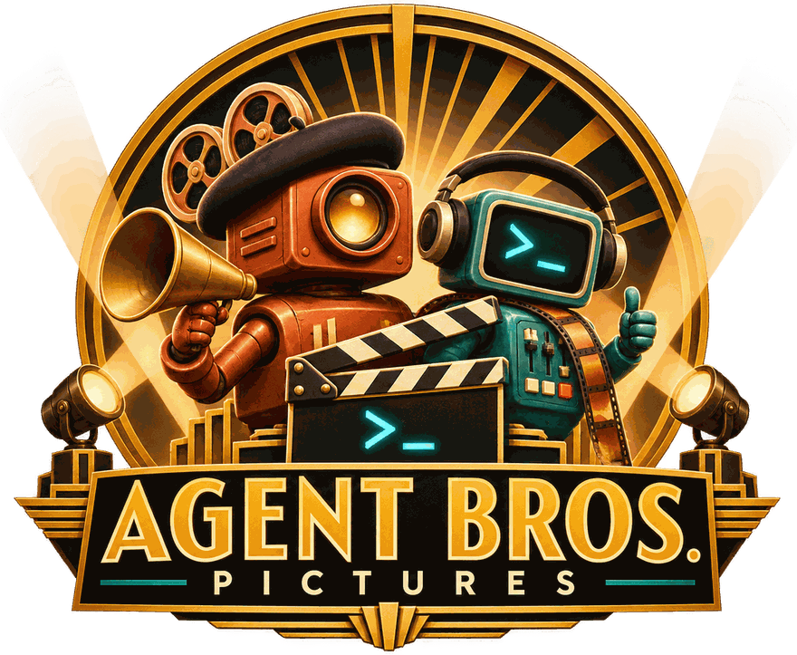
</picture>

# Agent Bros. Pictures

**The Creative Intelligence Harness for Your AI Agents**

### A source-available video studio run by two agent brothers, Claude Code and Codex.

Say what you need in one sentence. Get the finished video, and the code that made it.<br>
From a 15-second Reel to a launch film, a tutorial, a lesson or a whole campaign.

<br>

[](https://github.com/ilyamk/agentbros/stargazers)
[](AGENTS.md)
[](AGENTS.md)
[](docs/mcp.md)

[](https://www.remotion.dev)
[](https://react.dev)
[](tsconfig.json)
[](#licence)
[](#join-the-crew)
[](#honest-limits)

[](https://scorecard.dev/viewer/?uri=github.com/ilyamk/agentbros)
[](https://github.com/ilyamk/agentbros/actions/workflows/codeql.yml)
<!-- OpenSSF Best Practices badge: add after registering on bestpractices.dev (docs/github.md, step 5). -->

<br>

[**Quick start**](#quick-start) &nbsp;·&nbsp;
[**Who it's for**](#who-its-for) &nbsp;·&nbsp;
[**The Studio**](#the-studio) &nbsp;·&nbsp;
[**Models**](#models) &nbsp;·&nbsp;
[**Now Showing**](#now-showing) &nbsp;·&nbsp;
[**For teams**](#for-teams) &nbsp;·&nbsp;
[**FAQ**](#faq) &nbsp;·&nbsp;
[**For agents**](#for-agents) &nbsp;·&nbsp;
[**Story**](#the-story)

<br>

<!-- hero.jpg is an illustration; replace it with the studio's own trailer GIF
     (made with this repository, linked to the MP4 with sound) when it exists. -->
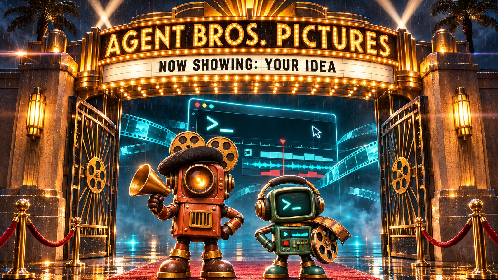

<br><br>

<!-- metrics:start -->
<table>
  <tr>
    <td align="center" width="20%"><h2>24</h2><sub>genres<br>(17 ready)</sub></td>
    <td align="center" width="20%"><h2>136</h2><sub>motion-design<br>blocks (101 verified)</sub></td>
    <td align="center" width="20%"><h2>23</h2><sub>crew agents<br>on set</sub></td>
    <td align="center" width="20%"><h2>3</h2><sub>formats<br>9:16 · 1:1 · 16:9</sub></td>
    <td align="center" width="20%"><h2>0</h2><sub>API keys needed<br>to render</sub></td>
  </tr>
</table>
<!-- metrics:end -->

<br>

[**⚡ Make your first video**](#quick-start) &nbsp;&nbsp;·&nbsp;&nbsp; [**🏢 Using it for a team or agency?**](#for-teams) &nbsp;&nbsp;·&nbsp;&nbsp; [**🤖 Agents: setup**](SETUP.md)

</div>

<br>

> [!TIP]
> **Your first take:** open this repository in Claude Code or Codex and say
> *“Make a 20-second vertical ad for my app, here is the landing page.”*
> The brothers plan it, build it in code, render it locally, watch their own frames and show you the cut.

## 📽️ How it works

**1 · Say it in one sentence.** Ask Claude Code or Codex for any video, in your own words:

> Make a **30-second launch film** for my app. Here is the site; use its real screens.

> Cut **five Shorts** from my podcast recording, with key-word captions.

> Make a **90-second lesson** on how compound interest works, with a calm voice.

> Here is our **product CSV**: one 15-second vertical video per item, prices from the sheet.

**2 · Approve, don't micromanage.** The agents pick the genre, write the strategy and the script, find the music and propose a look. You approve the idea, the look, the music and the final cut; nothing paid runs without a budget you set.

**3 · Get the cut, and the source.** A rendered video in 9:16, 1:1 or 16:9, plus everything that made it:

| You get | What it is |
|---|---|
| `out/<project>/…mp4` | the finished video per format, plus a clean cut where captions are a separate layer |
| `src/projects/<project>/` | a bespoke film as editable Remotion code; change a line, render again |
| `public/projects/<project>/pipeline/` | strategy, script, look, motion plan and critic notes, as reviewable files |
| `pnpm cost:report --project <project>` | every paid call with its quote, reservation and result |

## 💎 Why Agent Bros.

<table>
  <tr>
    <td width="33%" valign="top">🧾 <b>The source, not a black box</b><br><sub>Every film is source you own: code, plans and timelines. Change a word, a colour or a cut and render again; no regenerating and hoping.</sub></td>
    <td width="33%" valign="top">🎯 <b>Your real product</b><br><sub>Your app or site is captured live, never faked with a generic phone mock (<a href="docs/real-ui.md">real UI</a>).</sub></td>
    <td width="33%" valign="top">🧐 <b>A crew that checks itself</b><br><sub>A fresh, harsh critic every round, plus measured motion, sync, loudness and delivery checks before you see a cut.</sub></td>
  </tr>
  <tr>
    <td valign="top">🔒 <b>Local first</b><br><sub>Rendering, editing and tests run on your machine with no keys. Your media is stored and processed locally; your agent's model sees only the frames and text it reads.</sub></td>
    <td valign="top">💸 <b>Budgets, not surprises</b><br><sub>Paid generation is quoted or bounded, reserved against your limit and logged before it runs (<a href="docs/paid-execution.md">paid execution</a>).</sub></td>
    <td valign="top">🧠 <b>Learns your taste</b><br><sub>Your verdicts become local memory: the next film keeps your preferences and avoids last time's mistakes (<a href="memory/AGENTS.md">memory</a>).</sub></td>
  </tr>
  <tr>
    <td valign="top">🤖 <b>Many models, one desk</b><br><sub>1,500+ image, video, voice, music and 3D model endpoints, picked per task and price (<a href="#models">the casting office</a>).</sub></td>
    <td valign="top">🎛️ <b>Fits your tools</b><br><sub>A local review UI, reversible timeline edits, a cut-only DaVinci Resolve handoff and an <a href="docs/mcp.md">MCP server</a> for other agents.</sub></td>
    <td valign="top">🌍 <b>Readable and shared</b><br><sub>Every genre, block and promoted lesson is a file you can read and the next crew can improve. Source-available under BUSL-1.1: free for individuals, organisations of up to three people, non-profits and education; larger companies buy a <a href="#for-teams">commercial licence</a>. Each release becomes AGPL-3.0-or-later after four years.</sub></td>
  </tr>
</table>

## 🆕 Fresh from the edit bay

<!-- Keep the three newest user-facing items, dated, each linking to what changed. -->

- **2026-11-16** · Campaigns: one brief becomes many accountable videos, with A/B hooks, one video per catalogue row, monthly series and language versions. [Campaign production →](docs/campaign-production.md)
- **2026-11-16** · Vork joins Blender as a local GPU renderer for programmable 3D shots and effects (experimental). [Vork →](docs/vork.md)
- **2026-11-15** · Dozens of new motion blocks studied from reference films: print type, marquee rows, noise-matte wipes, liquid light, UI annotations. [Browse the library →](docs/motion-library.md)

<a id="who-its-for"></a>

## 👥 Who it's for

| You are | Ask for | Start with |
|---|---|---|
| **A product team or founder** | a launch film, a feature update, an App Store preview, a tutorial on your real screens | `product-promo` · `feature-update` · `app-store-preview` · `product-tutorial` · `teaser-trailer` |
| **A performance marketer or e-commerce shop** | hook variants to test, one video per product, creator-style ads | `ad-experiments` · `catalogue-videos` · `ugc-ad` · `reference-family` |
| **A creator or podcaster** | Shorts from a long recording, a tighter talk, captions, two cameras synced, a monthly series with a recurring host | `shorts-from-long` · `footage-edit` · `content-series` · `captions:place` |
| **A teacher or course author** | a lesson where the diagram moves with the voice, chapters for a long lecture | `explainer` · `product-tutorial` · `video:longform` |
| **An agency or studio** | campaigns across brands and languages, in a house style, with the source to hand over | `localise-campaign` · `reference-family` · [for teams](#for-teams) |
| **A filmmaker or motion designer** | mood films from approved key frames, kinetic type, 3D shots, a film in the style of one you admire | `ai-film` · `motion-design` · `video-remix` · `blender:run` · [references](#references) |

<p align="right"><sub><a href="#top">back to top ↑</a></sub></p>

<a id="quick-start"></a>

## ⚡ Quick start

**Way 1 · Tell your agent** <sub>(recommended)</sub>

```text
Install Agent Bros. Pictures from github.com/ilyamk/agentbros: follow its
SETUP.md, then tell me what works and which keys I need.
```

**Way 2 · Two lines**

```bash
git clone https://github.com/ilyamk/agentbros.git && cd agentbros
./setup.sh --apply --smoke   # Windows: ./setup.ps1 -Apply -Smoke
```

`./setup.sh` on its own only plans. `--apply` installs what is missing in this folder, plus Node, pnpm and uv through your own version manager. It installs system packages (Homebrew, apt, winget) only with `--system`. It finishes with `out/setup/REPORT.md`: what works, your machine's limits, and which keys unlock what.

Then open the folder in **Claude Code** or **Codex** and ask for a video. That's it.

<details>
<summary><b>What you need</b></summary>
<br>

Without the script: `nvm install && nvm use`, then `npm install --global pnpm@12.21.0 --allow-scripts=pnpm && pnpm install --frozen-lockfile && pnpm preflight`.

Node 26 (26.13.1 recommended and CI-tested; Node 24, tested on 24.22.3, also works), pinned pnpm, FFmpeg and uv; the install guide has steps for macOS, Debian/Ubuntu and Windows. Chromium is downloaded by Remotion. Blender, Vork, DaVinci Resolve and provider keys are optional; `pnpm preflight` tells you what is missing and how to install it. Full table per OS: [install guide](docs/install.md); [Node policy](docs/node-runtime.md); [Python 3.13 and uv](docs/python-runtime.md).

Other agents can drive the studio through the local [MCP server](docs/mcp.md) (`pnpm mcp:stdio`); it runs no paid tool unless you launch it with `--allow-paid`, and even then generation defaults to a dry run.

Optional: Remotion's own agent skill, `remotion-best-practices`, is not bundled (its upstream grants no redistribution licence); install it from upstream with `npx skills add remotion-dev/skills` ([third-party skills](.agents/skills/THIRD_PARTY.md)).

</details>

Prerequisites, keys, the offline first video and updates: **[install guide](docs/install.md)**. A one-page tour for people: **[how it works](docs/how-it-works.md)**.

<p align="right"><sub><a href="#top">back to top ↑</a></sub></p>

<a id="the-studio"></a>

<p align="center">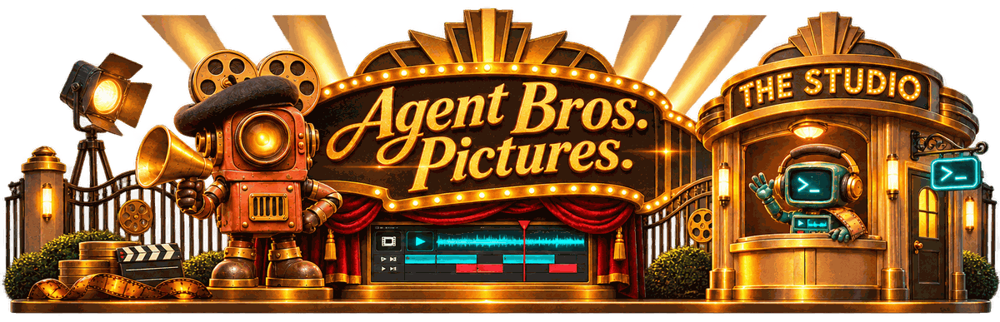</p>

## 🎬 The Studio

<sub>Every department of a real production, staffed by agents. Each one is a command with a JSON answer, so the crew can check its own work.</sub>

<table>
  <tr>
    <td align="center" width="25%" valign="top">
      <br>
      <b>Writers' room</b><br>
      <sub>Strategy, hooks, ideas from rival teams, scripts judged blind.</sub><br><br>
      <code>film:brief</code>
    </td>
    <td align="center" width="25%" valign="top">
      <br>
      <b>Art department</b><br>
      <sub>A motion-design library, ready looks and styleframes rendered from real code.</sub><br><br>
      <code>library:list</code>
    </td>
    <td align="center" width="25%" valign="top">
      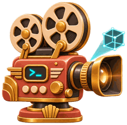<br>
      <b>Camera &amp; 3D</b><br>
      <sub>Blender, Vork, three.js and the real UI of your product, captured live.</sub><br><br>
      <code>capture:app</code>
    </td>
    <td align="center" width="25%" valign="top">
      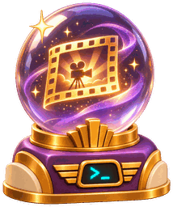<br>
      <b>Generation</b><br>
      <sub>Image and video models behind durable jobs and budget checks.</sub><br><br>
      <code>generate:video</code>
    </td>
  </tr>
  <tr>
    <td align="center" valign="top">
      <br>
      <b>Voice &amp; music</b><br>
      <sub>Voiceover, scores, 160+ sound effects, cuts locked to the beat.</sub><br><br>
      <code>audio:mix</code>
    </td>
    <td align="center" valign="top">
      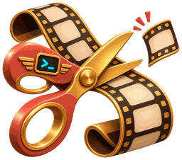<br>
      <b>Editing suite</b><br>
      <sub>Silences, fillers and false starts cut; multicam; vertical reframe.</sub><br><br>
      <code>recut:plan</code>
    </td>
    <td align="center" valign="top">
      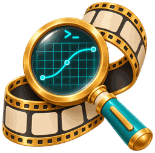<br>
      <b>Reference lab</b><br>
      <sub>Any film taken apart frame by frame, then rebuilt for your idea.</sub><br><br>
      <code>ref:analyze</code>
    </td>
    <td align="center" valign="top">
      <br>
      <b>Critics' table</b><br>
      <sub>A fresh, harsh critic every round; measured motion, sync and QA.</sub><br><br>
      <code>motion:check</code>
    </td>
  </tr>
</table>

<details>
<summary><b>How a picture gets made</b> <sub>(the bespoke film chain)</sub></summary>
<br>

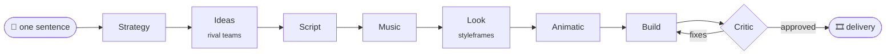

You approve at every gate that matters: the idea, the look, the music, the final cut. Details: [production chain](docs/production-chain.md).

</details>

<a id="models"></a>

## 🎭 The casting office: 1,500+ models, one desk

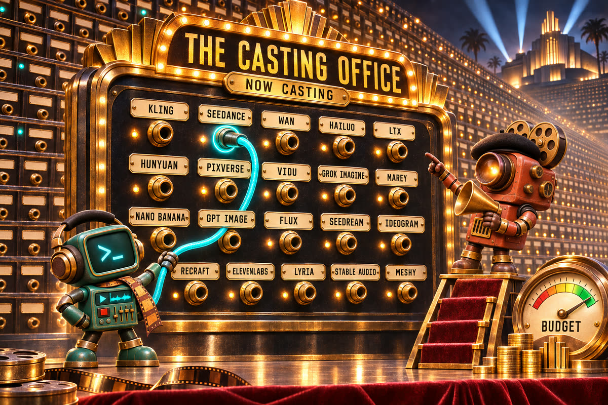

**Every major lab's models behind one sentence and one budget.** The studio keeps an offline catalogue of more than 1,500 model endpoints from 400+ model families on fal and Higgsfield, plus ElevenLabs directly: video, image, voice, music, sound effects, 3D, upscaling, lip-sync and avatars.

- **Cast for the part, not the brand.** `models:pick` chooses by task, quality tier and price; when two providers serve the same model, the cheaper one gets the job.
- **Priced before it plays.** Every call is quoted or bounded and reserved against your budget first; an ambiguous submit is resumed by the same operation, never blindly resubmitted.
- **One workflow for every medium.** The same agents, approvals and cost report for a video shot, a voiceover, a score or a 3D asset.
- **New models without new code.** A catalogue refresh brings new endpoints in with their schemas and prices; each one carries an honest trust tier, from discovered to verified.
- **No stack of subscriptions.** Your own fal, Higgsfield and ElevenLabs accounts, pay as you go.

**Kling** (Kuaishou) · **Seedance** (ByteDance) · **Wan** (Alibaba) · **Hailuo** (MiniMax) · **LTX** (Lightricks) · **Hunyuan Video** (Tencent) · **PixVerse** · **Vidu** · **Grok Imagine** (xAI) · **Marey** (Moonvalley) · **Nano Banana** (Google) · **GPT Image** (OpenAI) · **FLUX** (Black Forest Labs) · **Seedream** (ByteDance) · **Ideogram** · **Recraft** · **ElevenLabs** · **Lyria** (Google) · **Stable Audio** (Stability AI) · **Meshy** · <sub>and hundreds more, from Luma, Meta, Microsoft, NVIDIA, Topaz Labs and others.</sub>

<sub>Guides: [model slots](docs/model-slots-guide.md) · [fal catalogue](docs/fal-catalogue.md) · [Higgsfield](docs/higgsfield.md) · [paid execution](docs/paid-execution.md). Model names belong to their owners (see <a href="#trademarks">trademarks</a>).</sub>

<a id="sources"></a>

## 📥 The source room: your material, in by link

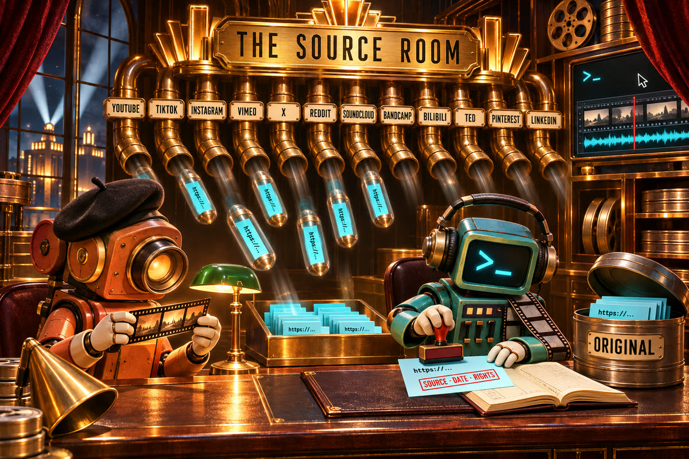

**A link is a source.** Paste the post that inspired you, your own published Reel or a track you licensed, and the original file lands in your project, filed with where it came from.

- **The original, not a screen recording.** The best available rendition of each attachment, with audio on its own when you ask; no upscaling, no crop.
- **Filed like an archive.** Each file is kept immutable with its checksum, source link, provider and date. Rights stay marked unknown until you confirm them.
- **Straight into the work.** A source becomes a reference for "in the style of…", a clip for a remix, or your own post to recut into Shorts.
- **Batches that survive.** Up to 100 links at once, resumable after a failure; an uncertain request is reconciled, never blindly paid again.
- **Public posts only.** No browser cookies, no private sessions, no DRM.

**YouTube** · **TikTok** · **Instagram** · **Facebook** · **X** · **Threads** · **Snapchat** · **Pinterest** · **LinkedIn** · **Reddit** · **Vimeo** · **Dailymotion** · **Bilibili** · **Douyin** · **Xiaohongshu** · **Weibo** · **SoundCloud** · **Bandcamp** · **Mixcloud** · **TED** · <sub>and about 20 more, as documented by the providers.</sub>

<sub>Fetching runs through your own RapidAPI or Apify account, paid per link within your budget; platform coverage is the providers' documentation, not a guarantee. Use it for material you own or may use: a fetched reference is analysed, not republished. Guide: [media acquisition](docs/media-fetch.md).</sub>

<p align="right"><sub><a href="#top">back to top ↑</a></sub></p>

<a id="now-showing"></a>

<p align="center"></p>

## 🍿 Now Showing

<sub>One sentence in, or the footage you shot, or a spreadsheet of products. Pick a genre: most cards are playbooks with their own method and quality bar; a few are tools that work inside any of them. The cards are illustrations, not frames of finished films.</sub>

<p>
  
  
</p>

<table>
  <tr>
    <td width="50%" valign="top">
      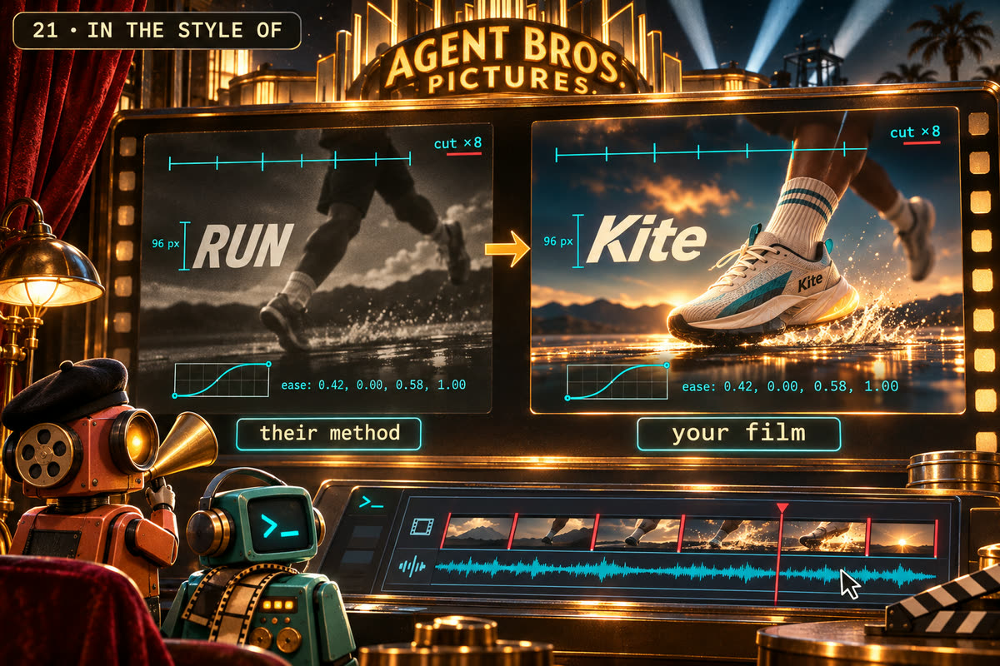
    </td>
    <td width="50%" valign="top">
      <h4>✨ Works with every genre: "in the style of…"</h4>
      Send a film you admire with any request. The crew measures its cuts, beat grid, type and eases, then builds <b>your</b> film with the same craft and new content. The reference is measured on your machine, and the repository keeps only numbers and descriptions.<br><br>
      <sub><code>ref:add</code> · <code>ref:analyze</code> · <a href="#references">how the crew learns →</a></sub>
    </td>
  </tr>
</table>

### 🚀 Product &amp; marketing

<table>
  <tr>
    <td width="50%" valign="top">
      <!-- ASSET card product-promo: 16:9 GIF, 800×450, loop ≤ 6 s. A launch film
           for a real app: the product's own screen flies in, one proposition
           in big type, logo lock-up. -->
      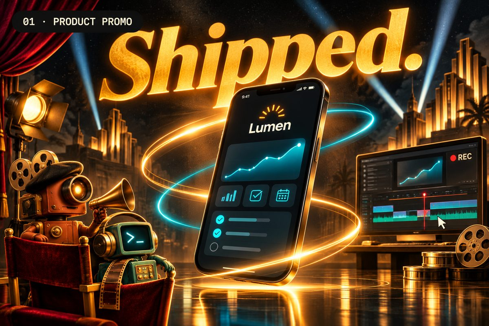
      <h4>Product promo</h4>
      Launch films built around your real product, not a stand-in.<br>
      <sub><code>product-promo</code> · 15–60 s</sub> 
    </td>
    <td width="50%" valign="top">
      <!-- ASSET card teaser-trailer: 16:9 GIF. Dark, slow build, flashes of the
           thing, a date card: "COMING 08.12". -->
      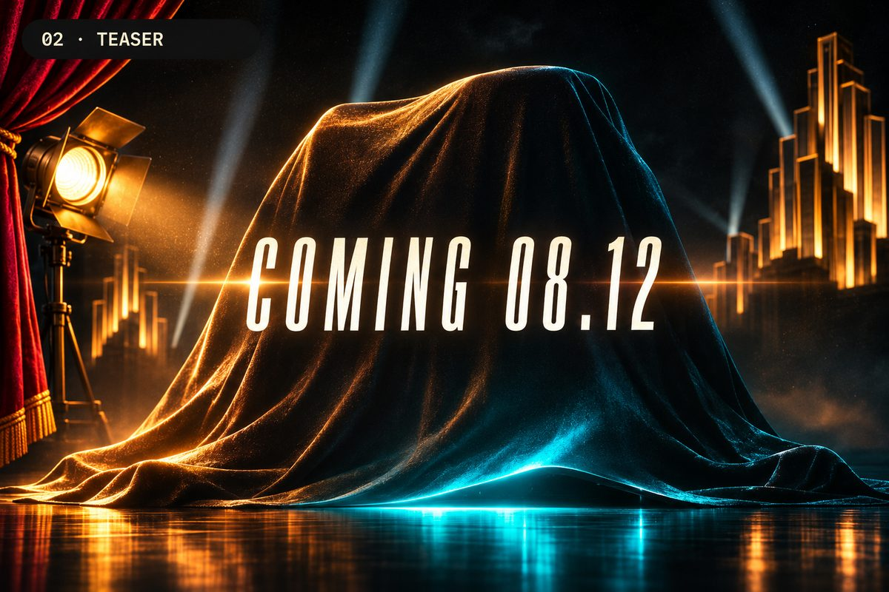
      <h4>Teaser &amp; trailer</h4>
      Anticipation for what isn't out yet. Ends on a date.<br>
      <sub><code>teaser-trailer</code> · 6–60 s</sub> 
    </td>
  </tr>
  <tr>
    <td width="50%" valign="top">
      <!-- ASSET card app-store-preview: three 9:16 phone frames side by side,
           real app screens with tap hotspots, store-size badge "886×1920". -->
      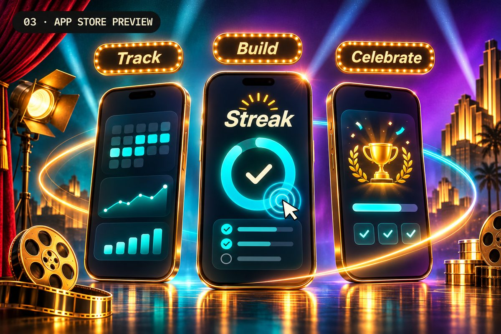
      <h4>App Store preview</h4>
      Your app's own screens at the store's exact size, built to pass review.<br>
      <sub><code>app-store-preview</code> · 15–30 s</sub> 
    </td>
    <td width="50%" valign="top">
      <!-- ASSET card feature-update: before / after wipe across a real UI,
           a "NEW" chip lands on the changed button. -->
      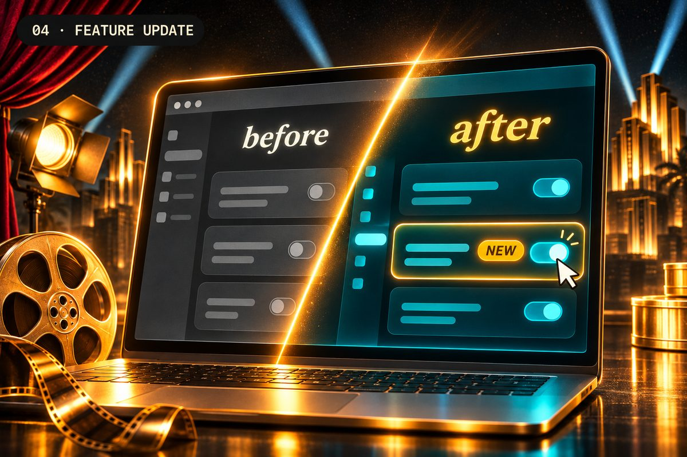
      <h4>Feature update</h4>
      One new feature: the change, before and after, where to try it.<br>
      <sub><code>feature-update</code> · 10–45 s</sub> 
    </td>
  </tr>
  <tr>
    <td width="50%" valign="top">
      <!-- ASSET card ugc-ad: 9:16, a creator talking to camera, bold hook caption
           in the first second, the product in hand. Label "3 hooks · 1 product". -->
      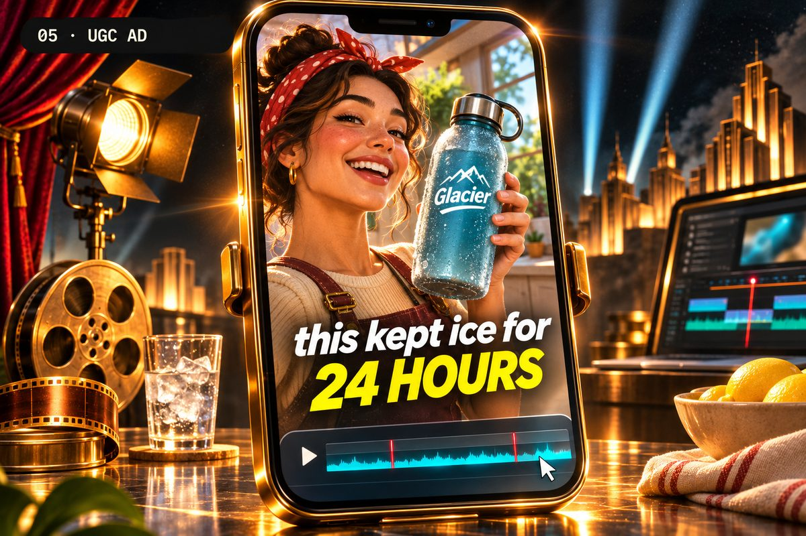
      <h4>UGC ad</h4>
      Creator-style vertical ads: hook, problem, product, proof.<br>
      <sub><code>ugc-ad</code> · vertical</sub> 
    </td>
    <td width="50%" valign="top">
      <!-- ASSET card case-study: an interview frame with a lower third and a
           signed-off number animating: "+38% retention". -->
      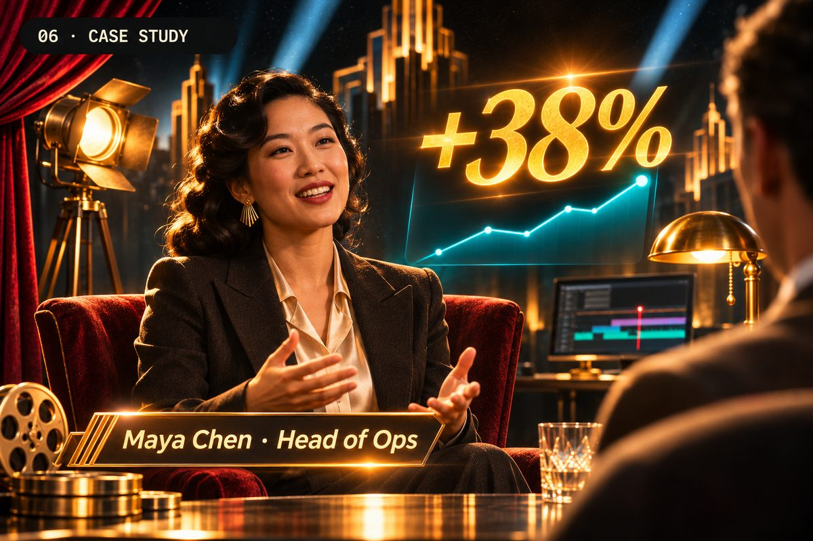
      <h4>Customer case study</h4>
      A client interview cut into a story with real, signed-off numbers.<br>
      <sub><code>case-study</code> · 60 s–3 min</sub> 
    </td>
  </tr>
</table>

### 📦 Campaigns at scale

<sub>One brief, many videos. Each variant is its own accountable project: its own facts, approvals and costs, nothing silently copied from the row before.</sub>

<table>
  <tr>
    <td width="50%" valign="top">
      <!-- ASSET card ad-experiments: three vertical ads, identical body,
           three different first seconds labelled A / B / C. -->
      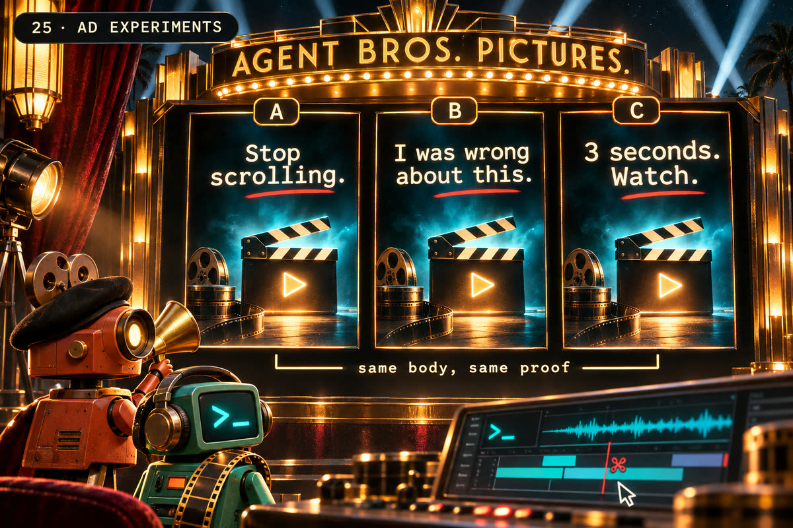
      <h4>Ad experiments</h4>
      Hook, offer and ending variants around one proven body, each with a hypothesis to test.<br>
      <sub><code>ad-experiments</code> · A/B</sub> 
    </td>
    <td width="50%" valign="top">
      <!-- ASSET card catalogue-videos: a product sheet whose rows turn into a
           grid of vertical videos, prices from the sheet. -->
      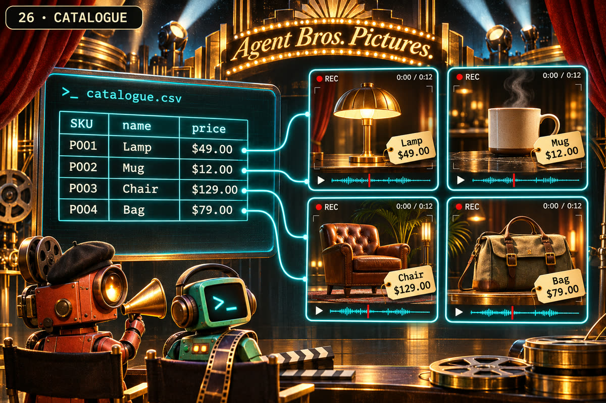
      <h4>Catalogue videos</h4>
      A CSV, TSV or JSON of products in, one reviewable video per SKU out, with names and prices checked row by row.<br>
      <sub><code>catalogue-videos</code> · e-commerce</sub> 
    </td>
  </tr>
  <tr>
    <td width="50%" valign="top">
      <!-- ASSET card content-series: a month of episodes with the same host. -->
      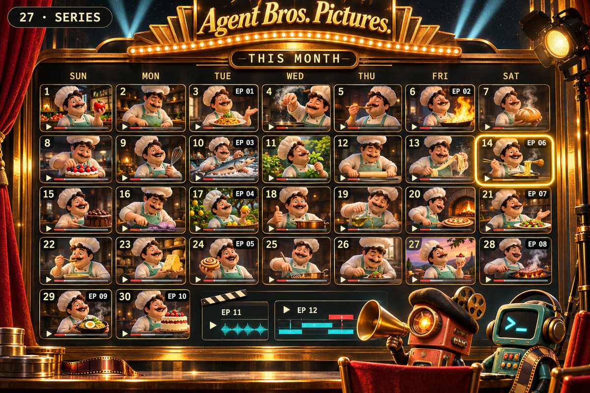
      <h4>Content series</h4>
      A month of episodes: the same character and format, new substance every time.<br>
      <sub><code>content-series</code> · recurring</sub> 
    </td>
    <td width="50%" valign="top">
      <!-- ASSET card reference-family: one blueprint, three products. -->
      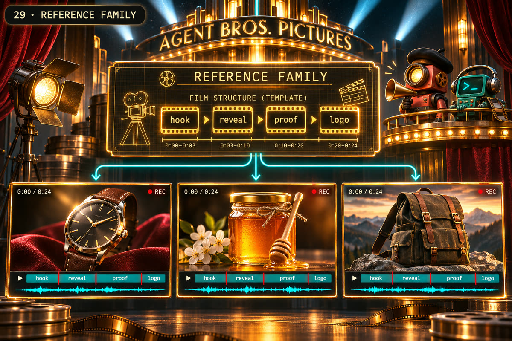
      <h4>Reference family</h4>
      One reference's method carried across a product line, so every film feels like the same brand.<br>
      <sub><code>reference-family</code> · product lines</sub> 
    </td>
  </tr>
  <tr>
    <td width="50%" valign="top">
      <!-- ASSET card localise-campaign: the same ads in four languages. -->
      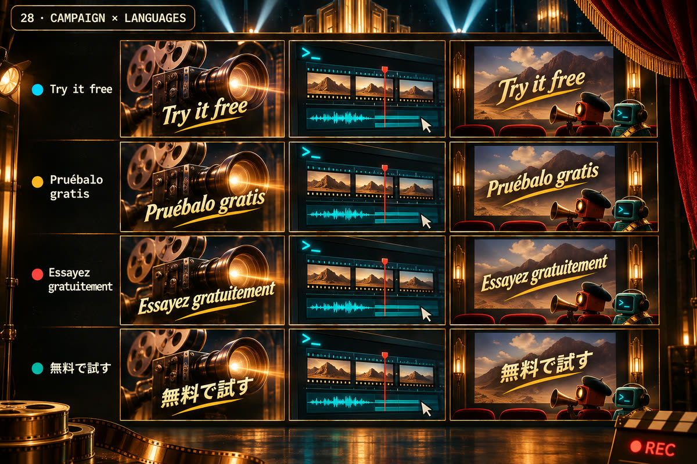
      <h4>Campaign × languages</h4>
      Accepted variants in new languages: voice, captions and on-screen text, with a reviewer per language.<br>
      <sub><code>localise-campaign</code></sub> 
    </td>
    <td width="50%" valign="top">
      <!-- ASSET card localise: the same frame in three languages stacked,
           subtitles switching EN → ES → JA. -->
      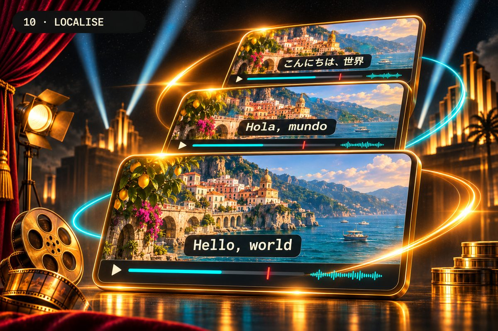
      <h4>Localise one video</h4>
      A finished video in another language: subtitles, voice, on-screen text.<br>
      <sub><code>localise</code></sub> 
    </td>
  </tr>
</table>

### 🎓 Explain &amp; teach

<table>
  <tr>
    <td width="50%" valign="top">
      <!-- ASSET card explainer: a diagram building itself to a voice, numbers
           counting up, a worked example highlighted. -->
      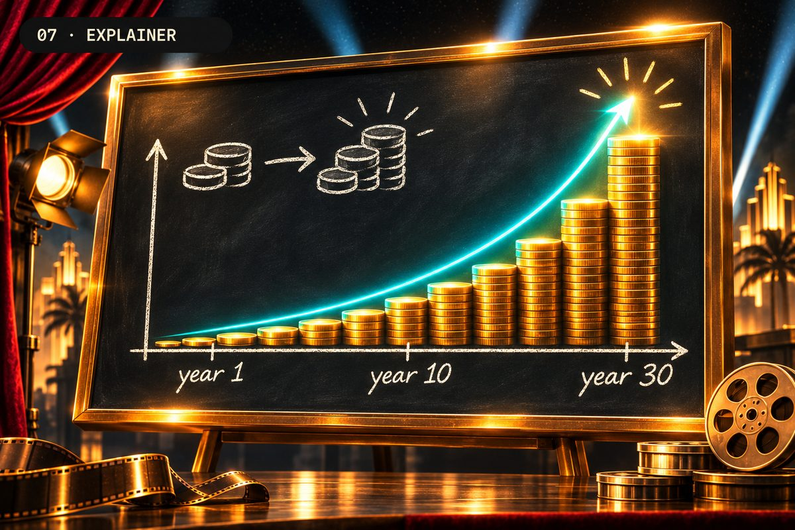
      <h4>Explainer &amp; lesson</h4>
      Ideas, processes and data, where the diagram moves with the voice.<br>
      <sub><code>explainer</code> · 30 s–several min</sub> 
    </td>
    <td width="50%" valign="top">
      <!-- ASSET card product-tutorial: a real web app, the cursor glides,
           a ring pulses on each click, step counter "2 / 5". -->
      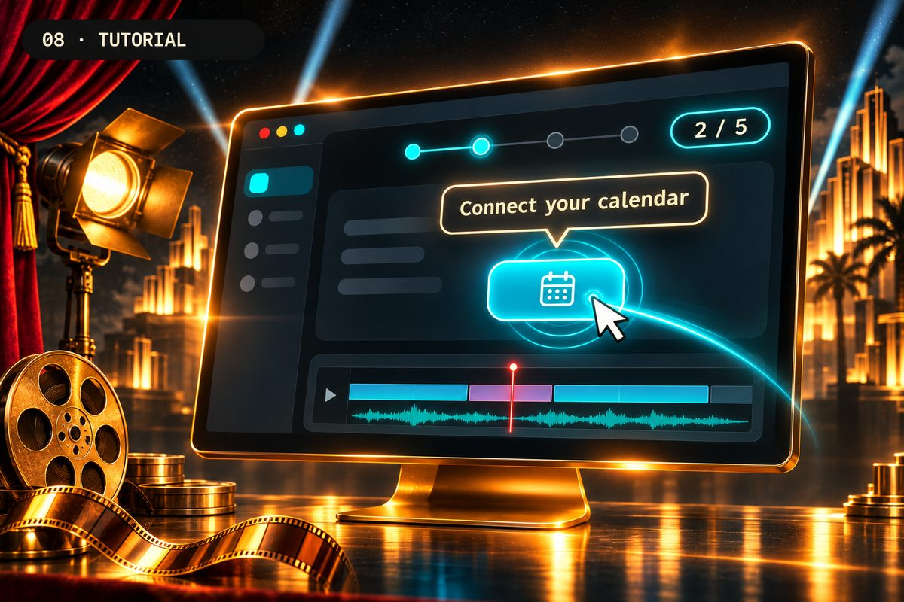
      <h4>Product tutorial</h4>
      One task taught on the real screens, click by click.<br>
      <sub><code>product-tutorial</code> · 30 s–several min</sub> 
    </td>
  </tr>
  <tr>
    <td width="50%" valign="top">
      <!-- ASSET card longform: a long lecture with gold chapter segments and
           vertical clips pulled out of it. -->
      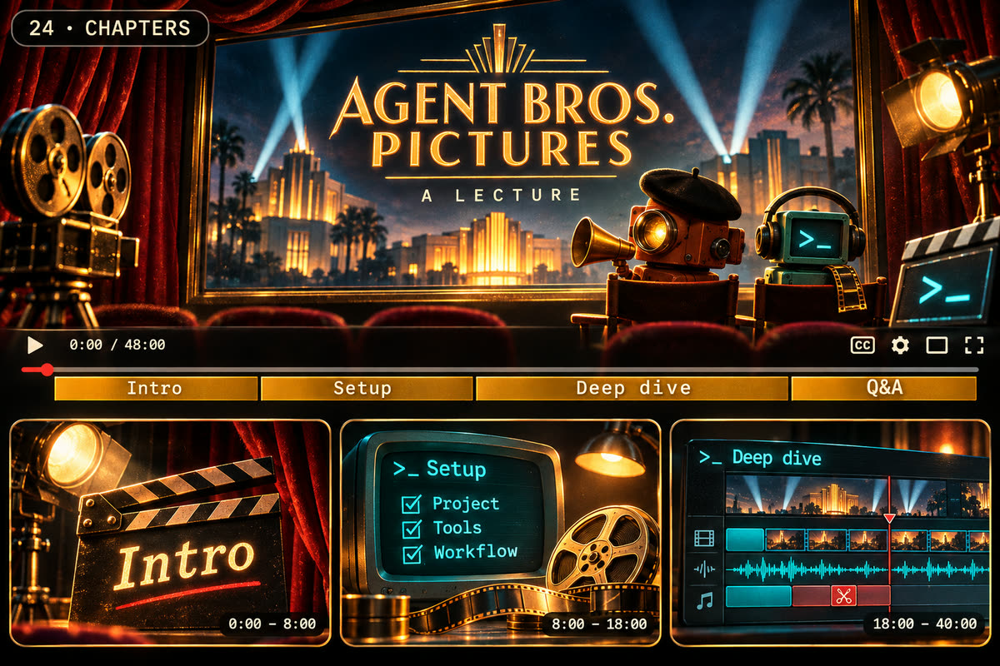
      <h4>Chapters &amp; long form</h4>
      A long lecture or stream split into titled chapters, with approved Shorts pulled from it.<br>
      <sub><code>video:longform</code> · local</sub>
    </td>
    <td width="50%" valign="top">
      <!-- ASSET card avatar-presenter: a digital presenter beside a slide,
           visible "AI-generated" label in the corner. -->
      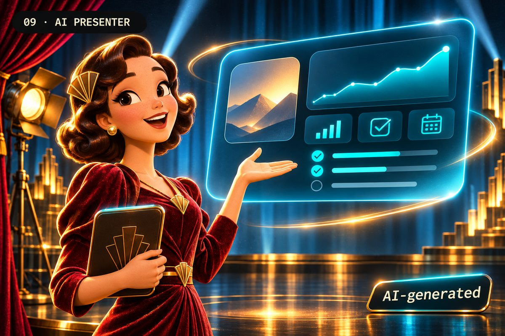
      <h4>AI presenter</h4>
      A digital host for onboarding and outreach, with consent and AI labels.<br>
      <sub><code>avatar-presenter</code></sub> 
    </td>
  </tr>
</table>

### 🎨 Motion, 3D &amp; AI cinema

<table>
  <tr>
    <td width="50%" valign="top">
      <!-- ASSET card motion-design: kinetic typography on the beat, letters
           splitting and re-forming into a logo ident. -->
      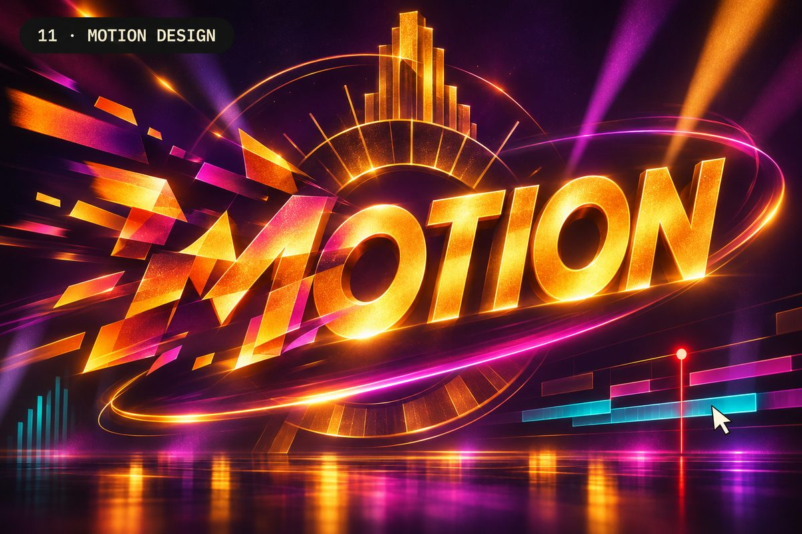
      <h4>Motion design</h4>
      Kinetic type, logo idents, title sequences, pure motion to music.<br>
      <sub><code>motion-design</code></sub> 
    </td>
    <td width="50%" valign="top">
      <!-- ASSET card photoreal-3d: an unbranded phone in a studio light,
           rendered in Blender, its wireframe ghosted behind it. -->
      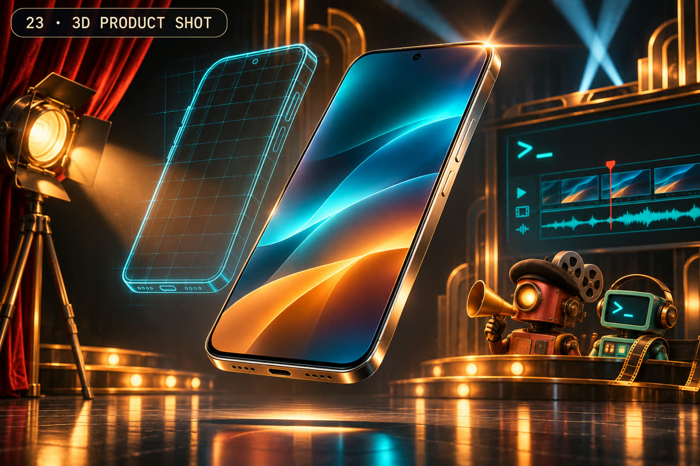
      <h4>3D product shots</h4>
      A real device model lit like a studio photograph in Blender, your screen on it, composited into the film.<br>
      <sub><code>blender:run</code> · optional Blender</sub>
    </td>
  </tr>
  <tr>
    <td width="50%" valign="top">
      <!-- ASSET card ai-film: a cinematic generated shot (mood film), letterbox
           bars, shot counter "SHOT 04 / 12". -->
      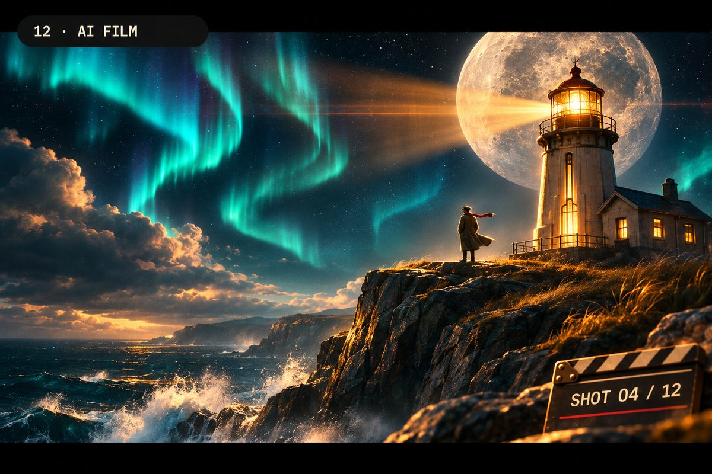
      <h4>AI film</h4>
      Short stories and mood films, directed shot by shot from approved key frames.<br>
      <sub><code>ai-film</code></sub> 
    </td>
    <td width="50%" valign="top">
      <!-- ASSET card video-remix: one clip as original, swapped and restyled. -->
      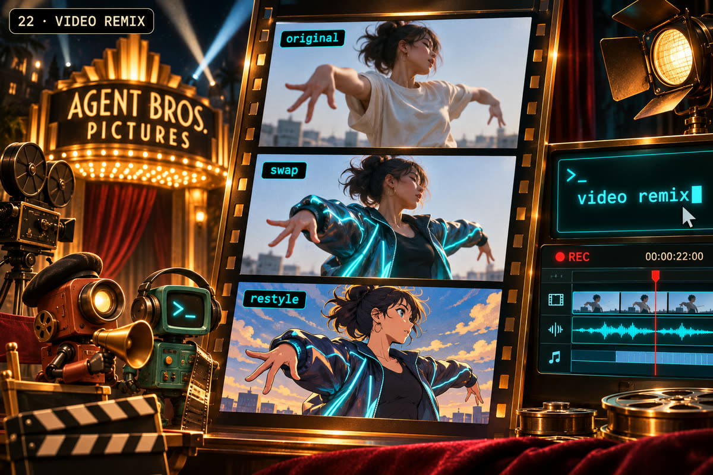
      <h4>Video remix</h4>
      Keep a clip's motion and swap a character, an outfit or the whole look, with consent and rights tracked (paid generation).<br>
      <sub><code>video-remix</code></sub> 
    </td>
  </tr>
  <tr>
    <td width="50%" valign="top">
      <!-- ASSET card photo-slideshow: holiday photos in a slow Ken Burns drift,
           cuts on the music's downbeats. -->
      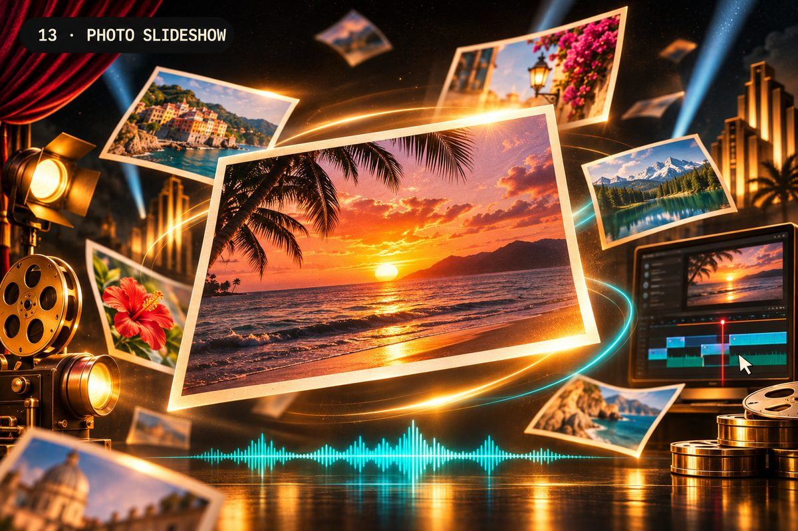
      <h4>Photo slideshow</h4>
      Your photos cut to music: memories, portfolios, property tours.<br>
      <sub><code>photo-slideshow</code></sub> 
    </td>
    <td width="50%" valign="top">
      <!-- ASSET card stock-montage: licensed b-roll under a bold manifesto line,
           one word per cut. -->
      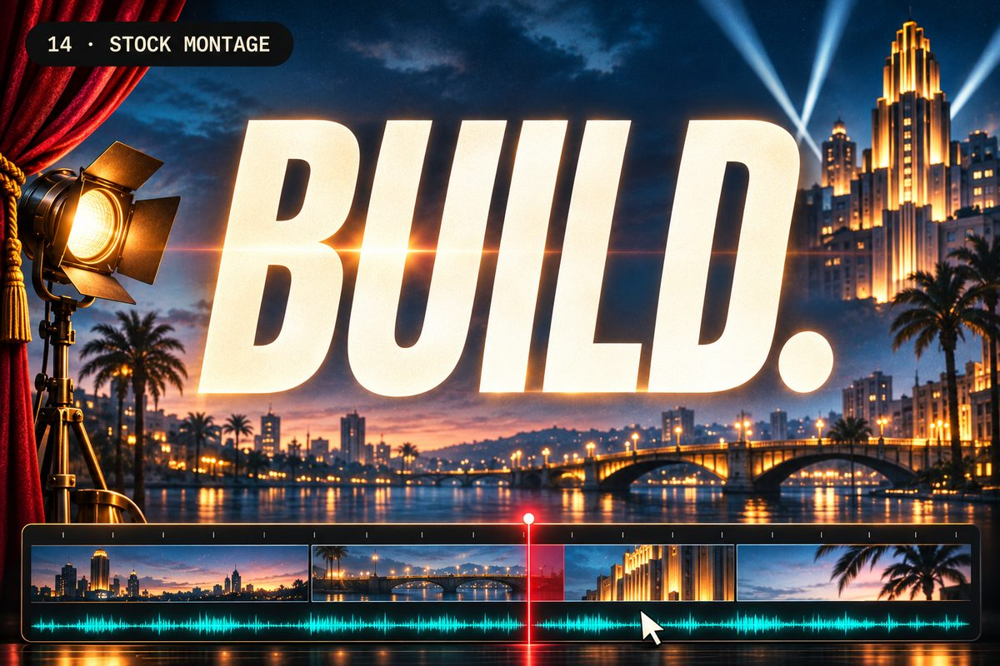
      <h4>Stock montage</h4>
      Licensed b-roll and type over picture: manifestos and mood films.<br>
      <sub><code>stock-montage</code></sub> 
    </td>
  </tr>
</table>

### ✂️ Your own footage

<table>
  <tr>
    <td width="50%" valign="top">
      <!-- ASSET card footage-edit: a talking-head frame, a strip below showing
           red cut regions; chip "removed 14 slips · 4:12 → 3:20". -->
      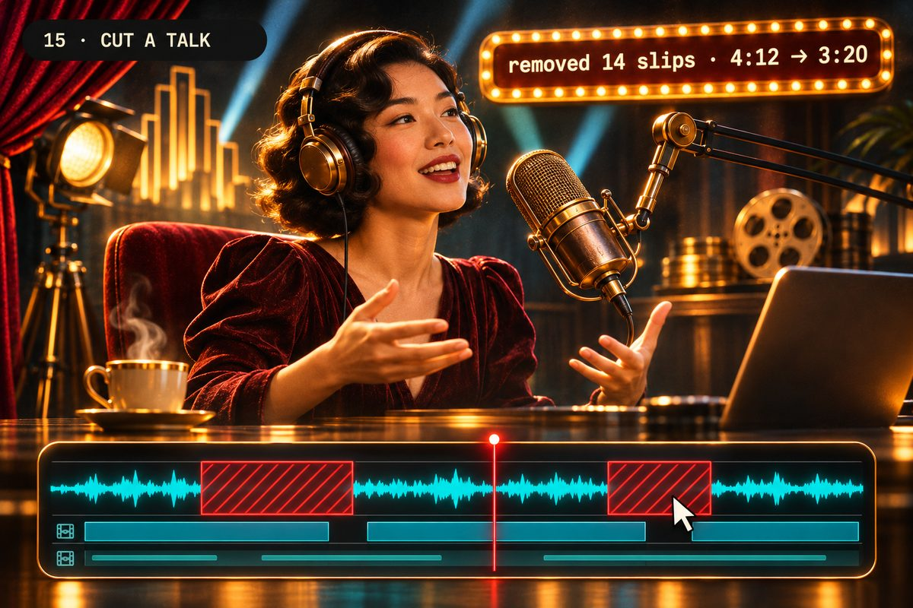
      <h4>Cut a talk</h4>
      Silences, ums and false starts found and cut. You approve the plan.<br>
      <sub><code>footage-edit</code></sub> 
    </td>
    <td width="50%" valign="top">
      <!-- ASSET card shorts-from-long: one 16:9 podcast frame splitting into
           three 9:16 clips, each with a score chip "hook 9/10". -->
      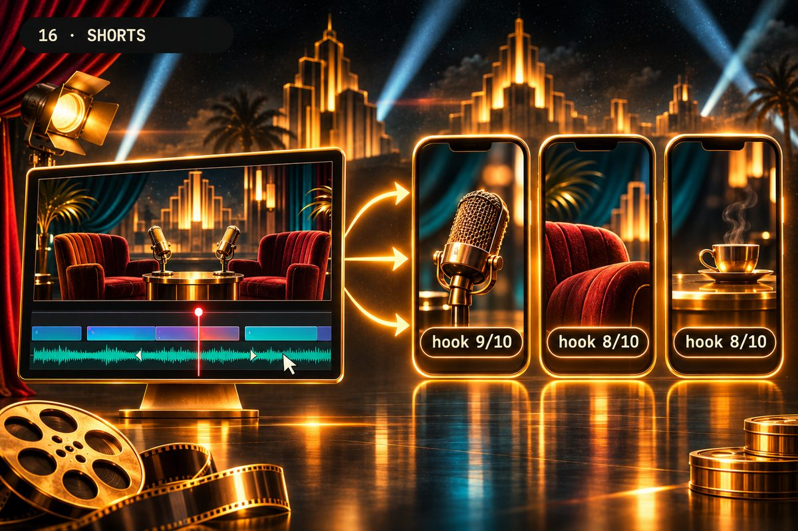
      <h4>Shorts from long</h4>
      Standalone Reels and Shorts from a long recording, ranked by hook.<br>
      <sub><code>shorts-from-long</code></sub> 
    </td>
  </tr>
  <tr>
    <td width="50%" valign="top">
      <!-- ASSET card captions: the same sentence in 4 of the 10 caption styles,
           cycling (outline pop, key-word colour, sliding box, single-word punch). -->
      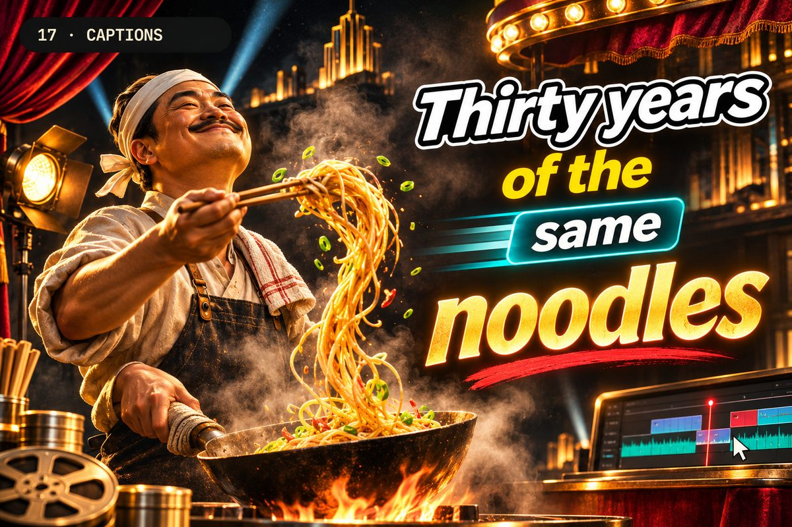
      <h4>Captions</h4>
      Word-timed subtitles in 10 styles, from clean to single-word punch, plus SRT and VTT.<br>
      <sub><code>captions:place</code> · any genre</sub>
    </td>
    <td width="50%" valign="top">
      <!-- ASSET card multicam-reframe: two camera angles switching on the
           speaker, then a 16:9 frame with a 9:16 crop box tracking a face. -->
      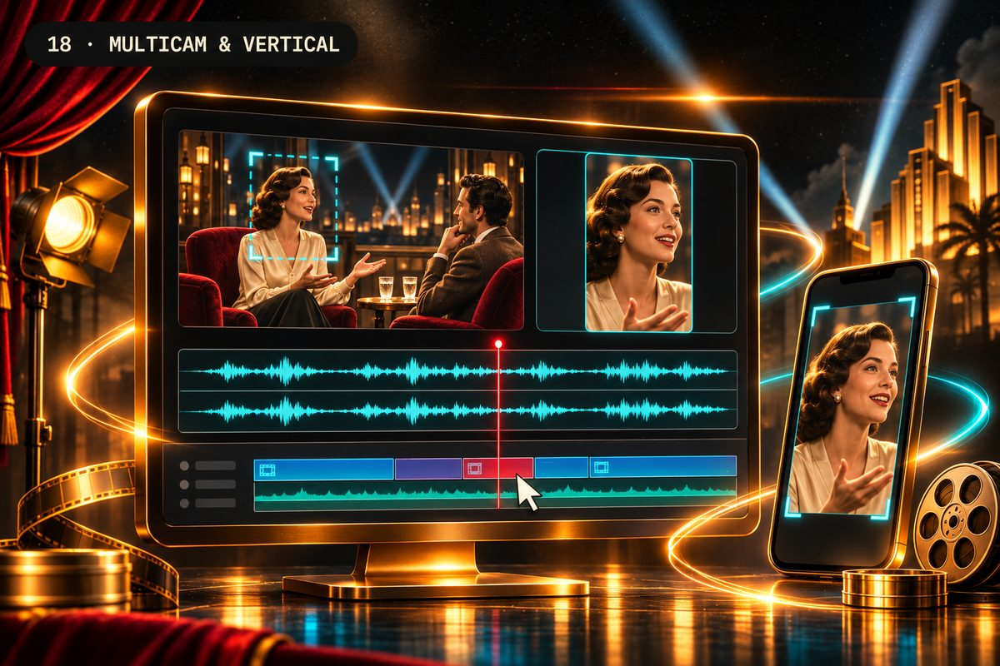
      <h4>Multicam &amp; vertical</h4>
      Two cameras synced by sound; any shot reframed to 9:16 on the speaker.<br>
      <sub><code>multicam:sync</code> · <code>reframe:track</code></sub>
    </td>
  </tr>
  <tr>
    <td width="50%" valign="top">
      <!-- ASSET card event-recap: fast montage of a conference: stage, crowd,
           badges, cut on the beat; "248 clips → 60 s". -->
      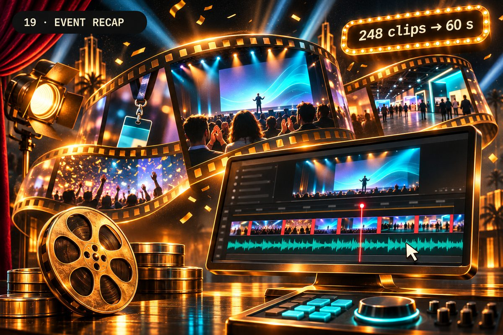
      <h4>Event recap</h4>
      Many clips from many phones, cut to music into one aftermovie.<br>
      <sub><code>event-recap</code></sub> 
    </td>
    <td width="50%" valign="top">
      <!-- ASSET card your-genre: an empty dotted frame with a "+" in the middle. -->
      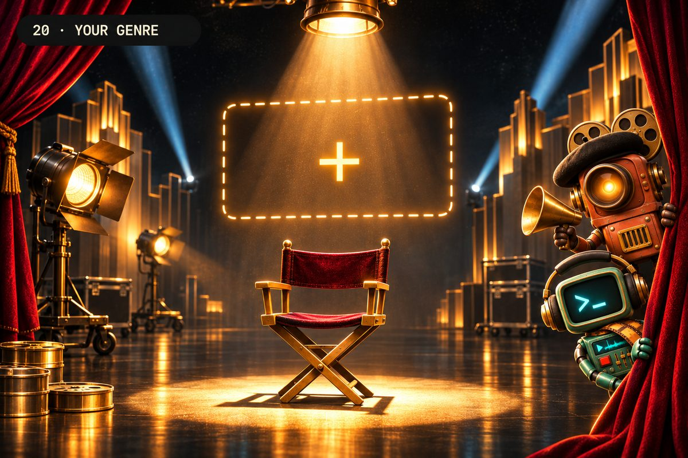
      <h4>Your genre</h4>
      Missing a kind of video? A playbook is a method plus a quality bar. Add one.<br>
      <sub>Wanted: lyric videos, podcast audiograms, game trailers, recruiting films, year-in-review data films. <a href="playbooks/AGENTS.md">How to add a playbook →</a></sub>
    </td>
  </tr>
</table>

<p align="right"><sub><a href="#top">back to top ↑</a></sub></p>

## 🪞 Why AI video looks cheap, and who on set stops it

<!-- ASSET glow-up 1: docs/readme/glowup-promo.gif, 1600×450, side by side,
     loop ≤ 10 s, both halves synced, a thin divider and two labels:
     "AGENT ALONE" / "AGENT BROS." Link the GIF to an MP4 with sound.
     Same model, same one-sentence brief. Left shows the usual tells (corner
     labels, fade on every beat, a generic card standing in for the product);
     right shows the real product UI, cuts on motion, type as the picture.
     Brands belong to their owners: prefer our own product or an invented one;
     if a real brand is used, add a line to the Licence section saying the demo
     is unofficial. Further pairs: a Short from a podcast (raw auto-captions vs
     key-word captions and a hook), and a lesson (bullet slides vs a diagram
     that builds with the voice). Add this section's before/after row only
     when real renders exist. -->

<sub>Hand an agent a video task on its own and the same tells keep turning up. Each one has an owner on set.</sub>

| The tell | What it looks like | Caught by |
|---|---|---|
| **The fake product** | A generic phone mock or card standing in for the real app | 🎥 the real-UI rule: the product is captured, never imitated |
| **Fades everywhere** | Every element fades in, every beat dissolves | 🎨 a chosen exit for every cut, then 🧐 the critic |
| **Slide-deck motion** | Default eases, a headline left and a card right, scene after scene | 🎨 the motion-design library and a fresh critic each round |
| **Music fighting the voice** | The score buries the words, or the cut ignores the beat | 🎙️ measured mixing, ducking and cuts on the beat |
| **Clipped speech** | Captions or scenes cut a sentence short | ✂️ real voice durations measured before the edit locks |
| **One-off guesswork** | Every film starts from zero; last week's notes are forgotten | 🧠 local memory of your verdicts, read at every step |
| **The surprise bill** | Generation reruns until the card says no | 🤖 a budget reserved before every paid call, resumed, never resubmitted |

<a id="premieres"></a>

<p align="center">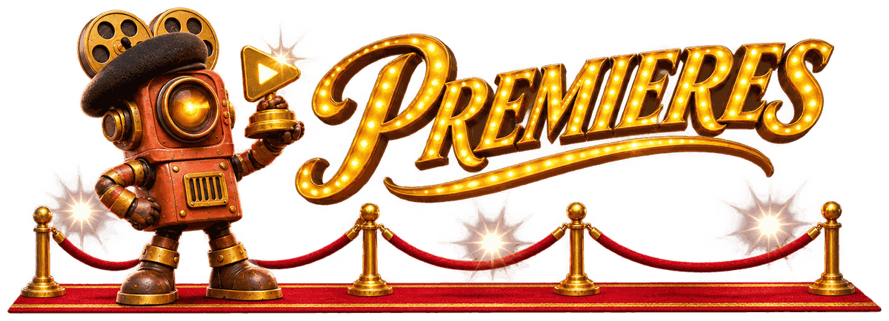</p>

## 🏆 Premieres

<sub>Finished pictures made end to end by the brothers, with the exact sentence that started each one. The first three are coming soon.</sub>

<table>
  <tr>
    <td width="33%" align="center" valign="top">
      <!-- ASSET premiere 1: poster 2:3 (600×900) + link to the full MP4.
           A real launch film made with the repo. -->
      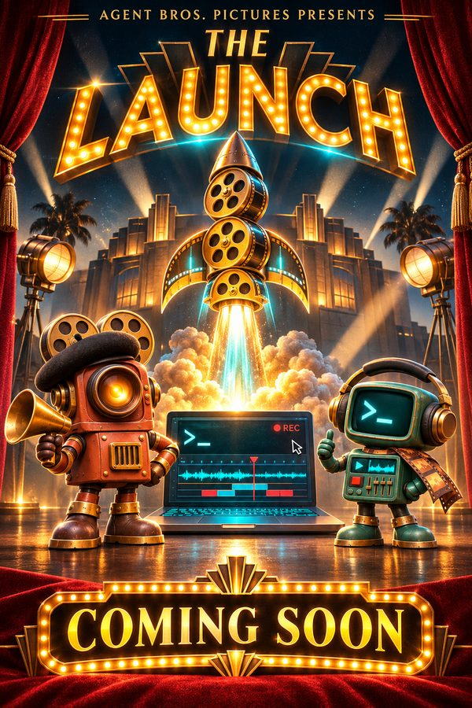<br>
      <b>Premiere #1</b><br>
      <sub>Product launch · 30 s · 16:9</sub>
    </td>
    <td width="33%" align="center" valign="top">
      <!-- ASSET premiere 2: poster 2:3 + link. A vertical Reel. -->
      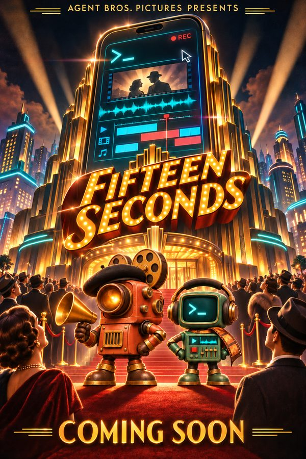<br>
      <b>Premiere #2</b><br>
      <sub>Reel · 15 s · 9:16</sub>
    </td>
    <td width="33%" align="center" valign="top">
      <!-- ASSET premiere 3: poster 2:3 + link. A lesson or explainer. -->
      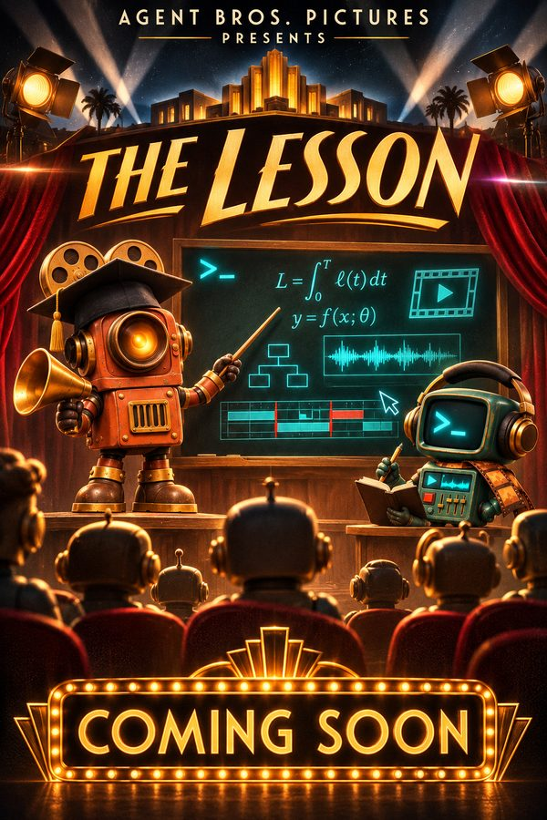<br>
      <b>Premiere #3</b><br>
      <sub>Lesson · 90 s · 16:9</sub>
    </td>
  </tr>
</table>

<!-- For each premiere, when it ships: the user's one-sentence request, the
     playbook used, what the user approved, time to first cut, and cost (0 if
     local only), as a table under a "The script behind each premiere" details. -->

**From the community**

<!-- showcases:start -->

Verified community films will appear here. [Share a showcase](docs/showcases.md).

<!-- showcases:end -->

<p align="right"><sub><a href="#top">back to top ↑</a></sub></p>

<a id="for-teams"></a>

## 🏢 For teams &amp; agencies

Agent Bros. Pictures is free in production for individuals using it on their own behalf, including to produce films and other media for their clients, for organisations of up to three people, and for non-profits and educational institutions in their non-commercial work. A company with more than three people (employees, contractors and freelancers, counted by head) needs our [commercial licence](COMMERCIAL-LICENSE.md) for production use and a [Remotion Company License](https://www.remotion.dev/license) to render; anyone may evaluate, test and study it first ([licence](#licence)). There are two ways to work together:

<table>
  <tr>
    <td width="50%" valign="top">
      <b>📜 Commercial licence</b><br>
      <sub>For production use by a company of more than three people, and for anything the free grant excludes: a hosted, managed or embedded service, API or platform, OEM, white label or resale.</sub>
    </td>
    <td width="50%" valign="top">
      <b>🛠️ Services</b><br>
      <sub>Team setup and provider configuration, custom scenes and brand production kits, training and support, and conversations about managed or cloud pilots.</sub>
    </td>
  </tr>
</table>

What teams get out of the box: campaigns with per-variant approvals and costs, brand looks and design tokens, reviewable plans and critic notes as files, a cost report per project, and the source of every film to hand over.

**Talk to us:** [hello@iliamax.com](mailto:hello@iliamax.com) · details in [COMMERCIAL-LICENSE.md](COMMERCIAL-LICENSE.md).

<a id="references"></a>

## 🧠 How the crew learns from references

Give the harness a film you admire and it learns the method, not the film. `pnpm ref:analyze` measures it on your machine: every cut, the beat grid, how text lands, how the camera eases. An agent then looks at frame strips and writes what each move does and why. The repository keeps only that analysis: numbers, timelines and descriptions. The film itself stays on your computer; only the frame strips your agent looks at go to its model.

**What an analysis looks like** (numbers from one launch film in the library, no frames of it):

```text
22.9 s · 140 BPM (grid confidence 0.72) · 10 judged shots · median shot 1.6 s · 23.6 cuts a minute
0.00  hook       two-line sentence, a word every 4 frames, off the grid
2.30  cut        white to a barely green white                        beat −4 (+14 ms)
4.00  cut        drop: orange ground, hero number 89.5% of the width   beat 0  (0 ms)
4.43  shrink     number 89.5% → 43.8% wide in 8 frames, ease-in-out    beat 1
5.30  text swap  one line on the held orange, pushes in 67% → 81%      beat 3  (+14 ms)
7.43  cut        prompt bar on white, 69% wide                         beat 8  (+4 ms)
```

All six structural changes land within 24 ms of a beat, against a 14% chance per change: a rule an agent can reuse ("cut on the beat, reveal words off it"), with the evidence attached.

**From many films to a block.** `pnpm ref:corpus` reads every analysis together, so a pace or an ease comes from the spread of professional films rather than one taste. A move seen in two films or more becomes a technique card and a motion-library block, rendered from our own code:

<p align="center">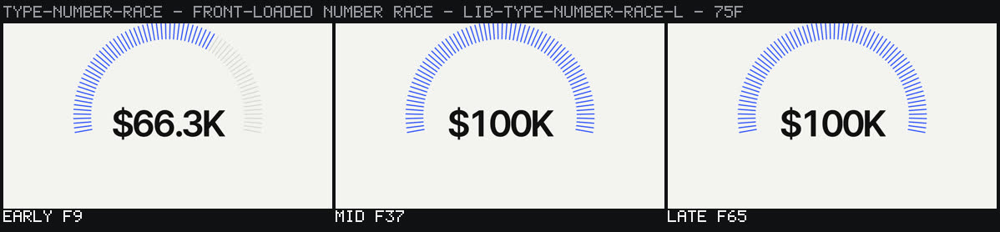</p>

**Checking a recreation.** `pnpm ref:compare` aligns our render with the analysis and reports timing, not taste: each cut's offset from the reference in frames, from numbers only.

**Contributing.** Analyse your own references locally and send the analyses: `pnpm ref:contribute --id <id>` checks that no media, frame or long quotation of the film is tracked, that private references stay private, and that the film is credited. See [contributing references](docs/contributing-references.md).

<p align="right"><sub><a href="#top">back to top ↑</a></sub></p>

<a id="faq"></a>

## ❓ FAQ

<details>
<summary><b>Do I need to know how to code?</b></summary>
<br>

No. You talk to Claude Code or Codex in plain words and approve at the gates. The code is there when you want to change something by hand, or to hand the film to a developer.

</details>

<details>
<summary><b>What does a video cost?</b></summary>
<br>

Rendering, editing, captions from local speech recognition, and QA run on your machine and cost nothing beyond your agent subscription (and, for companies above three people, our [commercial licence](COMMERCIAL-LICENSE.md) and a Remotion Company License). Image, video, voice and music generation run on your own provider accounts: every paid call is quoted or bounded first, reserved against a budget you set, and recorded in `pnpm cost:report`. Many genres, such as cutting your own footage or a motion-design film with library music, need no paid generation at all.

</details>

<details>
<summary><b>Can I make videos for clients, and sell them?</b></summary>
<br>

Yes. Our licence does not restrict the films you render: BUSL-1.1 covers the software, not what you make with it, and delivering films to clients is not distribution of the software. Production use is free for an individual using it on their own behalf, including to produce films and other media for their clients, for an organisation of up to three people, and for a non-profit or educational institution in its non-commercial work. Use by an individual on behalf of an organisation, or in the course of work for it, is use by that organisation. A company with more than three people usually needs our [commercial licence](COMMERCIAL-LICENSE.md) and may also need a [Remotion Company License](https://www.remotion.dev/license). Remotion counts employees and exempts non-profits, while we count all Personnel, contractors included, so check each licence's own threshold. Each film still carries the rights of what it uses (fonts, music, footage, voices). This is not legal advice.

</details>

<details>
<summary><b>Can my company use it, or offer it as a service?</b></summary>
<br>

Any company may evaluate, test, develop with and study it for free. Production use by a company with more than three people, counted by head across the company and its affiliates (employees, officers, directors, working owners, contractors, freelancers, interns and agency workers), needs our [commercial licence](COMMERCIAL-LICENSE.md), and rendering there also needs a [Remotion Company License](https://www.remotion.dev/license). The free grant never covers offering the software, or a modified version of it, to others as a hosted, managed or embedded service, API or platform, or distributing, selling or bundling it in a product or service you offer: at any size, that needs a commercial licence. Each release becomes AGPL-3.0-or-later four years after its first public distribution under BUSL-1.1 ([licence](#licence)).

</details>

<details>
<summary><b>Does my footage or product leave my machine?</b></summary>
<br>

Your files are stored and processed locally. Two things leave your machine: the frames and text your agent (Claude Code or Codex) reads go to its model provider, and any paid step you approve, such as transcription, voice or generation, goes to the provider you chose. Reference films are measured locally; only numbers and descriptions are kept in the repository.

</details>

<details>
<summary><b>Can I edit the result myself?</b></summary>
<br>

Yes, at any level: tell the agent what to change, use the local review UI (`pnpm review:ui`) with reversible timeline edits (`pnpm timeline:edit`), change the Remotion code directly, or hand a cut-only timeline to DaVinci Resolve 20.2+ (`resolve:handoff`, experimental).

</details>

<details>
<summary><b>Will it keep my brand and my taste?</b></summary>
<br>

Brand colours, type and looks live in design tokens and styles, and the crew records your verdicts as local, private memory, so the next film starts from what you approved last time. Campaigns pin approved characters and styles across every episode or variant.

</details>

<details>
<summary><b>Which agent and model should I use?</b></summary>
<br>

Claude Code or Codex on their strongest models: they follow the same rules from one shared `AGENTS.md`. Smaller models follow the rules but judge taste less well. Other MCP clients can call the studio's commands through the [MCP server](docs/mcp.md).

</details>

<p align="right"><sub><a href="#top">back to top ↑</a></sub></p>

<a id="for-agents"></a>

## 🤖 For agents

> [!NOTE]
> **If you are an AI agent reading this README:** follow [SETUP.md](SETUP.md) to install (plan, one question to the user, apply, report), [docs/install.md](docs/install.md) for details and updates, then read [AGENTS.md](AGENTS.md) before any video request. Ask the user before installing system software or spending money.

Contributors and their agents start at [CONTRIBUTING.md](CONTRIBUTING.md), then [contrib/AGENTS.md](contrib/AGENTS.md) and the card for their contribution category.

Humans, paste this into Claude Code or Codex:

```text
Install Agent Bros. Pictures for me: follow SETUP.md in
https://github.com/ilyamk/agentbros (plan, ask me once, apply, report).
Then tell me what works, which keys I need for what, and which kinds
of video you can make.
```

| Read | For |
|---|---|
| [SETUP.md](SETUP.md) | fast install: plan, one consent, apply, report with keys by goal |
| [docs/install.md](docs/install.md) | clone, dependencies, checks, staying current with upstream |
| [docs/dependency-licences.md](docs/dependency-licences.md) | licence inventory, dependency policy and integration reviews |
| [docs/how-it-works.md](docs/how-it-works.md) | one-page overview for people: the three commands, modes, where things live |
| [docs/architecture.md](docs/architecture.md) | for agents changing the harness: layers, directory map, request flow, sources of truth, how to extend |
| [AGENTS.md](AGENTS.md) | the rules, and the first step of every video request |
| [playbooks/AGENTS.md](playbooks/AGENTS.md) | every genre, its method and its tools |
| [docs/production-chain.md](docs/production-chain.md) | the bespoke film steps and approvals |

<details>
<summary><b>🗺️ Full command map</b> <sub>(every capability and its guide)</sub></summary>
<br>

Find any command with `pnpm commands --query <word>`; `pnpm next --project <id>` gives a project's next step on any route. Every CLI prints exactly one JSON line on stdout and progress on stderr.

| Work | Commands / guide |
|---|---|
| Commands and cleanup | [command catalogue](docs/commands.md), [cleanup](docs/cleanup.md) |
| Contributor development | [contribution gates](docs/contributing-gates.md), [GitHub automation](docs/github.md), [triage](docs/triage.md) (currently inactive), [releases and generated CREDITS.md](docs/releases.md), [agent workflow testing](docs/agent-workflow-e2e.md) |
| Context and inventory | [context budgets](docs/context-budget.md), [context loading](docs/context-loading.md), [metrics and API surface](docs/metrics.md) |
| Gallery and benchmarks | [showcases](docs/showcases.md), [benchmark](docs/benchmark.md), [creative benchmark](docs/creative-benchmark.md), [project experiments](docs/experiments.md) |
| Memory and lessons | `memory`; [memory](memory/AGENTS.md), [creative postmortem](.agents/skills/creative-postmortem/SKILL.md) |
| Design and implementation | [design tokens](docs/design-tokens.md), [library reference](docs/library-reference.md), [motion examples](docs/motion-examples.md), [icons and logos](docs/icon-resources.md) |
| Install and update | `bootstrap`, `keys`, `preflight`, `assets:sync`; [agent setup](SETUP.md), [install and update](docs/install.md), [local macOS tools](docs/local-macos.md) |
| Kind of video (playbooks) | `playbook --match`, `playbook --use`, `playbook --uses`, `next`; [playbooks](playbooks/AGENTS.md), [playbook reference](docs/playbooks.md) |
| Bespoke film chain | `film:init --type`, `film:next`, `film:brief`, `film:done`, `film:approve`, `film:route`, `step:unlock`; [production chain](docs/production-chain.md), [film types](docs/film-types.md), [step lease](docs/step-lease.md) |
| Prepared visualisations (experimental; ELK review pending) | `viz:list`, `viz:prepare`, `viz:mount`; [guide and open items](docs/visualisations.md) |
| Motion library | `library:list`, `library:preview`; [motion library](docs/motion-library.md) |
| Agent vision | `motion:still`, `motion:strip`, `motion:render`, `review:sheet`, `motion:check`; [agent vision](docs/agent-vision.md) |
| Editing your own footage | `footage:next` (what next), `speech:local` or `transcribe`, `recut:plan`, `shorts:*`, `multicam:*`, `reframe:track`, agent `footage-editor`; [footage editing](docs/footage-editing.md) |
| Shots in footage | `footage:shots`; [footage shots](docs/footage-shots.md) |
| Several cameras and reframing | `multicam:sync`, `multicam:angles`, `reframe:track`; [multicam and reframing](docs/multicam-reframe.md) |
| Transcripts and speech masks | `transcribe` (Scribe v3, paid), `speech:local` (Parakeet, Silero VAD, pyannote; free); [speech](docs/speech.md) |
| Reference films | `ref:add`, `ref:analyze`, `ref:validate`, `ref:compare`; [reference analysis](docs/reference-analysis.md); exact remakes: `reference-replica` skill |
| Recipes and scenarios | `video:recipe`, `video:workflow`; [template recipes](docs/template-recipes.md), [workflows](docs/workflows.md) |
| Models and budgets | `generate:model`, `fal:find`, `budget`; [task slots](docs/model-slots-guide.md); [fal catalogue](docs/fal-catalogue.md), [maintainer integration](docs/fal-integration.md), [Higgsfield](docs/higgsfield.md), [prompting](docs/higgsfield-prompting.md), [reference packs](docs/reference-packs.md), [paid execution](docs/paid-execution.md), [model drafts](docs/model-nonmedia-workflows.md) |
| Streaming and realtime | `generate:stream`, `generate:realtime`, `realtime:editor`; [HTTP streams](docs/http-stream.md), [realtime](docs/realtime-sessions.md), [editor](docs/realtime-editor.md) |
| Harness assets and entities | `asset:import`, `entity:card`, `asset:board`; [harness assets](docs/harness-assets.md), [entities](docs/entity-workflow.md) |
| Public media links | [media acquisition](docs/media-fetch.md) |
| Recordings and long form | `media:ingest`, `media:selects`, `video:longform`; [ingest](docs/media-ingest.md), [long form](docs/longform.md) |
| Timeline edits and review | `timeline:edit`, `review:ui`; [timeline](docs/timeline-edit.md), [review UI](docs/local-review-ui.md) |
| Audio and repair | `audio:editorial`, `audio:mix`, `audio:analyze`, `audio:repair`; [editorial audio](docs/editorial-audio.md), [audio QA](docs/local-audio-qa.md), [audio integrations](docs/audio-integrations.md), [ElevenLabs speech](docs/elevenlabs-speech.md) |
| Captions and QA evidence | `captions:place`, `captions:export`, `qa:evidence`, `qa:editorial`, `validate:render`; [caption styles](docs/captions-styles.md), [captions](docs/caption-delivery.md), [QA evidence](docs/qa-evidence.md) |
| Legacy generation routes | Kling 2.5, Seedance 2.0, Hailuo 02, gpt-image-2, old source aliases; [legacy generation](docs/legacy-generation.md) |
| Fonts, delivery, campaigns | `resources:font`, `delivery`, `campaign`; [fonts](docs/local-fonts-icons.md), [delivery](docs/delivery.md), [campaigns](docs/campaigns-localization.md) |
| Batch production | `campaign:production`, `campaign:next`, `campaign:brief`; [agent-orchestrated campaigns](docs/campaign-production.md) |
| Finishing, HTML and 3D | `backend`, `capture:html`, `capture:app`, `blender:run`, `blender:live`, `blender:ext`, `blender:assets`, `blender:recipe`, `resolve:handoff`; [Blender arsenal](docs/blender-arsenal/README.md), [photoreal 3D devices](docs/photoreal-3d.md), [Vork](docs/vork.md), [optional backends](docs/optional-backends.md), [Blender MCP evaluation](docs/blender-mcp-evaluation.md), [HTML capture](docs/html-capture.md), [app capture](docs/capture-app.md), [real product interfaces](docs/real-ui.md), [UI sources](docs/ui-sources.md), [Resolve](docs/resolve-worker.md) |
| MCP server | `mcp:stdio`; [setup and authority](docs/mcp.md) |

</details>

<p align="right"><sub><a href="#top">back to top ↑</a></sub></p>

<a id="honest-limits"></a>

## 🧭 Honest limits

- **The agents can't hear.** They read loudness, beats and spectra, but whether the music is right is your call, and they will never tell you a track sounds good.
- **Taste depends on the model.** Built and tested with Claude Code and Codex on their strongest models; smaller models follow the rules but judge less well.
- **Your product, your access.** Real-UI shots need the real app or site running; the agents ask when the source isn't obvious.
- **Generation costs money.** Rendering is local and needs no provider account; image, video, voice and music models run on your own provider accounts and budgets.
- **Some genres are in beta.** Their methods are still drafts (marked  above); Vork 3D is experimental.
- **Early access.** No public premieres yet; the first ones are in production, and the cards above are illustrations, not frames from them.
- **Larger companies may need two licences.** A company with more than three Personnel needs our commercial licence for production use, and a for-profit company with more than three employees also needs a Remotion Company License to render ([FAQ](#faq), [licence](#licence)).

<details>
<summary><b>🗂️ What's on the lot</b> <sub>(repository map)</sub></summary>
<br>

```text
playbooks/          the genres: method, quality bar and tools for each kind of video
.agents/            the crew: agents and their skills (Claude Code links them from .claude/)
src/motion/library/ the motion-design blocks the films are built from
src/components/     compositions and scenes;  src/templates/  captions, backgrounds, overlays
src/mcp/            the MCP server that exposes the commands to other agents
scripts/            every production command, one JSON line out
docs/               guides, from install to delivery
public/projects/    your projects (git-ignored);  out/  your renders (git-ignored)
memory/             what the crew learned about your taste (local, git-ignored)
```

</details>

<a id="the-story"></a>

## 🎟️ The story

<table>
  <tr>
    <td>
      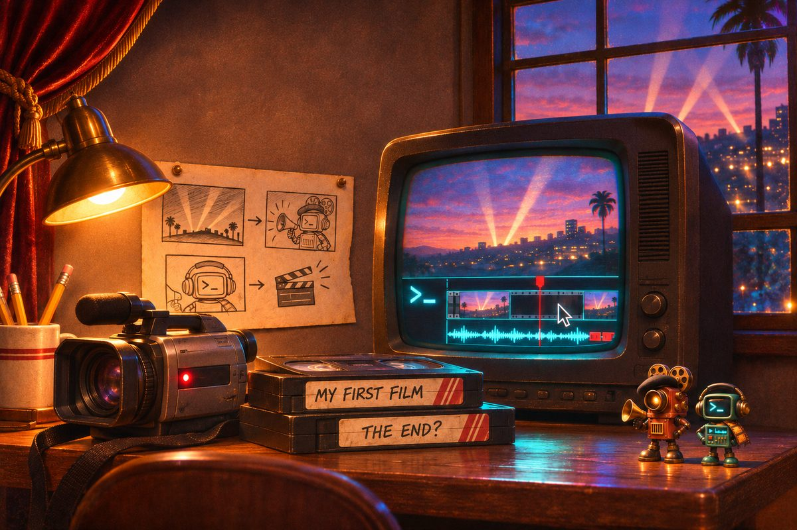
      <br>
      <p align="center"><sub>FADE IN.</sub></p>

> I picked up a camera as a kid and never really put it down. I shot, cut and re-cut my own little films long before I knew what an editor was, and all that time I carried one quiet dream: **a film studio of my own.**
>
> In 1923 four brothers founded one, and in 1927 they made pictures talk. A century later the brothers are agents. Claude Code and Codex can write a script, choose a look, cut to the beat and watch their own frames. The studio I always wanted finally fits in a repository.
>
> But a studio is never one person. So Agent Bros. Pictures is an open lot: a place where every creator and their agents can shoot, generate and cut their own work, from ads and Shorts to lessons and films, and leave something behind for the next crew: a playbook, a motion block, an effect, a lesson learned.
>
> **Shoot. Generate. Cut. Share what you learned.** Together we can build the first film studio made for AI agents, open to everyone who works on it.

<p align="right"><i>— Ilia, founder</i></p>
      <p align="center"><sub>CUT TO: <a href="#join-the-crew">your first pull request</a>.</sub></p>
    </td>
  </tr>
</table>

<sub>The name is an affectionate nod to a century of cinema, not an affiliation: Agent Bros. Pictures is not affiliated with or endorsed by Warner Bros. Discovery (see <a href="#trademarks">trademarks</a>).</sub>

<p align="right"><sub><a href="#top">back to top ↑</a></sub></p>

<a id="join-the-crew"></a>

<p align="center">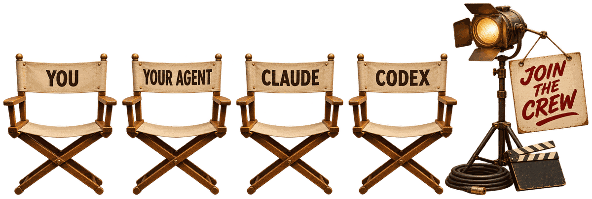</p>

## 🤝 Join the crew

New genres, motion blocks, sensors and fixes are all welcome. Good first contributions:

- **A playbook** for a genre we don't cover yet ([how to add one](playbooks/AGENTS.md)).
- **A motion block** studied from a move seen in two or more films ([motion library](src/motion/library/AGENTS.md)).
- **A reference analysis** of a film you admire, numbers only ([contributing references](docs/contributing-references.md)).
- **A showcase** of a film you made ([showcases](docs/showcases.md)).

Start with [CONTRIBUTING.md](CONTRIBUTING.md) and the [contributor protocol](contrib/AGENTS.md): find a useful task, meet its [gates](docs/contributing-gates.md) and send the evidence with your pull request. The human behind the account signs the [CLA](CLA.md) once through the signature workflow.

How decisions work: [governance](GOVERNANCE.md). Report vulnerabilities through [security](SECURITY.md). The [contribution-system RFC](docs/rfcs/0001-contribution-system.md) records the decisions and remaining launch work. Browse the [gallery](https://ilyamk.github.io/agentbros/) (live after launch), or [open an issue](https://github.com/ilyamk/agentbros/issues) with an idea or bug.

<div align="center">

<br>

**The cast so far**

<a href="https://github.com/ilyamk/agentbros/graphs/contributors">
  
</a>

<br><br>

**Box office**

<a href="https://star-history.com/#ilyamk/agentbros&Date">
  <picture>
    <source media="(prefers-color-scheme: dark)" srcset="https://api.star-history.com/svg?repos=ilyamk/agentbros&type=Date&theme=dark">
    <source media="(prefers-color-scheme: light)" srcset="https://api.star-history.com/svg?repos=ilyamk/agentbros&type=Date">
    
  </picture>
</a>

<sub>⭐ A star is a ticket sold. It keeps the lights on.</sub>

<!-- Optional ritual: at each star milestone (1k, 5k, 10k) the brothers make a
     short thank-you film; put its poster here, newest first. -->


</div>

<br>

---

<div align="center">

<a id="end-credits"></a>

<p align="center">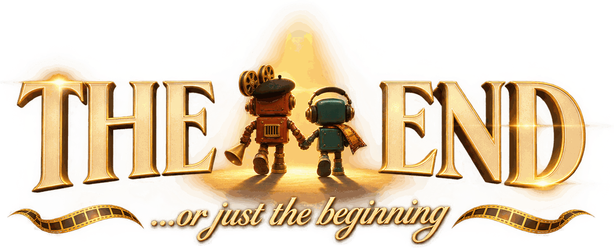</p>

## 🎞️ End credits

<br>

<sub>AGENT BROS. PICTURES PRESENTS</sub>

### A Claude Code &amp; Codex production

<br>

<sub>RENDERED ON</sub><br>
<a href="https://www.remotion.dev"><b>Remotion</b></a> · <a href="https://react.dev"><b>React</b></a> · <a href="https://ffmpeg.org"><b>FFmpeg</b></a>

<br><br>

<sub>MOTION TIMELINES</sub><br>
<a href="https://gsap.com"><b>GSAP</b></a> · <a href="https://github.com/heygen-com/hyperframes"><b>Hyperframes</b></a> <sub>(seek adapter)</sub>

<br><br>

<sub>CINEMATOGRAPHY &amp; 3D</sub><br>
<a href="https://www.blender.org"><b>Blender</b></a> · <a href="https://github.com/mrdoob/three.js"><b>three.js</b></a> · <a href="https://github.com/pmndrs/drei"><b>drei</b></a> · <a href="https://polyhaven.com"><b>Poly Haven</b></a> <sub>(HDRIs)</sub>

<br><br>

<sub>FILM LOOK &amp; POST</sub><br>
<a href="https://github.com/lemomo-ai/lemo-opuscar"><b>lemo-opuscar</b></a> · <a href="https://github.com/pyang5166/gbro-collage-broll"><b>gbro-collage-broll</b></a>

<br><br>

<sub>VOICE, MUSIC &amp; GENERATION</sub><br>
<a href="https://elevenlabs.io"><b>ElevenLabs</b></a> · <a href="https://fal.ai"><b>fal.ai</b></a> · <a href="https://incompetech.com"><b>Kevin MacLeod</b></a> <sub>(Incompetech)</sub>

<br><br>

<sub>SOUND EFFECTS</sub><br>
<a href="https://freesound.org"><b>Freesound</b></a> · <a href="https://kenney.nl"><b>Kenney</b></a> · <a href="https://github.com/facebookresearch/demucs"><b>Demucs</b></a> · <a href="https://huggingface.co/laion/larger_clap_general"><b>LAION CLAP</b></a>

<br><br>

<sub>SCRIPT SUPERVISOR</sub> <sub>(speech &amp; timing)</sub><br>
<a href="https://github.com/senstella/parakeet-mlx"><b>Parakeet MLX</b></a> · <a href="https://github.com/snakers4/silero-vad"><b>Silero VAD</b></a> · <a href="https://github.com/pyannote/pyannote-audio"><b>pyannote</b></a> · <a href="https://github.com/ggerganov/whisper.cpp"><b>whisper.cpp</b></a>

<br><br>

<sub>CONTINUITY</sub> <sub>(shots, sync &amp; reframing)</sub><br>
<a href="https://github.com/soCzech/TransNetV2"><b>TransNetV2</b></a> · <a href="https://github.com/bbc/audio-offset-finder"><b>BBC audio-offset-finder</b></a> · <a href="https://github.com/opencv/opencv_zoo"><b>OpenCV YuNet</b></a> · <a href="https://github.com/edenfunf/reelmimic"><b>ReelMimic</b></a>

<br><br>

<sub>PRODUCTION DESIGN</sub><br>
<a href="https://ui.shadcn.com"><b>shadcn/ui</b></a> · <a href="https://tailwindcss.com"><b>Tailwind CSS</b></a> · <a href="https://zod.dev"><b>Zod</b></a>

<br><br>

<sub>DEVICES</sub><br>
<a href="https://sketchfab.com/3d-models/apple-iphone-15-pro-max-black-df17520841214c1792fb8a44c6783ee7"><b>polyman</b></a> <sub>(phone model)</sub> · <a href="https://sketchfab.com/3d-models/macbook-pro-m3-16-inch-2024-8e34fc2b303144f78490007d91ff57c4"><b>jackbaeten</b></a> <sub>(laptop model)</sub>

<br><br>

<sub>WRITERS ON LOAN</sub> <sub>(vendored skills and references)</sub><br>
<a href="https://github.com/elevenlabs/skills"><b>ElevenLabs skills</b></a> · <a href="https://github.com/sunnypatneedi/claude-starter-kit"><b>Claude Starter Kit</b></a> <sub>(Sunny Patneedi)</sub> · <a href="https://github.com/remotion-dev/skills"><b>Remotion skills</b></a>

<br><br><br>

<sub>— AND INSPIRED BY —</sub>

<br><br>

<sub>CHOREOGRAPHY</sub> <sub>(motion vocabulary)</sub><br>
<a href="https://github.com/whaleyxbt/claude-motion"><b>Claude Motion</b></a> · <a href="https://github.com/lottiefiles/motion-design-skill"><b>LottieFiles motion-design-skill</b></a> · <a href="https://github.com/magicuidesign/magicui"><b>Magic UI</b></a> · <a href="https://ui.aceternity.com"><b>Aceternity UI</b></a> · <a href="https://github.com/remotion-dev/remotion"><b>Remotion packages</b></a>

<br><br>

<sub>RHYTHM &amp; EDITING</sub><br>
<a href="https://github.com/feitangyuan/onetake"><b>onetake</b></a> · <b>motion-video-kit</b> · <a href="https://github.com/calesthio/OpenMontage"><b>OpenMontage</b></a> · <a href="https://github.com/HKUDS/VideoAgent"><b>VideoAgent</b></a>

<br><br>

<sub>EDITING SUITE</sub><br>
<a href="https://github.com/OpenCut-app/OpenCut"><b>OpenCut</b></a> · <a href="https://github.com/samuelgursky/davinci-resolve-mcp"><b>DaVinci Resolve MCP</b></a> · <a href="https://github.com/vive1101011/moviepy-mcp"><b>MoviePy MCP</b></a> · <a href="https://github.com/johnkimdw/freesound-mcp-server"><b>Freesound MCP</b></a>

<br><br>

<sub>CAMERA OPERATOR</sub> <sub>(reframing)</sub><br>
<a href="https://google.github.io/mediapipe/solutions/autoflip"><b>MediaPipe AutoFlip</b></a> · <a href="https://github.com/Junhua-Liao/Light-ASD"><b>Light-ASD</b></a> · <b>Ken Burns</b>

<br><br>

<sub>SUBTITLES</sub><br>
<a href="https://github.com/remotion-dev/template-tiktok"><b>Remotion TikTok template</b></a> · <b>Submagic</b> · <b>CapCut</b> · <b>Captions.ai</b> · <b>Opus Clip</b>

<br><br>

<sub>DEVELOPMENT</sub> <sub>(prompt to motion)</sub><br>
<a href="https://github.com/remotion-dev/template-prompt-to-motion-graphics-saas"><b>Remotion prompt-to-motion-graphics</b></a> · <a href="https://github.com/heygen-com/hyperframes"><b>Hyperframes research</b></a> · <a href="https://github.com/faviovazquez/showtime"><b>Showtime</b></a> <sub>(workflow research)</sub>

<br><br>

<sub>TITLE DESIGN</sub> <sub>(this page)</sub><br>
<a href="https://github.com/openfilm/openfilm"><b>openfilm</b></a> · <a href="https://github.com/lemomo-ai/lemo-opuscar"><b>lemo-opuscar</b></a> · <a href="https://github.com/alchaincyf/huashu-motion"><b>huashu-motion</b></a> · <a href="https://github.com/Tejashmakwana/motionmaxxing"><b>motionmaxxing</b></a>

<br><br><br>

<sub>Every source, what we took and where it lives: <a href="CREDITS.md">CREDITS.md</a></sub>

<br><br>

<sub><i>No agents were harmed in the making of this repository.</i></sub>

</div>

---

<a id="licence"></a>

## 📜 Licence

Agent Bros. Pictures is **source-available** under the [Business Source License 1.1](LICENSE) (`BUSL-1.1`). It is not an open-source licence: every file is here to read, run, change and improve, production use is free for individuals and small teams, and larger companies buy a commercial licence.

**Free production use.** You may use it in production, free of charge, if you are:

- an individual using it on your own behalf, including to produce films and other media for your clients;
- a small organisation: a legal entity that, together with its affiliates, has no more than three people (employees, officers, directors, owners who work in the business, contractors, freelancers, interns and agency workers, counted by head, not by full-time equivalent);
- a non-profit organisation, or an accredited educational or research institution, using it for its non-commercial activities.

Use by an individual on behalf of an organisation, or in the course of work for it, is use by that organisation.

**What the free grant excludes.** You may not offer the software, or a modified version or derivative work of it, to third parties as a hosted, managed or embedded service, API or platform that gives them access to its functionality, and you may not distribute, sublicense, sell or resell it as part of, or bundled with, a product or service you offer to third parties. Delivering the films and other media you produce with it is not distribution of the software.

**Non-production use is free for everyone.** Whatever your size, you may copy, modify, create derivative works of and redistribute the software, and use it for evaluation, testing, development and study. Preparing and submitting contributions under the CLA is permitted to everyone.

**Commercial licence.** Any other production use, including use by an organisation with more than three people, requires a commercial licence: [COMMERCIAL-LICENSE.md](COMMERCIAL-LICENSE.md), [hello@iliamax.com](mailto:hello@iliamax.com).

**Change Date and Change License.** Each version becomes available under the GNU Affero General Public License, version 3 or later (`AGPL-3.0-or-later`), on the fourth anniversary of its first public distribution under BUSL-1.1.

**Rendered films.** BUSL-1.1 does not restrict the films and other media you render with the software. They still carry the rights of the material they use (fonts, music, footage, models, voices), and Remotion's licence applies to the company that renders them. This is not legal advice.

**Components under other licences.** BUSL-1.1 covers only the work the licensor holds the copyright to. The licensor's Python code that runs inside Blender (it imports `bpy`, or is a module of `scripts/blender/` or `scripts/workers/blender/` loaded by such code, including the Vork bridge `scripts/workers/blender/avc_vork_bridge.py`) is licensed under [GPL-3.0-or-later](LICENSES/GPL-3.0-or-later.txt), as is the vendored Vork Blender integration in `vendor/vork-blender/`; the skills `copywriter` and `ugc-content-creator` are CC BY-SA 4.0; other third-party code, skills, dependencies, fonts, media and models keep their own licences. [NOTICE.md](NOTICE.md) lists them. [Dependency licences](DEPENDENCY_LICENCES.md) collects locked package notices and declared integration evidence; [the validation guide](docs/dependency-licences.md) explains unresolved reviews and the CI checks.

The [exact-version review](docs/dependency-licence-review.md) covers the original 205 findings for publishing this source repository; downstream binary and browser-bundle distribution requires a separate assessment.

It depends on [Remotion](https://www.remotion.dev), which has its own licence: the Remotion License for Remotion 4 is free for individuals, for-profit organisations with up to 3 employees, non-profit organisations and evaluation, and any other for-profit organisation needs a paid Remotion Company License; check the current terms at [remotion.dev/license](https://www.remotion.dev/license). A company with more than three people usually needs our commercial licence and may also need a Remotion Company License. Remotion counts employees and exempts non-profits, while we count all Personnel, contractors included, so check each licence's own threshold. GSAP is free, including its plugins, under Webflow's [Standard "No Charge" GSAP License](https://gsap.com/standard-license), which forbids its use in no-code visual animation builders that compete with Webflow. Neither BUSL-1.1 nor the commercial licence of this repository grants or relicenses anything in Remotion, GSAP or any other dependency. Generated and stock media keep the rights recorded with them.

**Contributions.** Contributions need the [Contributor Licence Agreement](CLA.md), version 2.0, signed once by the human behind the account through the signature workflow; see [CONTRIBUTING.md](CONTRIBUTING.md). Contributors keep the copyright in their work; the CLA sets out the licence they grant the licensor.

<a id="trademarks"></a>

### Trademarks

The names Agent Bros. Pictures and agentbros and their logos are covered by the [trademark policy](TRADEMARKS.md); neither BUSL-1.1 nor its Change License grants any right in them.

Agent Bros. Pictures is an independent project. It is not affiliated with, sponsored by or endorsed by Anthropic, OpenAI, Warner Bros. Discovery, Apple, Remotion, ElevenLabs, Webflow (GSAP), Blender Foundation, HeyGen or any other company or product named in this repository. Claude and Claude Code are trademarks of Anthropic; Codex and OpenAI are trademarks of OpenAI; the other names, logos and brands mentioned, including those in badges, are trademarks of their respective owners and are used only to identify the tools this project works with.

<br>

<div align="center">

<sub>PRODUCED BY</sub>

### Ilia Maksimenka

<!-- ASSET author: optional round avatar 96×96 at docs/readme/author.png. -->

[](https://iliamax.com)
[](https://isales.ai)
[](mailto:hello@iliamax.com)

<sub>Commercial licence and partnerships: <a href="mailto:hello@iliamax.com">hello@iliamax.com</a></sub>

<br><br>

<sub>© 2026 Ilia Maksimenka · BUSL-1.1 · <a href="#top">back to top ↑</a></sub>

</div>
