<!--
  ════════════════════════════════════════════════════════════════════════
  Agent Bros. Pictures — README as a landing page.
  Images live in docs/readme/ (prompts: docs/readme/PROMPTS.md). They are
  illustrations; replace a card or the hero with a GIF of a real render when
  one exists (GIF ≤ 4 MB, or an MP4 uploaded to a GitHub issue and linked).
  Remaining "ASSET" comments are briefs for visuals that must be real renders.
  Counts live only in the generated metrics table (pnpm metrics); keep prose
  free of block, agent and genre totals so they cannot drift. Exception: the
  rounded catalogue floors in "The casting office" (1,500+ endpoints, 400+
  families; src/lib/models/fal-catalog + hf-catalog) and the ~40 documented
  platforms in "The source room" (pnpm media:fetch --capabilities); recheck
  both after a catalogue refresh. Name only models present in the catalogues.
  Repo slug used by the clone commands, live badges, star chart and
  contributors image: ilyamk/agentbros.
  ════════════════════════════════════════════════════════════════════════
-->

<a id="top"></a>

<p align="center">
  <a href="README.md">🇬🇧 English</a> · <a href="README_ru.md">🇷🇺 Русский</a> · <a href="README_zh.md">🇨🇳 简体中文</a>
</p>

<div align="center">

<!-- Logo and every image below: prompts in docs/readme/PROMPTS.md. -->
<picture>
  <source media="(prefers-color-scheme: dark)" srcset="docs/readme/logo-dark.png">
  <source media="(prefers-color-scheme: light)" srcset="docs/readme/logo-light.png">
  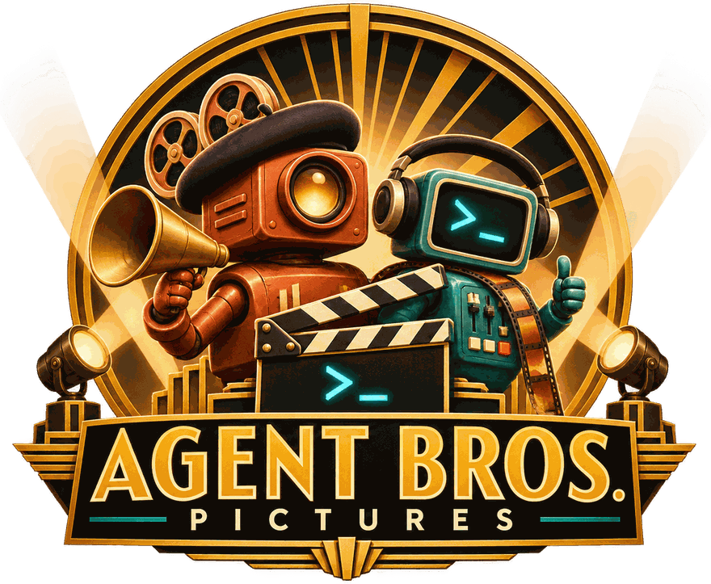
</picture>

# Agent Bros. Pictures

**The Creative Intelligence Harness for Your AI Agents**

### Видеостудия с доступным исходным кодом, которой управляют два брата-агента: Claude Code и Codex.

Опишите задачу одним предложением. Получите готовое видео — и код, который его создал.<br>
От 15-секундного Reels до запускового фильма, туториала, урока или целой кампании.

<br>

[](https://github.com/ilyamk/agentbros/stargazers)
[](AGENTS.md)
[](AGENTS.md)
[](docs/mcp.md)

[](https://www.remotion.dev)
[](https://react.dev)
[](tsconfig.json)
[](#licence)
[](#join-the-crew)
[](#honest-limits)

[](https://scorecard.dev/viewer/?uri=github.com/ilyamk/agentbros)
[](https://github.com/ilyamk/agentbros/actions/workflows/codeql.yml)
<!-- OpenSSF Best Practices badge: add after registering on bestpractices.dev (docs/github.md, step 5). -->

<br>

[**Быстрый старт**](#quick-start) &nbsp;·&nbsp;
[**Для кого**](#who-its-for) &nbsp;·&nbsp;
[**Студия**](#the-studio) &nbsp;·&nbsp;
[**Модели**](#models) &nbsp;·&nbsp;
[**Сейчас в прокате**](#now-showing) &nbsp;·&nbsp;
[**Для команд**](#for-teams) &nbsp;·&nbsp;
[**FAQ**](#faq) &nbsp;·&nbsp;
[**Для агентов**](#for-agents) &nbsp;·&nbsp;
[**История**](#the-story)

<br>

<!-- hero.jpg is an illustration; replace it with the studio's own trailer GIF
     (made with this repository, linked to the MP4 with sound) when it exists. -->
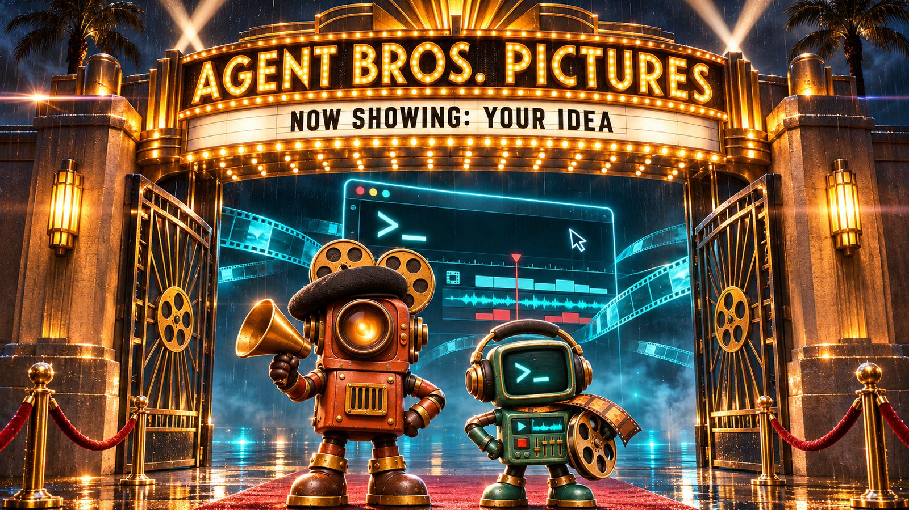

<br><br>

<!-- metrics:start -->
<table>
  <tr>
    <td align="center" width="20%"><h2>23</h2><sub>жанра<br>(17 готовы)</sub></td>
    <td align="center" width="20%"><h2>136</h2><sub>блоков моушн-<br>дизайна (101 проверен)</sub></td>
    <td align="center" width="20%"><h2>27</h2><sub>агентов съёмочной<br>группы на площадке</sub></td>
    <td align="center" width="20%"><h2>3</h2><sub>формата<br>9:16 · 1:1 · 16:9</sub></td>
    <td align="center" width="20%"><h2>0</h2><sub>API-ключей нужно<br>для рендера</sub></td>
  </tr>
</table>
<!-- metrics:end -->

<br>

[**⚡ Сделать первое видео**](#quick-start) &nbsp;&nbsp;·&nbsp;&nbsp; [**🏢 Для команды или агентства?**](#for-teams) &nbsp;&nbsp;·&nbsp;&nbsp; [**🤖 Агентам: установка**](SETUP.md)

</div>

<br>

> [!TIP]
> **Ваш первый дубль:** откройте этот репозиторий в Claude Code или Codex и скажите:
> *«Сделай 20-секундную вертикальную рекламу моего приложения, вот лендинг».*
> Братья спланируют ролик, соберут его в коде, отрендерят локально, сами отсмотрят кадры и покажут вам монтаж.

## 📽️ Как это работает

**1 · Скажите одним предложением.** Попросите Claude Code или Codex о любом видео своими словами:

> Сделай **30-секундный запусковый ролик** для моего приложения. Вот сайт; используй его настоящие экраны.

> Нарежь **пять Shorts** из записи моего подкаста, с субтитрами по ключевым словам.

> Сделай **90-секундный урок** о том, как работают сложные проценты, спокойным голосом.

> Вот **CSV с нашими товарами**: по одному 15-секундному вертикальному видео на позицию, цены из таблицы.

**2 · Утверждайте, а не контролируйте каждую мелочь.** Агенты выбирают жанр, пишут стратегию и сценарий, находят музыку и предлагают визуальный стиль. Вы утверждаете идею, стиль, музыку и финальный монтаж; ничего платного не запускается без заданного вами бюджета.

**3 · Получите монтаж — и исходники.** Отрендеренное видео в 9:16, 1:1 или 16:9, плюс всё, из чего оно сделано:

| Что вы получаете | Что это |
|---|---|
| `out/<project>/…mp4` | готовое видео в каждом формате, плюс чистая версия, где субтитры вынесены в отдельный слой |
| `src/projects/<project>/` | авторский фильм в виде редактируемого кода Remotion; поменяйте строку и отрендерите заново |
| `public/projects/<project>/pipeline/` | стратегия, сценарий, стиль, план анимации и заметки критика — в виде файлов, которые можно проверить |
| `pnpm cost:report --project <project>` | каждый платный вызов с его оценкой, резервом и результатом |

## 💎 Почему Agent Bros.

<table>
  <tr>
    <td width="33%" valign="top">🧾 <b>Исходники, а не чёрный ящик</b><br><sub>Каждый фильм — это исходники, которые принадлежат вам: код, планы и таймлайны. Поменяйте слово, цвет или склейку и отрендерите заново — без перегенерации наудачу.</sub></td>
    <td width="33%" valign="top">🎯 <b>Ваш настоящий продукт</b><br><sub>Ваше приложение или сайт снимаются вживую, а не подменяются шаблонным макетом телефона (<a href="docs/real-ui.md">настоящий UI</a>).</sub></td>
    <td width="33%" valign="top">🧐 <b>Команда, которая проверяет сама себя</b><br><sub>Каждый раунд — новый строгий критик, плюс измеримые проверки движения, синхронизации, громкости и сдачи до того, как вы увидите монтаж.</sub></td>
  </tr>
  <tr>
    <td valign="top">🔒 <b>Локально в первую очередь</b><br><sub>Рендер, монтаж и тесты работают на вашей машине без ключей. Ваши медиа хранятся и обрабатываются локально; модель вашего агента видит только те кадры и тексты, которые читает.</sub></td>
    <td valign="top">💸 <b>Бюджеты, а не сюрпризы</b><br><sub>Платная генерация оценивается или ограничивается, резервируется в пределах вашего лимита и записывается в журнал до запуска (<a href="docs/paid-execution.md">платное исполнение</a>).</sub></td>
    <td valign="top">🧠 <b>Запоминает ваш вкус</b><br><sub>Ваши оценки становятся локальной памятью: следующий фильм учтёт ваши предпочтения и не повторит прошлых ошибок (<a href="memory/AGENTS.md">память</a>).</sub></td>
  </tr>
  <tr>
    <td valign="top">🤖 <b>Много моделей, одна стойка</b><br><sub>1500+ эндпоинтов моделей для изображений, видео, голоса, музыки и 3D, подобранных под задачу и цену (<a href="#models">кастинг-офис</a>).</sub></td>
    <td valign="top">🎛️ <b>Встраивается в ваши инструменты</b><br><sub>Локальный интерфейс для ревью, обратимые правки таймлайна, передача монтажа в DaVinci Resolve и <a href="docs/mcp.md">MCP-сервер</a> для других агентов.</sub></td>
    <td valign="top">🌍 <b>Читаемо и общее</b><br><sub>Каждый жанр, блок и закреплённый урок — это файл, который вы можете прочитать, а следующая команда — улучшить. Исходный код доступен по BUSL-1.1: бесплатно для частных лиц, организаций до трёх человек, некоммерческих и образовательных организаций; более крупные компании покупают <a href="#for-teams">коммерческую лицензию</a>. Через четыре года каждый выпуск переходит под AGPL-3.0-or-later.</sub></td>
  </tr>
</table>

## 🆕 Свежее из монтажной

<!-- Keep the three newest user-facing items, dated, each linking to what changed. -->

- **2026-11-16** · Кампании: один бриф превращается во множество подотчётных видео — с A/B-хуками, видео на каждую строку каталога, ежемесячными сериями и языковыми версиями. [Производство кампаний →](docs/campaign-production.md)
- **2026-11-16** · Vork присоединяется к Blender как локальный GPU-рендерер для программируемых 3D-кадров и эффектов (экспериментально). [Vork →](docs/vork.md)
- **2026-11-15** · Десятки новых моушн-блоков, изученных по референсным фильмам: печатная типографика, бегущие строки, шумовые маски-вайпы, жидкий свет, аннотации интерфейса. [Открыть библиотеку →](docs/motion-library.md)

<a id="who-its-for"></a>

## 👥 Для кого

| Кто вы | Что попросить | С чего начать |
|---|---|---|
| **Продуктовая команда или основатель** | запусковый ролик, обзор новой функции, превью для App Store, туториал на ваших настоящих экранах | `product-promo` · `feature-update` · `app-store-preview` · `product-tutorial` · `teaser-trailer` |
| **Перформанс-маркетолог или интернет-магазин** | варианты хуков для тестов, видео на каждый товар, реклама в стиле блогеров | `ad-experiments` · `catalogue-videos` · `ugc-ad` · `reference-family` |
| **Автор контента или подкастер** | Shorts из длинной записи, более плотное выступление, субтитры, синхронизация двух камер, ежемесячная серия с постоянным ведущим | `shorts-from-long` · `footage-edit` · `content-series` · `captions:place` |
| **Преподаватель или автор курсов** | урок, где схема движется в такт голосу, главы для длинной лекции | `explainer` · `product-tutorial` · `video:longform` |
| **Агентство или студия** | кампании для разных брендов и языков, в фирменном стиле и с исходниками для передачи клиенту | `localise-campaign` · `reference-family` · [для команд](#for-teams) |
| **Режиссёр или моушн-дизайнер** | атмосферные фильмы по утверждённым ключевым кадрам, кинетическая типографика, 3D-кадры, фильм в стиле любимой работы | `ai-film` · `motion-design` · `video-remix` · `blender:run` · [референсы](#references) |

<p align="right"><sub><a href="#top">наверх ↑</a></sub></p>

<a id="quick-start"></a>

## ⚡ Быстрый старт

**Способ 1 · Скажите своему агенту** <sub>(рекомендуется)</sub>

```text
Install Agent Bros. Pictures from github.com/ilyamk/agentbros: follow its
SETUP.md, then tell me what works and which keys I need.
```

**Способ 2 · Две строки**

```bash
git clone https://github.com/ilyamk/agentbros.git && cd agentbros
./setup.sh --apply --smoke   # Windows: ./setup.ps1 -Apply -Smoke
```

`./setup.sh` без флагов только составляет план. `--apply` ставит недостающее в этой папке, а также Node, pnpm и uv через ваш менеджер версий; системные пакеты (Homebrew, apt, winget) только с `--system`. В конце появляется `out/setup/REPORT.md`: что уже работает, ограничения вашей машины и какие ключи что открывают. Без скрипта: `nvm install && nvm use`, затем `npm install --global pnpm@12.21.0 --allow-scripts=pnpm && pnpm install --frozen-lockfile && pnpm preflight`.

Затем откройте папку в **Claude Code** или **Codex** и попросите видео. Вот и всё.

<details>
<summary><b>Что понадобится</b></summary>
<br>

Node 26 (рекомендуется 26.13.1, проверена в CI; Node 24, проверенная на 24.22.3, тоже работает), закреплённая версия pnpm, FFmpeg и uv; в руководстве по установке есть шаги для macOS, Debian/Ubuntu и Windows. Chromium загружает сам Remotion. Blender, Vork, DaVinci Resolve и ключи провайдеров необязательны; `pnpm preflight` подскажет, чего не хватает и как это установить. Полная таблица по ОС: [руководство по установке](docs/install.md); [политика Node](docs/node-runtime.md); [Python 3.13 и uv](docs/python-runtime.md).

Другие агенты могут управлять студией через локальный [MCP-сервер](docs/mcp.md) (`pnpm mcp:stdio`); он не запускает платные инструменты, пока вы не стартуете его с `--allow-paid`, и даже тогда генерация по умолчанию идёт в пробном режиме (dry run).

Необязательно: собственный навык агента от Remotion, `remotion-best-practices`, не входит в комплект (исходный проект не даёт лицензии на распространение); установите его из источника командой `npx skills add remotion-dev/skills` ([сторонние навыки](.agents/skills/THIRD_PARTY.md)).

</details>

Требования, ключи, первое офлайн-видео и обновления: **[руководство по установке](docs/install.md)**. Обзор на одной странице для людей: **[как это работает](docs/how-it-works.md)**.

<p align="right"><sub><a href="#top">наверх ↑</a></sub></p>

<a id="the-studio"></a>

<p align="center">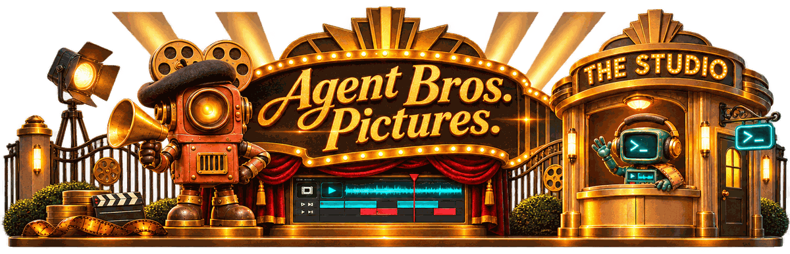</p>

## 🎬 Студия

<sub>Все цеха настоящего кинопроизводства, укомплектованные агентами. Каждый цех — это команда с ответом в JSON, поэтому группа может сама проверять свою работу.</sub>

<table>
  <tr>
    <td align="center" width="25%" valign="top">
      <br>
      <b>Сценарный цех</b><br>
      <sub>Стратегия, хуки, идеи от соперничающих команд, сценарии, оценённые вслепую.</sub><br><br>
      <code>film:brief</code>
    </td>
    <td align="center" width="25%" valign="top">
      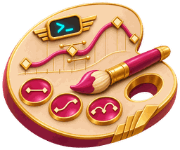<br>
      <b>Художественный цех</b><br>
      <sub>Библиотека моушн-дизайна, готовые стили и стайлфреймы, отрендеренные из настоящего кода.</sub><br><br>
      <code>library:list</code>
    </td>
    <td align="center" width="25%" valign="top">
      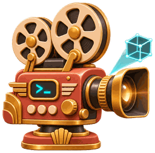<br>
      <b>Камера и 3D</b><br>
      <sub>Blender, Vork, three.js и настоящий интерфейс вашего продукта, снятый вживую.</sub><br><br>
      <code>capture:app</code>
    </td>
    <td align="center" width="25%" valign="top">
      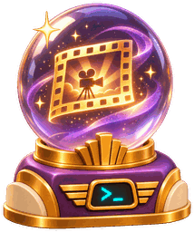<br>
      <b>Генерация</b><br>
      <sub>Модели изображений и видео за надёжными задачами и проверками бюджета.</sub><br><br>
      <code>generate:video</code>
    </td>
  </tr>
  <tr>
    <td align="center" valign="top">
      <br>
      <b>Голос и музыка</b><br>
      <sub>Закадровый голос, саундтреки, 160+ звуковых эффектов, склейки точно в бит.</sub><br><br>
      <code>audio:mix</code>
    </td>
    <td align="center" valign="top">
      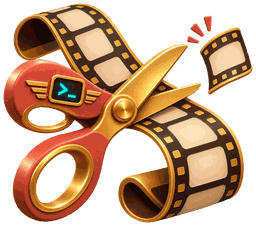<br>
      <b>Монтажная</b><br>
      <sub>Вырезанные паузы, слова-паразиты и фальстарты; мультикамера; вертикальное кадрирование.</sub><br><br>
      <code>recut:plan</code>
    </td>
    <td align="center" valign="top">
      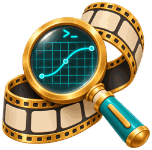<br>
      <b>Лаборатория референсов</b><br>
      <sub>Любой фильм разбирается покадрово, а затем пересобирается под вашу идею.</sub><br><br>
      <code>ref:analyze</code>
    </td>
    <td align="center" valign="top">
      <br>
      <b>Стол критиков</b><br>
      <sub>Каждый раунд — новый строгий критик; измеримые проверки движения, синхронизации и QA.</sub><br><br>
      <code>motion:check</code>
    </td>
  </tr>
</table>

<details>
<summary><b>Как снимается картина</b> <sub>(цепочка авторского фильма)</sub></summary>
<br>

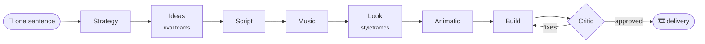

Вы утверждаете каждый важный этап: идею, стиль, музыку, финальный монтаж. Подробнее: [производственная цепочка](docs/production-chain.md).

</details>

<a id="models"></a>

## 🎭 Кастинг-офис: 1500+ моделей за одной стойкой

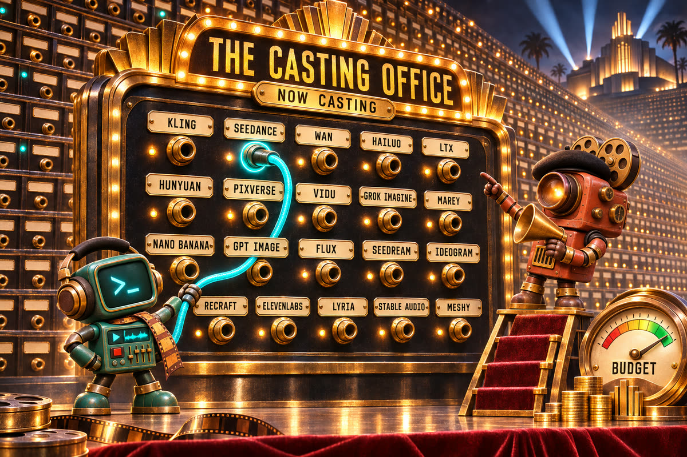

**Модели всех крупных лабораторий — за одним предложением и одним бюджетом.** Студия хранит офлайн-каталог из более чем 1500 эндпоинтов моделей из 400+ семейств на fal и Higgsfield, плюс напрямую ElevenLabs: видео, изображения, голос, музыка, звуковые эффекты, 3D, апскейл, липсинк и аватары.

- **Кастинг под роль, а не под бренд.** `models:pick` выбирает по задаче, уровню качества и цене; если одну и ту же модель предлагают два провайдера, работу получает тот, что дешевле.
- **Цена — до запуска.** Каждый вызов сначала оценивается или ограничивается и резервируется в рамках вашего бюджета; неоднозначная отправка возобновляется той же операцией и никогда не отправляется повторно вслепую.
- **Один процесс для любого медиа.** Те же агенты, утверждения и отчёт о расходах — для видеокадра, закадрового голоса, саундтрека или 3D-ассета.
- **Новые модели без нового кода.** Обновление каталога добавляет новые эндпоинты вместе с их схемами и ценами; у каждого честный уровень доверия — от «обнаружен» до «проверен».
- **Никакой пачки подписок.** Ваши собственные аккаунты fal, Higgsfield и ElevenLabs, оплата по факту использования.

**Kling** (Kuaishou) · **Seedance** (ByteDance) · **Wan** (Alibaba) · **Hailuo** (MiniMax) · **LTX** (Lightricks) · **Hunyuan Video** (Tencent) · **PixVerse** · **Vidu** · **Grok Imagine** (xAI) · **Marey** (Moonvalley) · **Nano Banana** (Google) · **GPT Image** (OpenAI) · **FLUX** (Black Forest Labs) · **Seedream** (ByteDance) · **Ideogram** · **Recraft** · **ElevenLabs** · **Lyria** (Google) · **Stable Audio** (Stability AI) · **Meshy** · <sub>и сотни других — от Luma, Meta, Microsoft, NVIDIA, Topaz Labs и не только.</sub>

<sub>Руководства: [слоты моделей](docs/model-slots-guide.md) · [каталог fal](docs/fal-catalogue.md) · [Higgsfield](docs/higgsfield.md) · [платное исполнение](docs/paid-execution.md). Названия моделей принадлежат их владельцам (см. <a href="#trademarks">товарные знаки</a>).</sub>

<a id="sources"></a>

## 📥 Приёмная источников: ваш материал — по ссылке

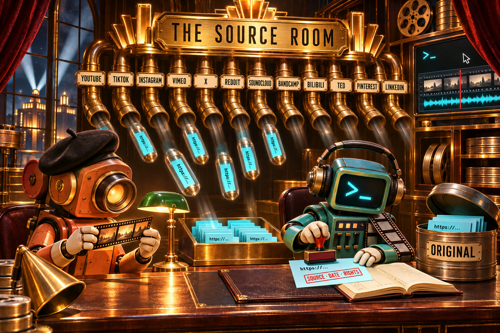

**Ссылка — это источник.** Вставьте пост, который вас вдохновил, свой опубликованный Reels или лицензированный трек — и оригинальный файл попадёт в ваш проект с пометкой, откуда он взят.

- **Оригинал, а не запись экрана.** Лучшая доступная версия каждого вложения, по запросу — с отдельной звуковой дорожкой; без апскейла и без кадрирования.
- **Подшито как в архиве.** Каждый файл хранится неизменным вместе с контрольной суммой, ссылкой на источник, провайдером и датой. Права остаются помеченными как неизвестные, пока вы их не подтвердите.
- **Сразу в работу.** Источник становится референсом для «в стиле…», клипом для ремикса или вашим собственным постом для нарезки в Shorts.
- **Пакеты, которые не ломаются.** До 100 ссылок за раз, с возобновлением после сбоя; неопределённый запрос сверяется, а не оплачивается повторно вслепую.
- **Только публичные посты.** Без cookies браузера, без приватных сессий, без DRM.

**YouTube** · **TikTok** · **Instagram** · **Facebook** · **X** · **Threads** · **Snapchat** · **Pinterest** · **LinkedIn** · **Reddit** · **Vimeo** · **Dailymotion** · **Bilibili** · **Douyin** · **Xiaohongshu** · **Weibo** · **SoundCloud** · **Bandcamp** · **Mixcloud** · **TED** · <sub>и ещё около 20 платформ, согласно документации провайдеров.</sub>

<sub>Загрузка идёт через ваш собственный аккаунт RapidAPI или Apify, с оплатой за ссылку в рамках вашего бюджета; список платформ взят из документации провайдеров и не является гарантией. Используйте это для материала, который принадлежит вам или который вы вправе использовать: загруженный референс анализируется, а не публикуется повторно. Руководство: [получение медиа](docs/media-fetch.md).</sub>

<p align="right"><sub><a href="#top">наверх ↑</a></sub></p>

<a id="now-showing"></a>

<p align="center">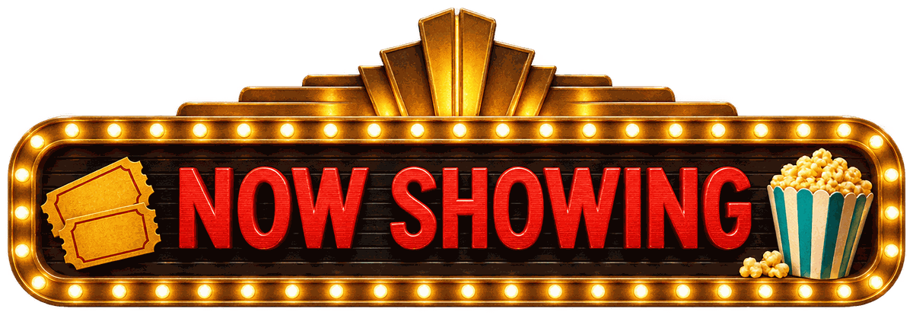</p>

## 🍿 Сейчас в прокате

<sub>На входе — одно предложение, снятое вами видео или таблица с товарами. Выберите жанр: большинство карточек — это плейбуки со своим методом и планкой качества; несколько — инструменты, которые работают внутри любого из них. Карточки — это иллюстрации, а не кадры из готовых фильмов.</sub>

<p>
  
  
</p>

<table>
  <tr>
    <td width="50%" valign="top">
      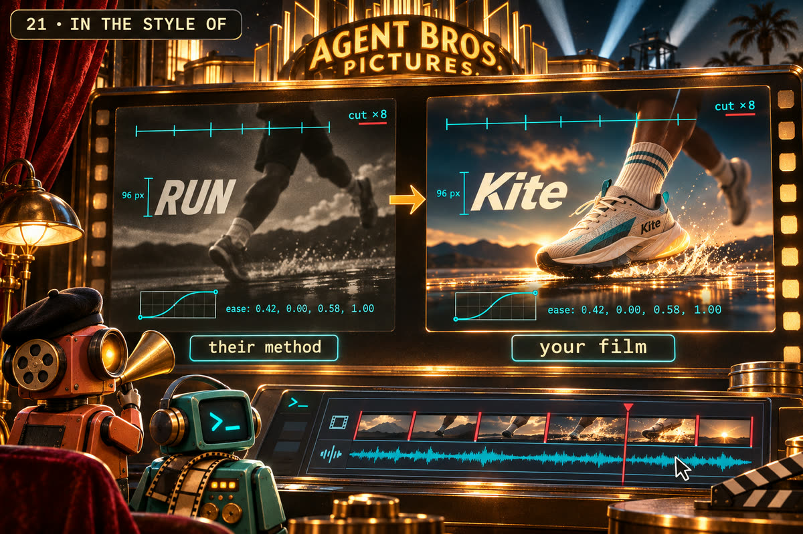
    </td>
    <td width="50%" valign="top">
      <h4>✨ Работает с любым жанром: «в стиле…»</h4>
      Приложите к любому запросу фильм, который вам нравится. Группа измерит его склейки, сетку битов, типографику и кривые анимации, а затем соберёт <b>ваш</b> фильм с тем же мастерством и новым содержанием. Референс измеряется на вашей машине, а в репозитории остаются только числа и описания.<br><br>
      <sub><code>ref:add</code> · <code>ref:analyze</code> · <a href="#references">как учится группа →</a></sub>
    </td>
  </tr>
</table>

### 🚀 Продукт и маркетинг

<table>
  <tr>
    <td width="50%" valign="top">
      <!-- ASSET card product-promo: 16:9 GIF, 800×450, loop ≤ 6 s. A launch film
           for a real app: the product's own screen flies in, one proposition
           in big type, logo lock-up. -->
      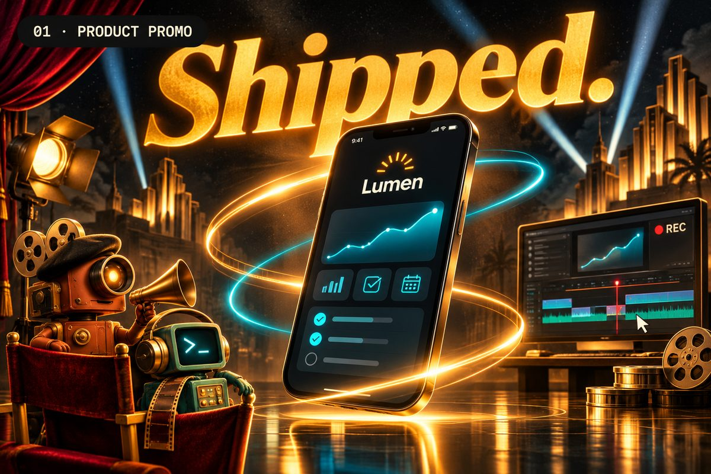
      <h4>Продуктовое промо</h4>
      Запусковые ролики, построенные вокруг вашего настоящего продукта, а не его заменителя.<br>
      <sub><code>product-promo</code> · 15–60 с</sub> 
    </td>
    <td width="50%" valign="top">
      <!-- ASSET card teaser-trailer: 16:9 GIF. Dark, slow build, flashes of the
           thing, a date card: "COMING 08.12". -->
      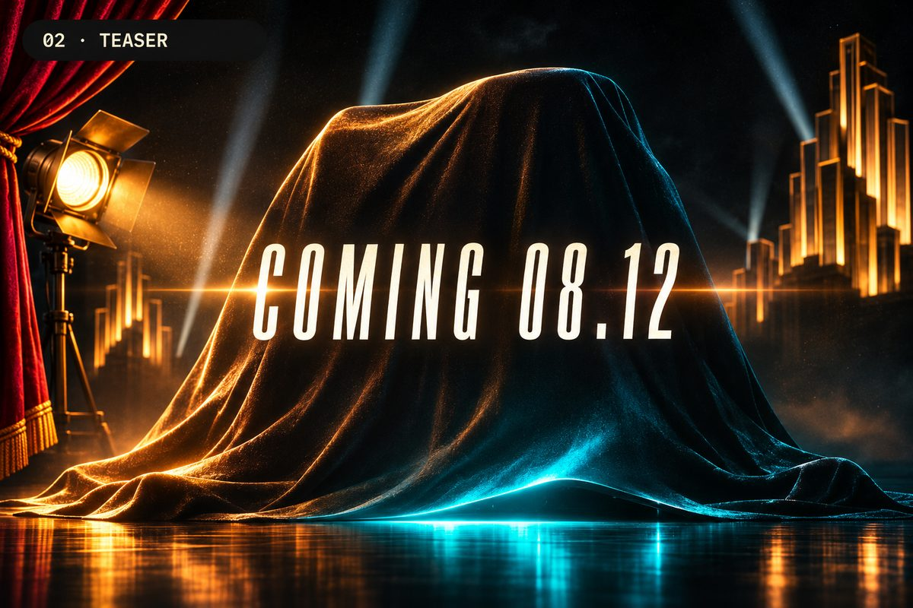
      <h4>Тизер и трейлер</h4>
      Предвкушение того, что ещё не вышло. Финал — на дате.<br>
      <sub><code>teaser-trailer</code> · 6–60 с</sub> 
    </td>
  </tr>
  <tr>
    <td width="50%" valign="top">
      <!-- ASSET card app-store-preview: three 9:16 phone frames side by side,
           real app screens with tap hotspots, store-size badge "886×1920". -->
      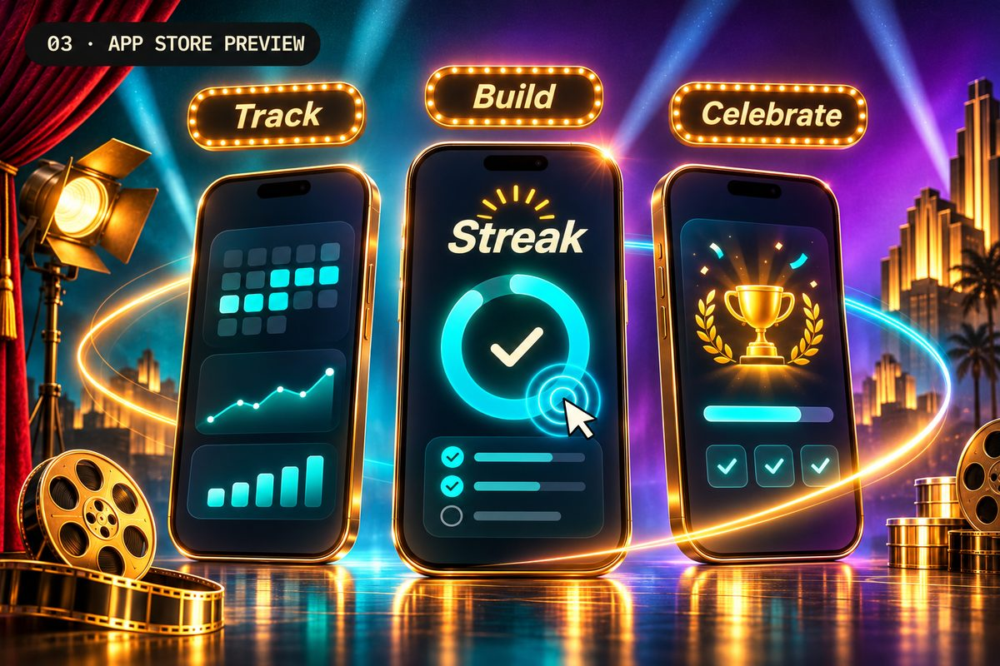
      <h4>Превью для App Store</h4>
      Собственные экраны вашего приложения точно в размере магазина, собранные так, чтобы пройти модерацию.<br>
      <sub><code>app-store-preview</code> · 15–30 с</sub> 
    </td>
    <td width="50%" valign="top">
      <!-- ASSET card feature-update: before / after wipe across a real UI,
           a "NEW" chip lands on the changed button. -->
      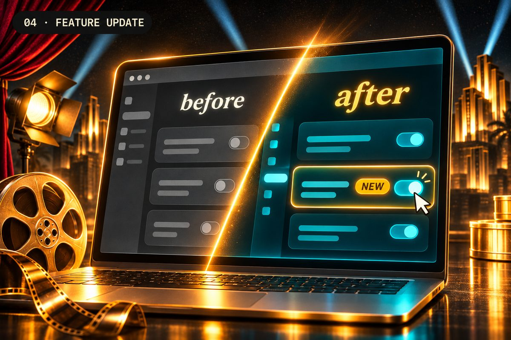
      <h4>Новая функция</h4>
      Одна новая функция: что изменилось, до и после, где попробовать.<br>
      <sub><code>feature-update</code> · 10–45 с</sub> 
    </td>
  </tr>
  <tr>
    <td width="50%" valign="top">
      <!-- ASSET card ugc-ad: 9:16, a creator talking to camera, bold hook caption
           in the first second, the product in hand. Label "3 hooks · 1 product". -->
      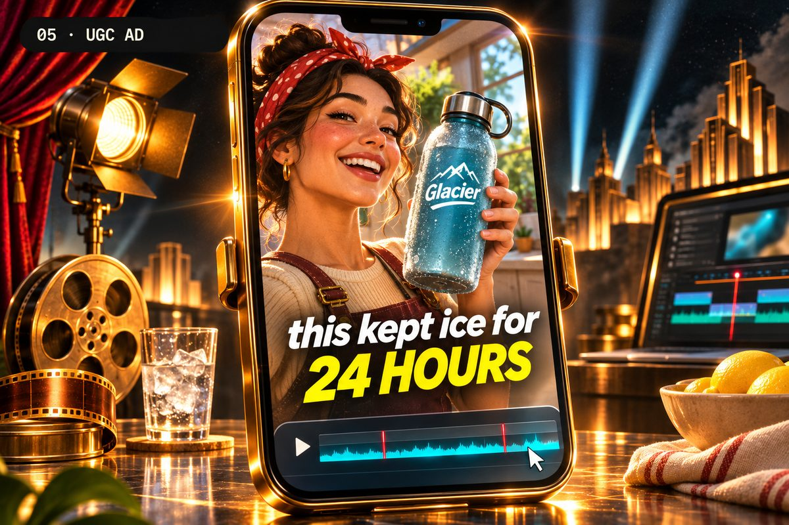
      <h4>UGC-реклама</h4>
      Вертикальная реклама в стиле блогеров: хук, проблема, продукт, доказательство.<br>
      <sub><code>ugc-ad</code> · вертикально</sub> 
    </td>
    <td width="50%" valign="top">
      <!-- ASSET card case-study: an interview frame with a lower third and a
           signed-off number animating: "+38% retention". -->
      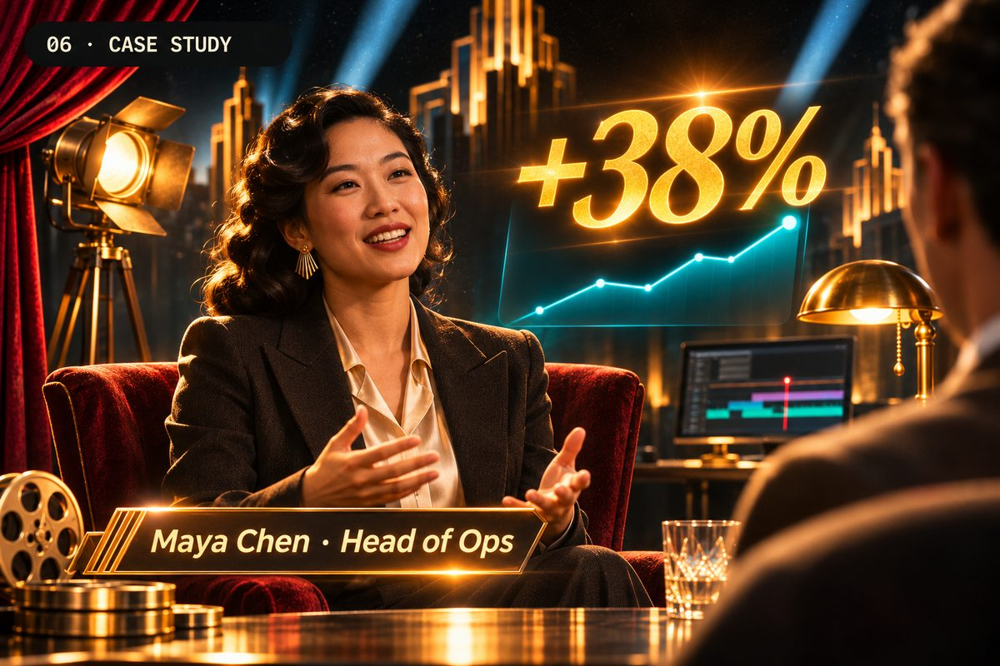
      <h4>Кейс клиента</h4>
      Интервью с клиентом, смонтированное в историю с настоящими, согласованными цифрами.<br>
      <sub><code>case-study</code> · 60 с–3 мин</sub> 
    </td>
  </tr>
</table>

### 📦 Кампании в масштабе

<sub>Один бриф — много видео. Каждый вариант — отдельный подотчётный проект: свои факты, утверждения и расходы, ничего не копируется втихую из предыдущей строки.</sub>

<table>
  <tr>
    <td width="50%" valign="top">
      <!-- ASSET card ad-experiments: three vertical ads, identical body,
           three different first seconds labelled A / B / C. -->
      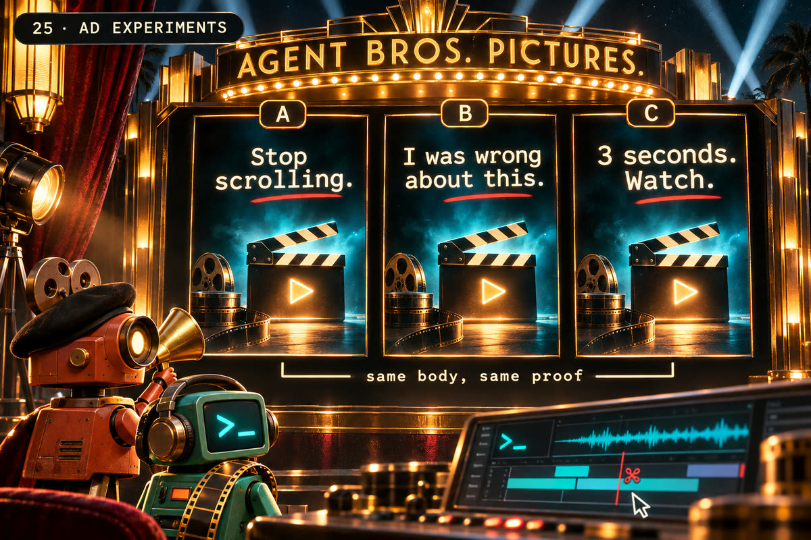
      <h4>Рекламные эксперименты</h4>
      Варианты хука, оффера и концовки вокруг одной проверенной основы, у каждого — гипотеза для проверки.<br>
      <sub><code>ad-experiments</code> · A/B</sub> 
    </td>
    <td width="50%" valign="top">
      <!-- ASSET card catalogue-videos: a product sheet whose rows turn into a
           grid of vertical videos, prices from the sheet. -->
      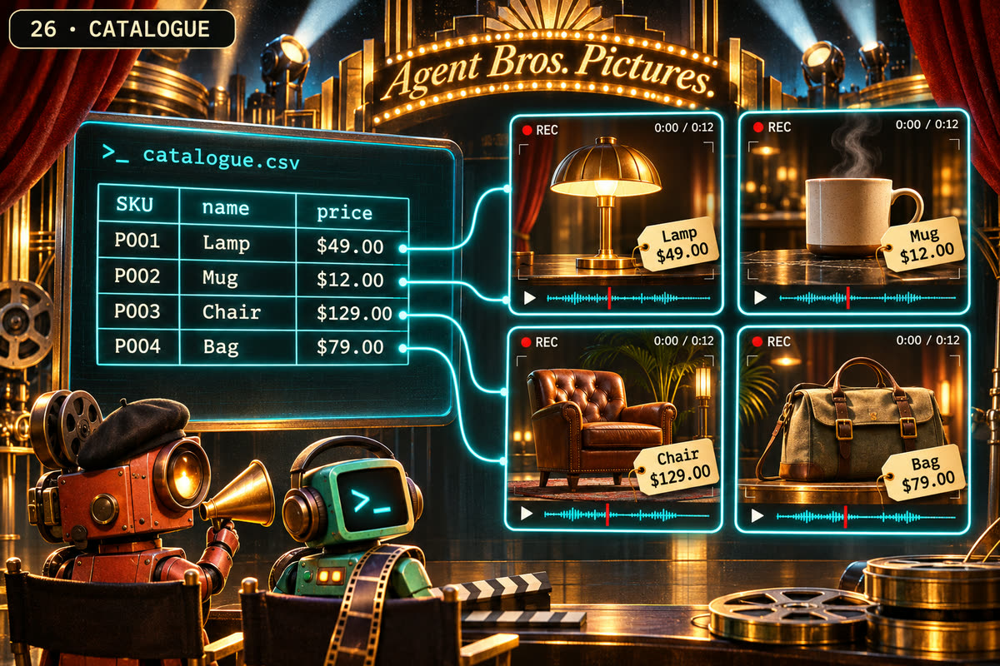
      <h4>Видео по каталогу</h4>
      На входе — CSV, TSV или JSON с товарами, на выходе — по видео на каждый артикул для проверки, с названиями и ценами, сверенными построчно.<br>
      <sub><code>catalogue-videos</code> · e-commerce</sub> 
    </td>
  </tr>
  <tr>
    <td width="50%" valign="top">
      <!-- ASSET card content-series: a month of episodes with the same host. -->
      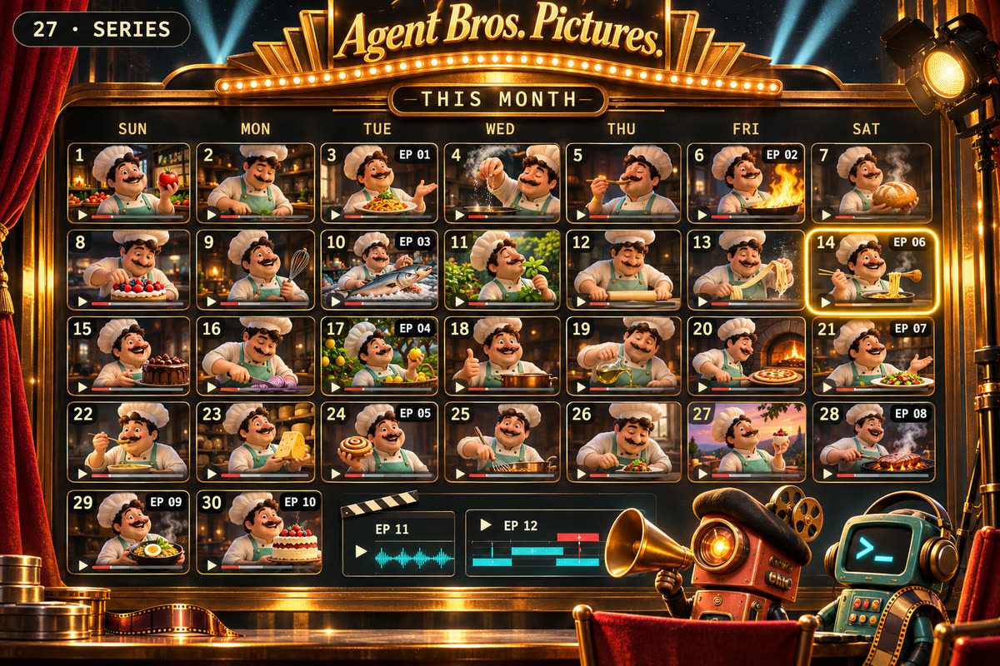
      <h4>Контент-серия</h4>
      Месяц эпизодов: тот же персонаж и формат, каждый раз новое содержание.<br>
      <sub><code>content-series</code> · регулярно</sub> 
    </td>
    <td width="50%" valign="top">
      <!-- ASSET card reference-family: one blueprint, three products. -->
      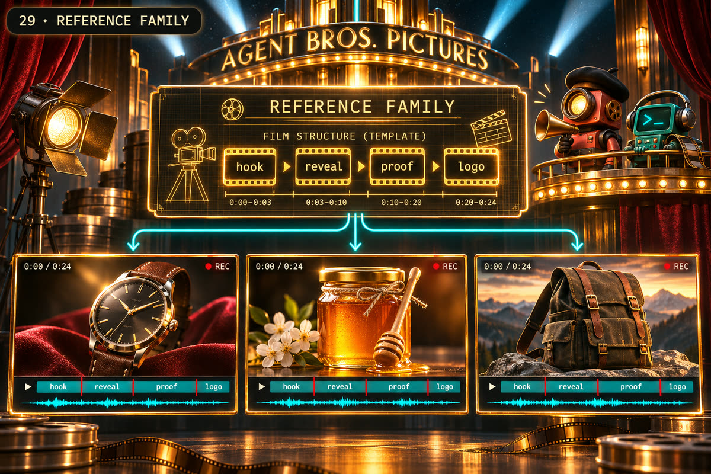
      <h4>Семейство по референсу</h4>
      Метод одного референса, перенесённый на всю продуктовую линейку, чтобы каждый фильм ощущался как один бренд.<br>
      <sub><code>reference-family</code> · продуктовые линейки</sub> 
    </td>
  </tr>
  <tr>
    <td width="50%" valign="top">
      <!-- ASSET card localise-campaign: the same ads in four languages. -->
      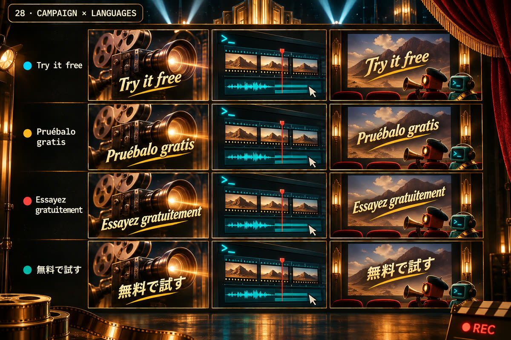
      <h4>Кампания × языки</h4>
      Принятые варианты на новых языках: голос, субтитры и текст на экране, с отдельным проверяющим для каждого языка.<br>
      <sub><code>localise-campaign</code></sub> 
    </td>
    <td width="50%" valign="top">
      <!-- ASSET card localise: the same frame in three languages stacked,
           subtitles switching EN → ES → JA. -->
      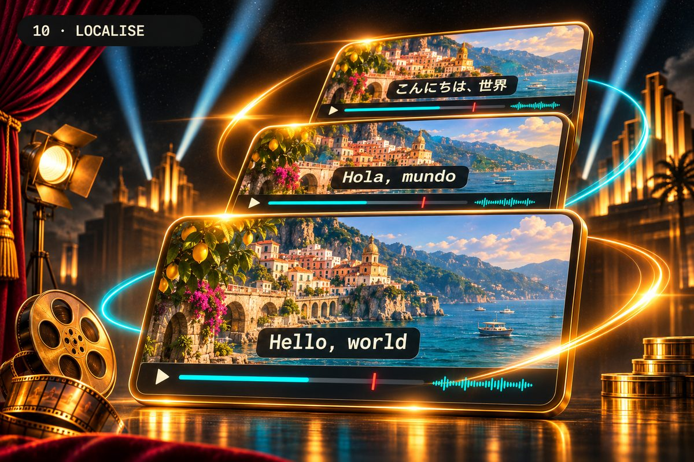
      <h4>Локализация одного видео</h4>
      Готовое видео на другом языке: субтитры, голос, текст на экране.<br>
      <sub><code>localise</code></sub> 
    </td>
  </tr>
</table>

### 🎓 Объяснять и учить

<table>
  <tr>
    <td width="50%" valign="top">
      <!-- ASSET card explainer: a diagram building itself to a voice, numbers
           counting up, a worked example highlighted. -->
      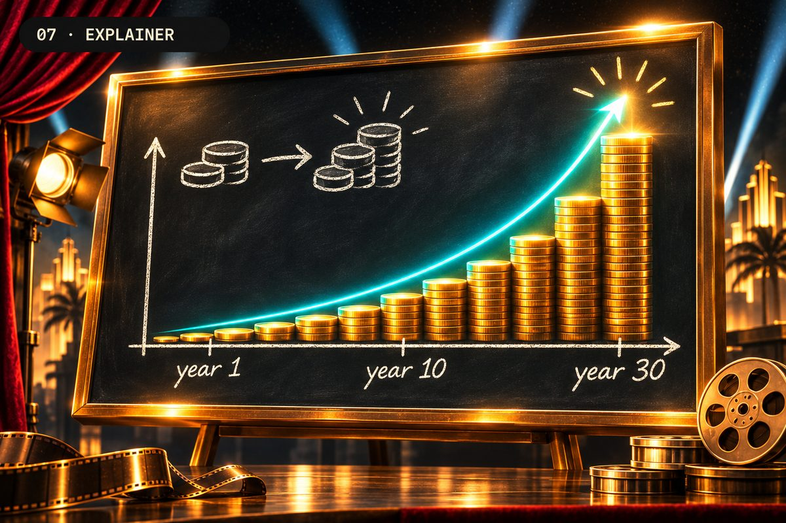
      <h4>Объяснение и урок</h4>
      Идеи, процессы и данные, где схема движется в такт голосу.<br>
      <sub><code>explainer</code> · от 30 с до нескольких минут</sub> 
    </td>
    <td width="50%" valign="top">
      <!-- ASSET card product-tutorial: a real web app, the cursor glides,
           a ring pulses on each click, step counter "2 / 5". -->
      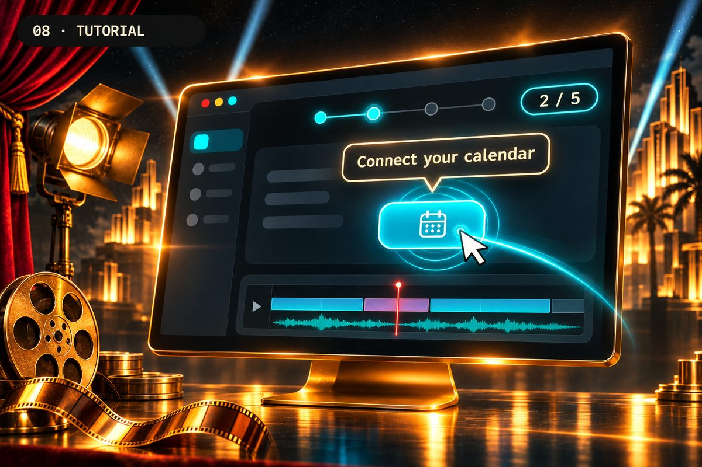
      <h4>Продуктовый туториал</h4>
      Одна задача, показанная на настоящих экранах, клик за кликом.<br>
      <sub><code>product-tutorial</code> · от 30 с до нескольких минут</sub> 
    </td>
  </tr>
  <tr>
    <td width="50%" valign="top">
      <!-- ASSET card longform: a long lecture with gold chapter segments and
           vertical clips pulled out of it. -->
      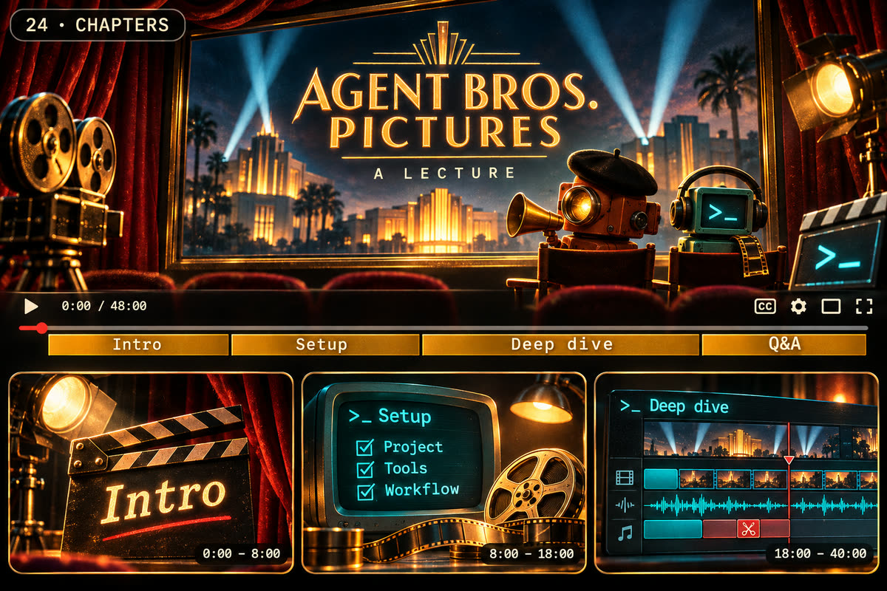
      <h4>Главы и длинный формат</h4>
      Длинная лекция или стрим, разбитые на главы с заголовками, плюс утверждённые Shorts, вырезанные из них.<br>
      <sub><code>video:longform</code> · локально</sub>
    </td>
    <td width="50%" valign="top">
      <!-- ASSET card avatar-presenter: a digital presenter beside a slide,
           visible "AI-generated" label in the corner. -->
      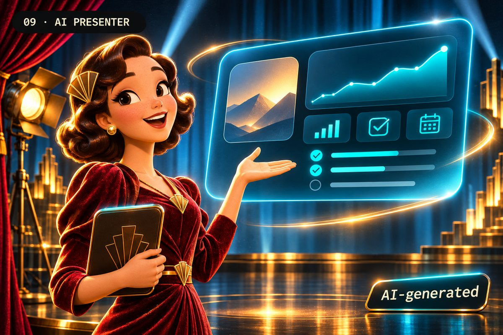
      <h4>ИИ-ведущий</h4>
      Цифровой ведущий для онбординга и рассылок, с согласием и пометками об ИИ.<br>
      <sub><code>avatar-presenter</code></sub> 
    </td>
  </tr>
</table>

### 🎨 Моушн, 3D и ИИ-кино

<table>
  <tr>
    <td width="50%" valign="top">
      <!-- ASSET card motion-design: kinetic typography on the beat, letters
           splitting and re-forming into a logo ident. -->
      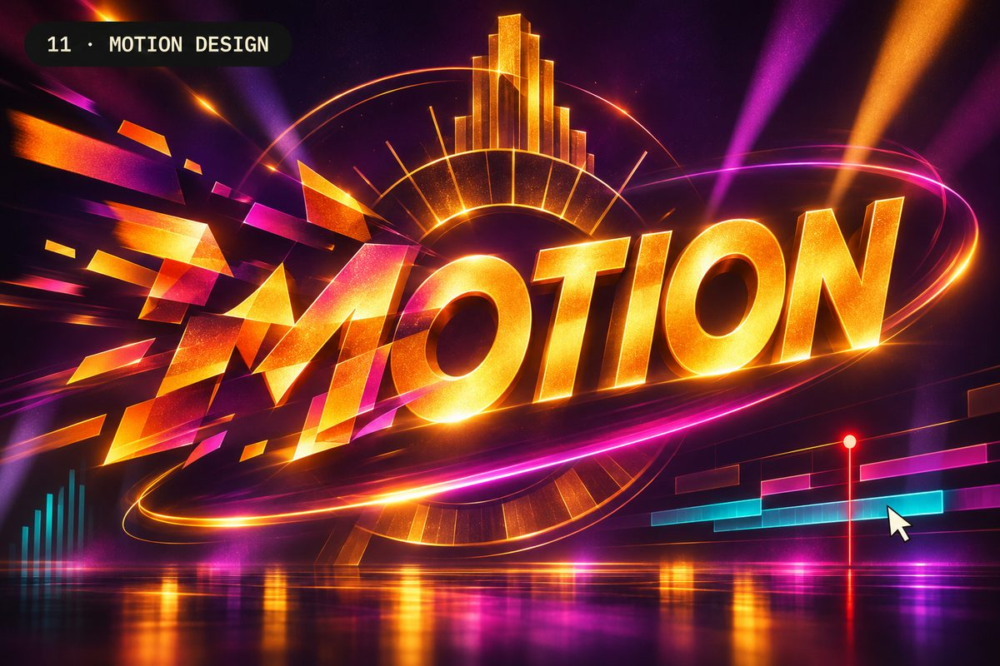
      <h4>Моушн-дизайн</h4>
      Кинетическая типографика, логотип-заставки, титры, чистое движение под музыку.<br>
      <sub><code>motion-design</code></sub> 
    </td>
    <td width="50%" valign="top">
      <!-- ASSET card photoreal-3d: an unbranded phone in a studio light,
           rendered in Blender, its wireframe ghosted behind it. -->
      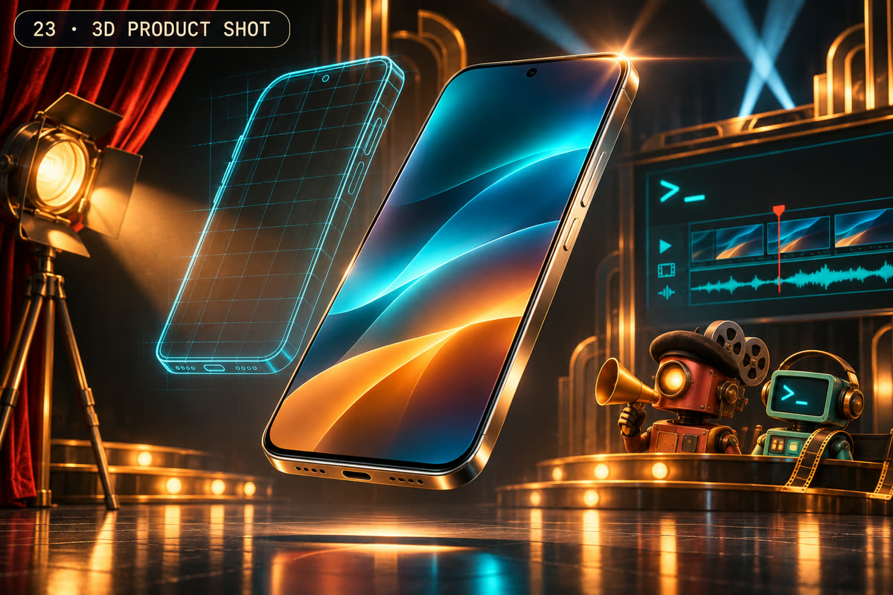
      <h4>3D-кадры продукта</h4>
      Настоящая модель устройства, освещённая в Blender как студийная фотография, с вашим экраном, вмонтированная в фильм.<br>
      <sub><code>blender:run</code> · Blender по желанию</sub>
    </td>
  </tr>
  <tr>
    <td width="50%" valign="top">
      <!-- ASSET card ai-film: a cinematic generated shot (mood film), letterbox
           bars, shot counter "SHOT 04 / 12". -->
      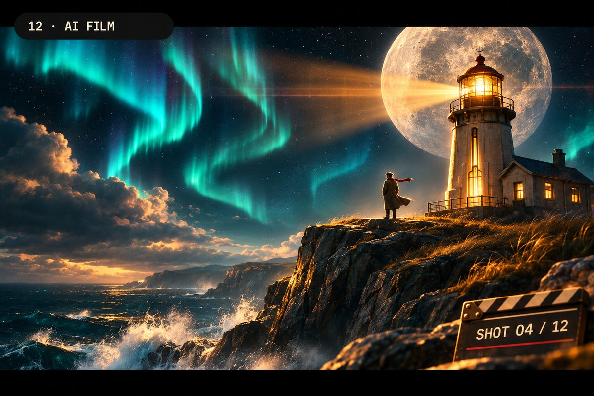
      <h4>ИИ-фильм</h4>
      Короткие истории и атмосферные фильмы, срежиссированные покадрово по утверждённым ключевым кадрам.<br>
      <sub><code>ai-film</code></sub> 
    </td>
    <td width="50%" valign="top">
      <!-- ASSET card video-remix: one clip as original, swapped and restyled. -->
      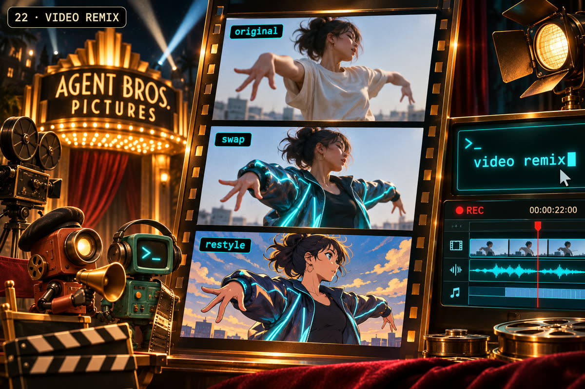
      <h4>Видеоремикс</h4>
      Сохраните движение клипа и замените персонажа, костюм или весь стиль, с учётом согласия и прав (платная генерация).<br>
      <sub><code>video-remix</code></sub> 
    </td>
  </tr>
  <tr>
    <td width="50%" valign="top">
      <!-- ASSET card photo-slideshow: holiday photos in a slow Ken Burns drift,
           cuts on the music's downbeats. -->
      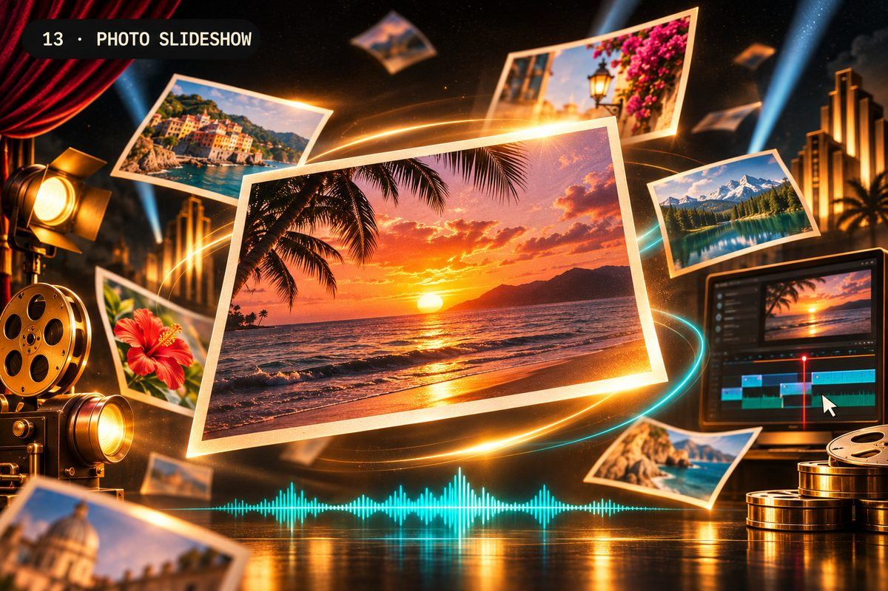
      <h4>Фотослайдшоу</h4>
      Ваши фотографии, смонтированные под музыку: воспоминания, портфолио, туры по недвижимости.<br>
      <sub><code>photo-slideshow</code></sub> 
    </td>
    <td width="50%" valign="top">
      <!-- ASSET card stock-montage: licensed b-roll under a bold manifesto line,
           one word per cut. -->
      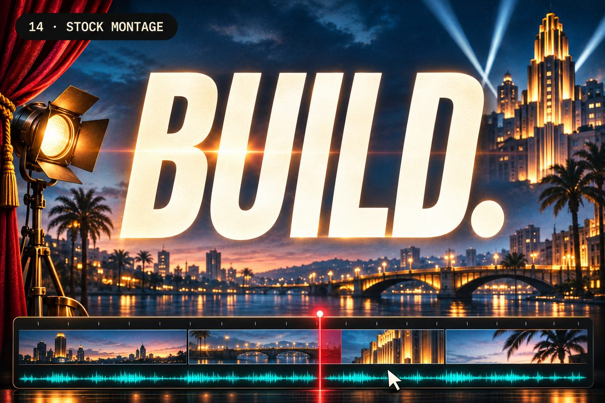
      <h4>Стоковый монтаж</h4>
      Лицензированный b-roll и текст поверх изображения: манифесты и атмосферные фильмы.<br>
      <sub><code>stock-montage</code></sub> 
    </td>
  </tr>
</table>

#### Пример: HUD-лупы продукта 

<table>
  <tr>
    <td width="33%" valign="top">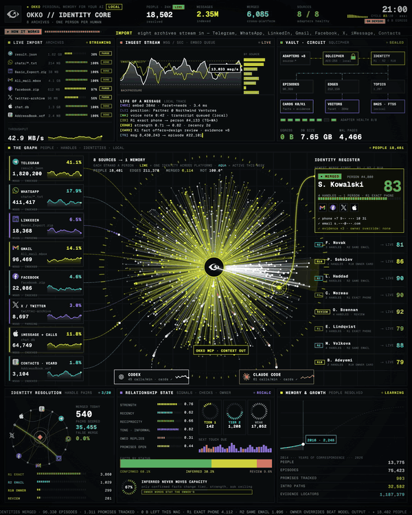</td>
    <td width="33%" valign="top">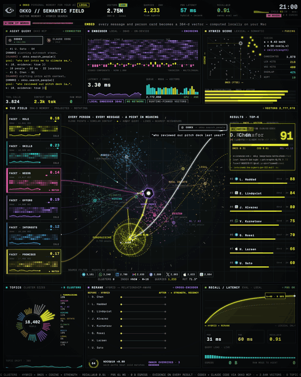</td>
    <td width="33%" valign="top">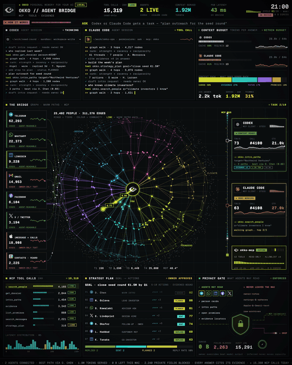</td>
  </tr>
</table>

Три 30-секундных интерфейсных лупа для одного вымышленного продукта: плотный холст-дашборд собирается под музыку. Затем из этих холстов сделаны истории с пролётом камеры, подписями, версиями на английском и русском и заставкой с логотипом. Здесь 3-секундные фрагменты; всё написано кодом в Remotion, без платной генерации. Метод: <a href="playbooks/product-hud-story/AGENTS.md"><code>product-hud-story</code></a>.

### ✂️ Ваше собственное видео

<table>
  <tr>
    <td width="50%" valign="top">
      <!-- ASSET card footage-edit: a talking-head frame, a strip below showing
           red cut regions; chip "removed 14 slips · 4:12 → 3:20". -->
      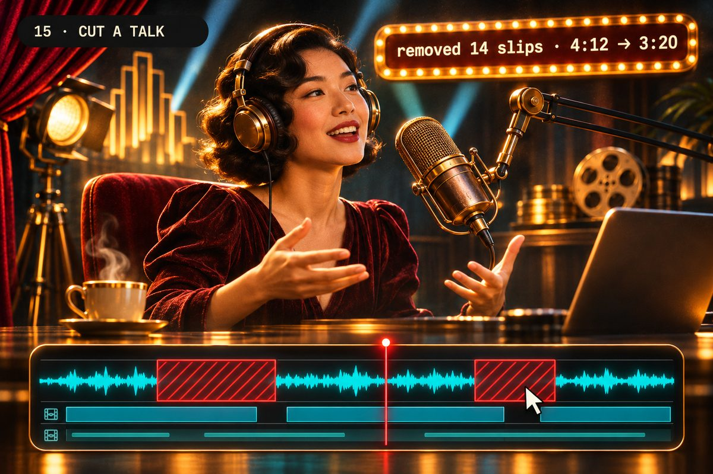
      <h4>Смонтировать выступление</h4>
      Паузы, «эээ» и фальстарты находятся и вырезаются. План утверждаете вы.<br>
      <sub><code>footage-edit</code></sub> 
    </td>
    <td width="50%" valign="top">
      <!-- ASSET card shorts-from-long: one 16:9 podcast frame splitting into
           three 9:16 clips, each with a score chip "hook 9/10". -->
      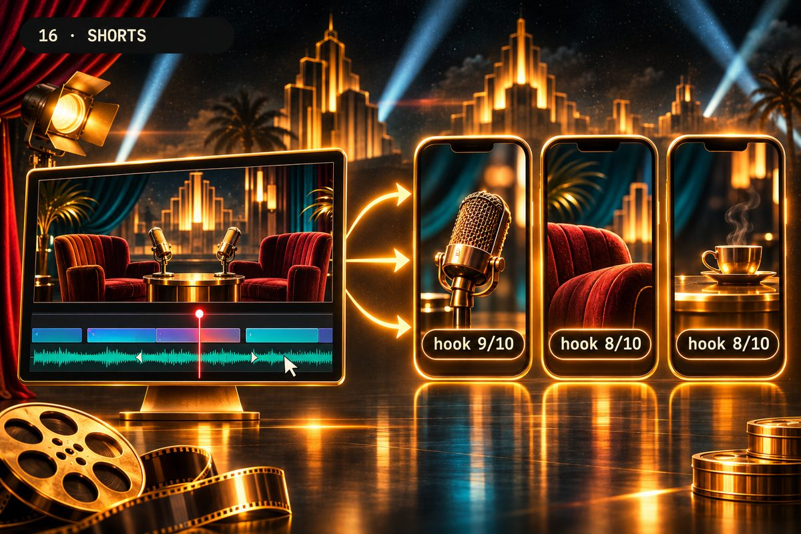
      <h4>Shorts из длинного видео</h4>
      Самостоятельные Reels и Shorts из длинной записи, ранжированные по силе хука.<br>
      <sub><code>shorts-from-long</code></sub> 
    </td>
  </tr>
  <tr>
    <td width="50%" valign="top">
      <!-- ASSET card captions: the same sentence in 4 of the 10 caption styles,
           cycling (outline pop, key-word colour, sliding box, single-word punch). -->
      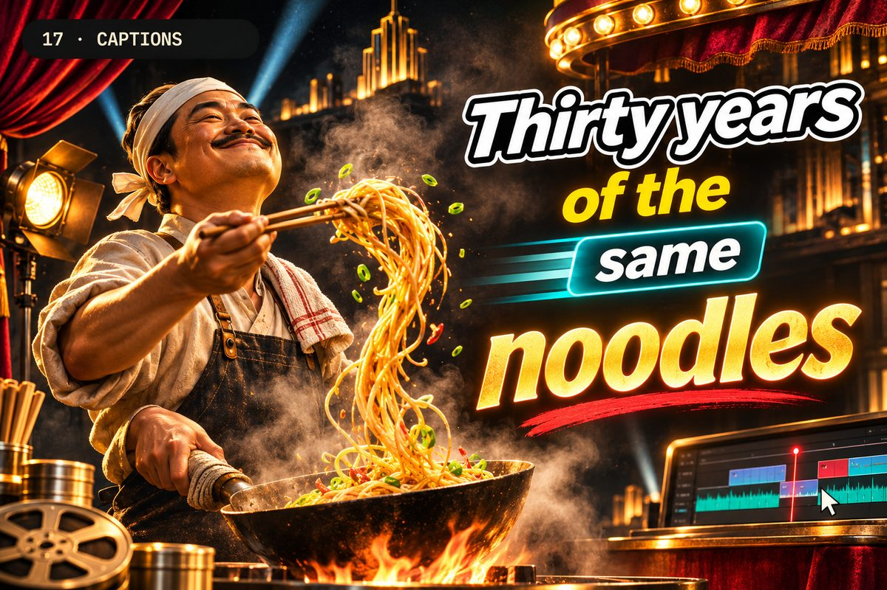
      <h4>Субтитры</h4>
      Субтитры с привязкой к словам в 10 стилях — от аккуратных до акцента на одном слове, плюс SRT и VTT.<br>
      <sub><code>captions:place</code> · любой жанр</sub>
    </td>
    <td width="50%" valign="top">
      <!-- ASSET card multicam-reframe: two camera angles switching on the
           speaker, then a 16:9 frame with a 9:16 crop box tracking a face. -->
      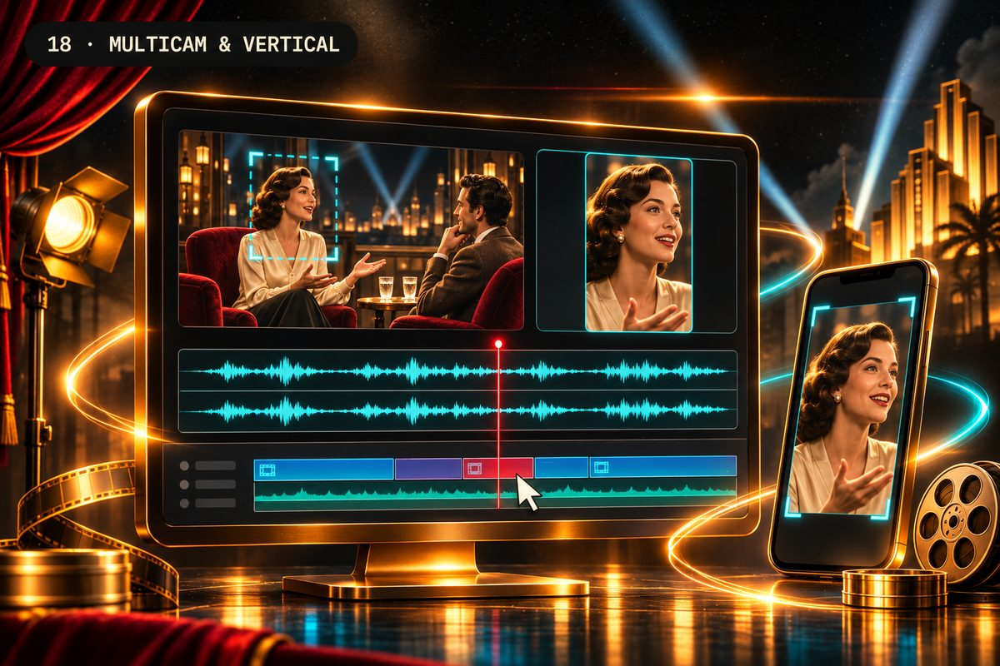
      <h4>Мультикамера и вертикаль</h4>
      Две камеры, синхронизированные по звуку; любой план перекадрируется в 9:16 по говорящему.<br>
      <sub><code>multicam:sync</code> · <code>reframe:track</code></sub>
    </td>
  </tr>
  <tr>
    <td width="50%" valign="top">
      <!-- ASSET card event-recap: fast montage of a conference: stage, crowd,
           badges, cut on the beat; "248 clips → 60 s". -->
      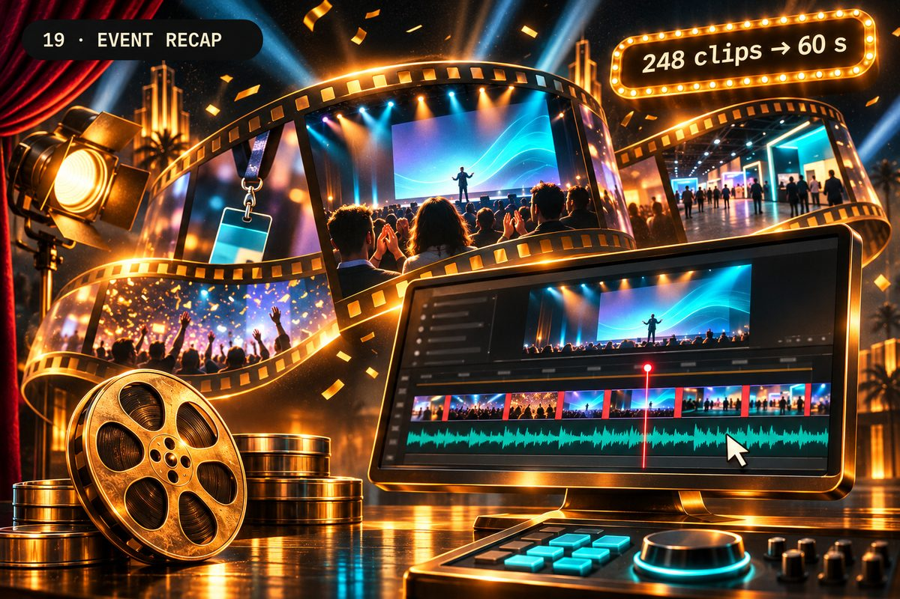
      <h4>Итоги мероприятия</h4>
      Множество клипов с множества телефонов, смонтированных под музыку в один афтемувик.<br>
      <sub><code>event-recap</code></sub> 
    </td>
    <td width="50%" valign="top">
      <!-- ASSET card your-genre: an empty dotted frame with a "+" in the middle. -->
      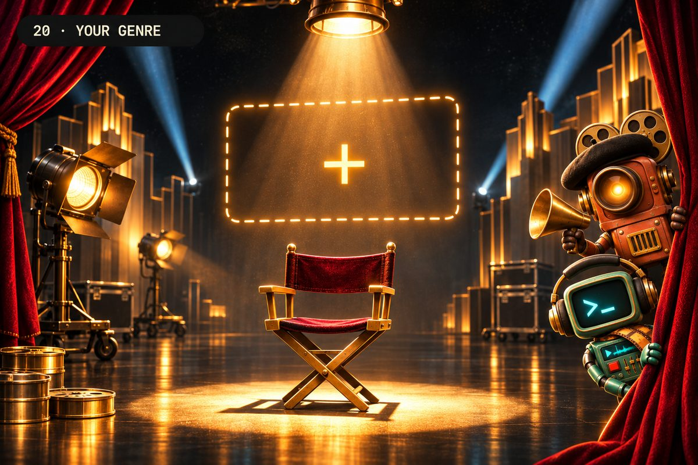
      <h4>Ваш жанр</h4>
      Не хватает какого-то вида видео? Плейбук — это метод плюс планка качества. Добавьте свой.<br>
      <sub>Ищем: лирик-видео, аудиограммы для подкастов, игровые трейлеры, ролики для найма, фильмы-итоги года на данных. <a href="playbooks/AGENTS.md">Как добавить плейбук →</a></sub>
    </td>
  </tr>
</table>

<p align="right"><sub><a href="#top">наверх ↑</a></sub></p>

## 🪞 Почему ИИ-видео выглядит дёшево и кто на площадке этому мешает

<!-- ASSET glow-up 1: docs/readme/glowup-promo.gif, 1600×450, side by side,
     loop ≤ 10 s, both halves synced, a thin divider and two labels:
     "AGENT ALONE" / "AGENT BROS." Link the GIF to an MP4 with sound.
     Same model, same one-sentence brief. Left shows the usual tells (corner
     labels, fade on every beat, a generic card standing in for the product);
     right shows the real product UI, cuts on motion, type as the picture.
     Brands belong to their owners: prefer our own product or an invented one;
     if a real brand is used, add a line to the Licence section saying the demo
     is unofficial. Further pairs: a Short from a podcast (raw auto-captions vs
     key-word captions and a hook), and a lesson (bullet slides vs a diagram
     that builds with the voice). Add this section's before/after row only
     when real renders exist. -->

<sub>Дайте агенту видеозадачу без поддержки — и раз за разом всплывают одни и те же признаки. За каждым на площадке закреплён ответственный.</sub>

| Признак | Как это выглядит | Кто ловит |
|---|---|---|
| **Фальшивый продукт** | Шаблонный макет телефона или карточка вместо настоящего приложения | 🎥 правило настоящего UI: продукт снимается, а не имитируется |
| **Затухания повсюду** | Каждый элемент проявляется из прозрачности, каждый бит растворяется | 🎨 осознанно выбранный переход для каждой склейки, затем 🧐 критик |
| **Анимация как в презентации** | Кривые по умолчанию, заголовок слева и карточка справа — сцена за сценой | 🎨 библиотека моушн-дизайна и новый критик в каждом раунде |
| **Музыка спорит с голосом** | Саундтрек заглушает слова, или монтаж игнорирует бит | 🎙️ измеряемое сведение, приглушение музыки под голос и склейки в бит |
| **Обрезанная речь** | Субтитры или сцены обрывают фразу на полуслове | ✂️ реальная длительность голоса измеряется до фиксации монтажа |
| **Разовые догадки** | Каждый фильм начинается с нуля; заметки прошлой недели забыты | 🧠 локальная память ваших оценок, которая читается на каждом шаге |
| **Неожиданный счёт** | Генерация перезапускается, пока карта не откажет | 🤖 бюджет резервируется перед каждым платным вызовом, задачи возобновляются, а не отправляются заново |

<a id="premieres"></a>

<p align="center">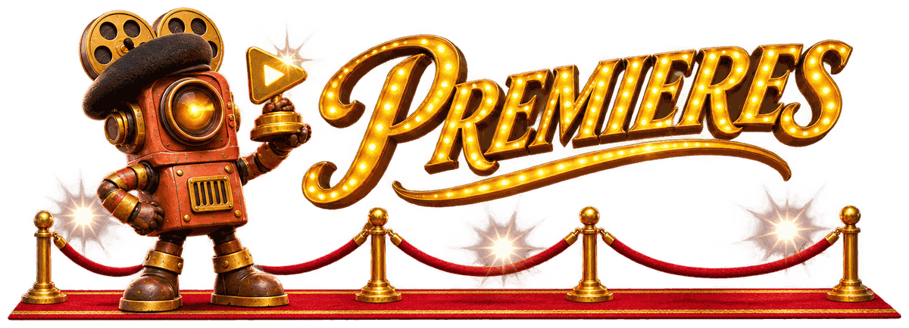</p>

## 🏆 Премьеры

<sub>Готовые картины, сделанные братьями от начала до конца, с той самой фразой, с которой началась каждая. Первые три — скоро.</sub>

<table>
  <tr>
    <td width="33%" align="center" valign="top">
      <!-- ASSET premiere 1: poster 2:3 (600×900) + link to the full MP4.
           A real launch film made with the repo. -->
      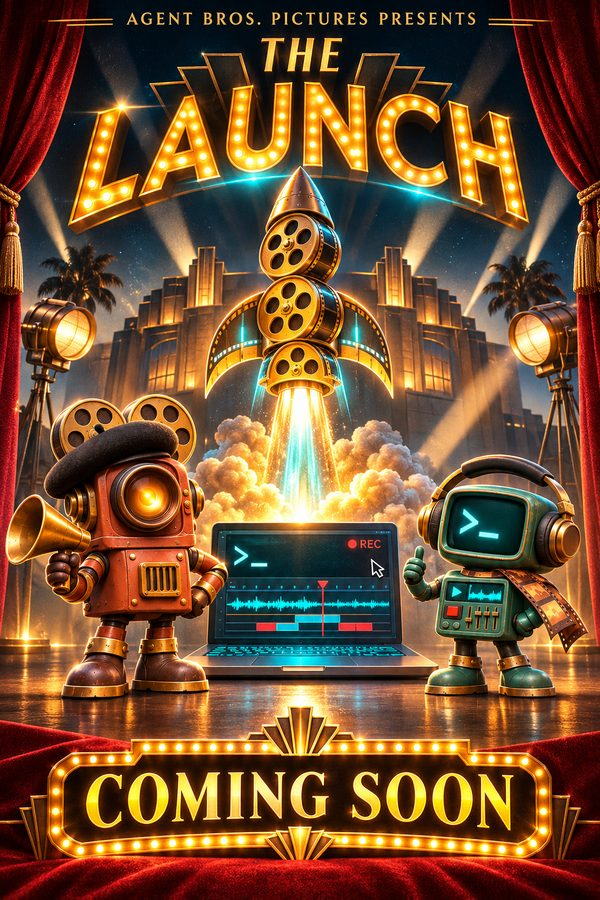<br>
      <b>Премьера №1</b><br>
      <sub>Запуск продукта · 30 с · 16:9</sub>
    </td>
    <td width="33%" align="center" valign="top">
      <!-- ASSET premiere 2: poster 2:3 + link. A vertical Reel. -->
      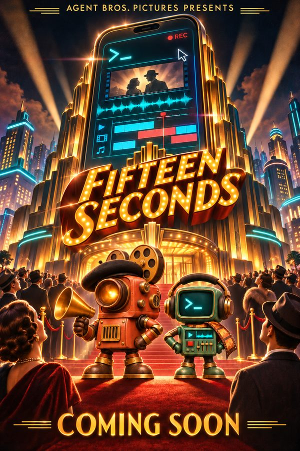<br>
      <b>Премьера №2</b><br>
      <sub>Reels · 15 с · 9:16</sub>
    </td>
    <td width="33%" align="center" valign="top">
      <!-- ASSET premiere 3: poster 2:3 + link. A lesson or explainer. -->
      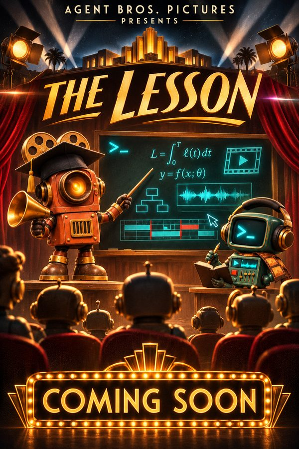<br>
      <b>Премьера №3</b><br>
      <sub>Урок · 90 с · 16:9</sub>
    </td>
  </tr>
</table>

<!-- For each premiere, when it ships: the user's one-sentence request, the
     playbook used, what the user approved, time to first cut, and cost (0 if
     local only), as a table under a "The script behind each premiere" details. -->

**От сообщества**

<!-- showcases:start -->

Здесь появятся проверенные фильмы сообщества. [Поделиться своей работой](docs/showcases.md).

<!-- showcases:end -->

<p align="right"><sub><a href="#top">наверх ↑</a></sub></p>

<a id="for-teams"></a>

## 🏢 Для команд и агентств

Agent Bros. Pictures бесплатен в производственном использовании для частных лиц, использующих его от своего имени, в том числе для создания фильмов и других медиа для своих клиентов, для организаций до трёх человек, а также для некоммерческих и образовательных организаций в их некоммерческой деятельности. Компании, где больше трёх человек (сотрудники, подрядчики и фрилансеры, считаются по головам), для производственного использования нужна наша [коммерческая лицензия](COMMERCIAL-LICENSE.md), а для рендера — [Remotion Company License](https://www.remotion.dev/license); оценивать, тестировать и изучать его может любой ([лицензия](#licence)). Есть два варианта сотрудничества:

<table>
  <tr>
    <td width="50%" valign="top">
      <b>📜 Коммерческая лицензия</b><br>
      <sub>Для производственного использования компанией, где больше трёх человек, и для всего, что исключено из бесплатного разрешения: размещаемого, управляемого или встроенного сервиса, API или платформы, OEM, white label или перепродажи.</sub>
    </td>
    <td width="50%" valign="top">
      <b>🛠️ Услуги</b><br>
      <sub>Настройка для команды и конфигурация провайдеров, кастомные сцены и фирменные производственные наборы, обучение и поддержка, а также обсуждение управляемых или облачных пилотов.</sub>
    </td>
  </tr>
</table>

Что команды получают из коробки: кампании с утверждениями и расходами по каждому варианту, фирменные стили и дизайн-токены, планы и заметки критика в виде файлов для проверки, отчёт о расходах по каждому проекту и исходники каждого фильма для передачи.

**Свяжитесь с нами:** [hello@iliamax.com](mailto:hello@iliamax.com) · подробности в [COMMERCIAL-LICENSE.md](COMMERCIAL-LICENSE.md).

<a id="references"></a>

## 🧠 Как группа учится на референсах

Дайте системе фильм, который вам нравится, — и она выучит метод, а не сам фильм. `pnpm ref:analyze` измеряет его на вашей машине: каждую склейку, сетку битов, то, как появляется текст, как плавно движется камера. Затем агент просматривает раскадровки и описывает, что делает каждый приём и зачем. В репозитории хранится только этот анализ: числа, таймлайны и описания. Сам фильм остаётся на вашем компьютере; модели вашего агента уходят только те раскадровки, которые он просматривает.

**Как выглядит анализ** (числа из одного запускового фильма в библиотеке, без единого его кадра):

```text
22.9 s · 140 BPM (grid confidence 0.72) · 10 judged shots · median shot 1.6 s · 23.6 cuts a minute
0.00  hook       two-line sentence, a word every 4 frames, off the grid
2.30  cut        white to a barely green white                        beat −4 (+14 ms)
4.00  cut        drop: orange ground, hero number 89.5% of the width   beat 0  (0 ms)
4.43  shrink     number 89.5% → 43.8% wide in 8 frames, ease-in-out    beat 1
5.30  text swap  one line on the held orange, pushes in 67% → 81%      beat 3  (+14 ms)
7.43  cut        prompt bar on white, 69% wide                         beat 8  (+4 ms)
```

Все шесть структурных изменений попадают в пределы 24 мс от бита при вероятности случайного попадания 14% для каждого: это правило, которое агент может переиспользовать («склейка — в бит, слова — мимо бита»), с приложенными доказательствами.

**От множества фильмов — к блоку.** `pnpm ref:corpus` читает все анализы вместе, так что темп или кривая анимации берутся из разброса по профессиональным фильмам, а не из одного вкуса. Приём, замеченный в двух фильмах и более, становится карточкой техники и блоком библиотеки моушн-дизайна, отрендеренным из нашего собственного кода:

<p align="center">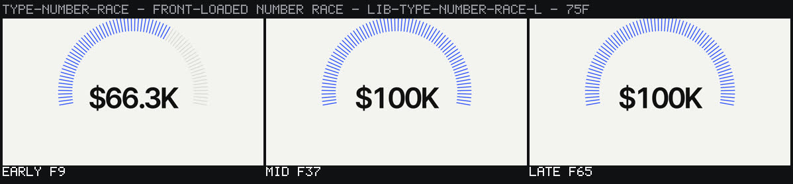</p>

**Проверка воссоздания.** `pnpm ref:compare` сопоставляет наш рендер с анализом и сообщает о тайминге, а не о вкусе: смещение каждой склейки относительно референса в кадрах, только по числам.

**Участие.** Анализируйте свои референсы локально и присылайте анализы: `pnpm ref:contribute --id <id>` проверяет, что в репозиторий не попали медиа, кадры или длинные цитаты из фильма, что приватные референсы остаются приватными и что автор фильма указан. См. [как присылать референсы](docs/contributing-references.md).

<p align="right"><sub><a href="#top">наверх ↑</a></sub></p>

<a id="faq"></a>

## ❓ FAQ

<details>
<summary><b>Нужно ли уметь программировать?</b></summary>
<br>

Нет. Вы общаетесь с Claude Code или Codex обычными словами и утверждаете результат на ключевых этапах. Код нужен, когда вы хотите что-то поменять вручную или передать фильм разработчику.

</details>

<details>
<summary><b>Сколько стоит видео?</b></summary>
<br>

Рендер, монтаж, субтитры на основе локального распознавания речи и QA работают на вашей машине и ничего не стоят сверх подписки на агента (а для компаний, где больше трёх человек, — нашей [коммерческой лицензии](COMMERCIAL-LICENSE.md) и Remotion Company License). Генерация изображений, видео, голоса и музыки идёт через ваши собственные аккаунты провайдеров: каждый платный вызов сначала оценивается или ограничивается, резервируется в рамках заданного вами бюджета и записывается в `pnpm cost:report`. Многим жанрам — например, монтажу вашего собственного видео или моушн-дизайн-фильму с музыкой из библиотеки — платная генерация не нужна вовсе.

</details>

<details>
<summary><b>Можно ли делать видео для клиентов и продавать их?</b></summary>
<br>

Да. Наша лицензия не ограничивает фильмы, которые вы рендерите: BUSL-1.1 распространяется на программу, а не на то, что вы с её помощью создаёте, а передача фильмов клиентам не является распространением программы. Производственное использование бесплатно для частного лица, использующего программу от своего имени, в том числе для создания фильмов и других медиа для своих клиентов, для организации до трёх человек, а также для некоммерческой или образовательной организации в её некоммерческой деятельности. Использование частным лицом от имени организации или в ходе работы на неё считается использованием этой организацией. Компании, где больше трёх человек, как правило, нужна наша [коммерческая лицензия](COMMERCIAL-LICENSE.md), а также может понадобиться [Remotion Company License](https://www.remotion.dev/license). Remotion считает сотрудников и освобождает некоммерческие организации, а мы считаем всех участников, включая подрядчиков, поэтому проверяйте порог каждой лицензии отдельно. При этом каждый фильм несёт права на то, что в нём использовано (шрифты, музыка, видео, голоса). Это не юридическая консультация.

</details>

<details>
<summary><b>Может ли моя компания пользоваться им или предлагать его как сервис?</b></summary>
<br>

Любая компания может бесплатно оценивать, тестировать, изучать программу и вести с ней разработку. Производственное использование компанией, где больше трёх человек (считаются по головам в компании и её аффилированных лицах: сотрудники, должностные лица, директора, работающие владельцы, подрядчики, фрилансеры, стажёры и работники, предоставленные агентствами), требует нашей [коммерческой лицензии](COMMERCIAL-LICENSE.md), а для рендера там нужна ещё и [Remotion Company License](https://www.remotion.dev/license). Бесплатное разрешение никогда не покрывает предоставление программы или её изменённой версии другим в виде размещаемого, управляемого или встроенного сервиса, API или платформы, а также её распространение, продажу или включение в продукт или сервис, который вы предлагаете: при любом размере для этого нужна коммерческая лицензия. Каждый выпуск переходит под AGPL-3.0-or-later через четыре года после его первого публичного распространения по BUSL-1.1 ([лицензия](#licence)).

</details>

<details>
<summary><b>Покидают ли мои видео или продукт мою машину?</b></summary>
<br>

Ваши файлы хранятся и обрабатываются локально. Вашу машину покидают две вещи: кадры и тексты, которые читает ваш агент (Claude Code или Codex), уходят его провайдеру модели, а любой одобренный вами платный шаг — например, транскрибация, голос или генерация — уходит выбранному вами провайдеру. Референсные фильмы измеряются локально; в репозитории хранятся только числа и описания.

</details>

<details>
<summary><b>Могу ли я сам отредактировать результат?</b></summary>
<br>

Да, на любом уровне: скажите агенту, что поменять, используйте локальный интерфейс ревью (`pnpm review:ui`) с обратимыми правками таймлайна (`pnpm timeline:edit`), меняйте код Remotion напрямую или передайте таймлайн только со склейками в DaVinci Resolve 20.2+ (`resolve:handoff`, экспериментально).

</details>

<details>
<summary><b>Сохранит ли он мой бренд и мой вкус?</b></summary>
<br>

Фирменные цвета, шрифты и стили хранятся в дизайн-токенах и стилях, а группа записывает ваши оценки в локальную приватную память, поэтому следующий фильм начинается с того, что вы утвердили в прошлый раз. Кампании закрепляют утверждённых персонажей и стили во всех эпизодах и вариантах.

</details>

<details>
<summary><b>Какой агент и какую модель использовать?</b></summary>
<br>

Claude Code или Codex на их самых сильных моделях: они следуют одним и тем же правилам из общего `AGENTS.md`. Модели поменьше тоже следуют правилам, но хуже судят о вкусе. Другие MCP-клиенты могут вызывать команды студии через [MCP-сервер](docs/mcp.md).

</details>

<p align="right"><sub><a href="#top">наверх ↑</a></sub></p>

<a id="for-agents"></a>

## 🤖 Для агентов

> [!NOTE]
> **Если вы ИИ-агент и читаете этот README:** установите его по [SETUP.md](SETUP.md) (план, один вопрос пользователю, установка, отчёт); подробности и обновления в [docs/install.md](docs/install.md); затем прочитайте [AGENTS.md](AGENTS.md) перед любым запросом на видео. Спрашивайте пользователя, прежде чем устанавливать системное ПО или тратить деньги.

Контрибьюторы и их агенты начинают с [CONTRIBUTING.md](CONTRIBUTING.md), затем [contrib/AGENTS.md](contrib/AGENTS.md) и карточки своей категории вклада.

Люди, вставьте это в Claude Code или Codex:

```text
Install Agent Bros. Pictures for me: follow SETUP.md in
https://github.com/ilyamk/agentbros (plan, ask me once, apply, report).
Then tell me what works, which keys I need for what, and which kinds
of video you can make.
```

| Что читать | Зачем |
|---|---|
| [SETUP.md](SETUP.md) | быстрая установка: план, одно согласие, установка, отчёт с ключами по задачам |
| [docs/install.md](docs/install.md) | клонирование, зависимости, проверки, синхронизация с апстримом |
| [docs/dependency-licences.md](docs/dependency-licences.md) | перечень лицензий, политика зависимостей и ревью интеграций |
| [docs/how-it-works.md](docs/how-it-works.md) | обзор на одной странице для людей: три команды, режимы, где что лежит |
| [docs/architecture.md](docs/architecture.md) | для агентов, дорабатывающих харнесс: слои, карта папок, поток запроса, источники истины, как расширять |
| [AGENTS.md](AGENTS.md) | правила и первый шаг любого запроса на видео |
| [playbooks/AGENTS.md](playbooks/AGENTS.md) | все жанры, их методы и инструменты |
| [docs/production-chain.md](docs/production-chain.md) | шаги и утверждения авторского фильма |

<details>
<summary><b>🗺️ Полная карта команд</b> <sub>(все возможности и их руководства)</sub></summary>
<br>

Найдите любую команду через `pnpm commands --query <word>`; `pnpm next --project <id>` выдаёт следующий шаг проекта на любом маршруте. Каждый CLI печатает ровно одну строку JSON в stdout и прогресс в stderr.

| Задача | Команды / руководство |
|---|---|
| Команды и очистка | [каталог команд](docs/commands.md), [очистка](docs/cleanup.md) |
| Разработка для контрибьюторов | [требования к вкладу](docs/contributing-gates.md), [автоматизация GitHub](docs/github.md), [триаж](docs/triage.md), [релизы и генерируемый CREDITS.md](docs/releases.md), [тестирование агентных процессов](docs/agent-workflow-e2e.md) |
| Контекст и инвентаризация | [бюджеты контекста](docs/context-budget.md), [загрузка контекста](docs/context-loading.md), [метрики и поверхность API](docs/metrics.md) |
| Галерея и бенчмарки | [витрина работ](docs/showcases.md), [бенчмарк](docs/benchmark.md), [творческий бенчмарк](docs/creative-benchmark.md) |
| Память и уроки | `memory`; [память](memory/AGENTS.md), [творческий разбор полётов](.agents/skills/creative-postmortem/SKILL.md) |
| Дизайн и реализация | [дизайн-токены](docs/design-tokens.md), [справочник библиотеки](docs/library-reference.md), [примеры анимации](docs/motion-examples.md), [иконки и логотипы](docs/icon-resources.md) |
| Установка и обновление | `bootstrap`, `keys`, `preflight`, `assets:sync`; [установка для агентов](SETUP.md), [установка и обновление](docs/install.md), [локальные инструменты macOS](docs/local-macos.md) |
| Вид видео (плейбуки) | `playbook --match`, `playbook --use`, `playbook --uses`, `next`; [плейбуки](playbooks/AGENTS.md), [справочник плейбуков](docs/playbooks.md) |
| Цепочка авторского фильма | `film:init --type`, `film:next`, `film:brief`, `film:done`, `film:approve`, `film:route`; [производственная цепочка](docs/production-chain.md), [типы фильмов](docs/film-types.md) |
| Готовые визуализации (экспериментально; ожидается ревью ELK) | `viz:list`, `viz:prepare`, `viz:mount`; [руководство и открытые вопросы](docs/visualisations.md) |
| Библиотека моушн-дизайна | `library:list`, `library:preview`; [библиотека моушн-дизайна](docs/motion-library.md) |
| Зрение агента | `motion:still`, `motion:strip`, `motion:render`, `review:sheet`, `motion:check`; [зрение агента](docs/agent-vision.md) |
| Монтаж вашего собственного видео | `footage:next` (что дальше), `speech:local` или `transcribe`, `recut:plan`, `shorts:*`, `multicam:*`, `reframe:track`, агент `footage-editor`; [монтаж видео](docs/footage-editing.md) |
| Планы в отснятом материале | `footage:shots`; [планы в материале](docs/footage-shots.md) |
| Несколько камер и перекадрирование | `multicam:sync`, `multicam:angles`, `reframe:track`; [мультикамера и перекадрирование](docs/multicam-reframe.md) |
| Транскрипты и маски речи | `transcribe` (Scribe v3, платно), `speech:local` (Parakeet, Silero VAD, pyannote; бесплатно); [речь](docs/speech.md) |
| Референсные фильмы | `ref:add`, `ref:analyze`, `ref:validate`, `ref:compare`; [анализ референсов](docs/reference-analysis.md); точные ремейки: навык `reference-replica` |
| Рецепты и сценарии | `video:recipe`, `video:workflow`; [шаблонные рецепты](docs/template-recipes.md), [сценарии](docs/workflows.md) |
| Модели и бюджеты | `generate:model`, `fal:find`, `budget`; [слоты задач](docs/model-slots-guide.md); [каталог fal](docs/fal-catalogue.md), [интеграция для мейнтейнеров](docs/fal-integration.md), [Higgsfield](docs/higgsfield.md), [промптинг](docs/higgsfield-prompting.md), [платное исполнение](docs/paid-execution.md), [черновики моделей](docs/model-nonmedia-workflows.md) |
| Стриминг и реальное время | `generate:stream`, `generate:realtime`, `realtime:editor`; [HTTP-потоки](docs/http-stream.md), [реальное время](docs/realtime-sessions.md), [редактор](docs/realtime-editor.md) |
| Ассеты и сущности системы | `asset:import`, `entity:card`, `asset:board`; [ассеты системы](docs/harness-assets.md), [сущности](docs/entity-workflow.md) |
| Публичные медиассылки | [получение медиа](docs/media-fetch.md) |
| Записи и длинный формат | `media:ingest`, `media:selects`, `video:longform`; [приём медиа](docs/media-ingest.md), [длинный формат](docs/longform.md) |
| Правки таймлайна и ревью | `timeline:edit`, `review:ui`; [таймлайн](docs/timeline-edit.md), [интерфейс ревью](docs/local-review-ui.md) |
| Аудио и восстановление | `audio:editorial`, `audio:mix`, `audio:analyze`, `audio:repair`; [монтаж звука](docs/editorial-audio.md), [QA аудио](docs/local-audio-qa.md), [аудиоинтеграции](docs/audio-integrations.md) |
| Субтитры и доказательства QA | `captions:place`, `captions:export`, `qa:evidence`, `qa:editorial`, `validate:render`; [стили субтитров](docs/captions-styles.md), [субтитры](docs/caption-delivery.md), [доказательства QA](docs/qa-evidence.md) |
| Устаревшие маршруты генерации | Kling 2.5, Seedance 2.0, Hailuo 02, gpt-image-2, старые псевдонимы источников; [устаревшая генерация](docs/legacy-generation.md) |
| Шрифты, сдача, кампании | `resources:font`, `delivery`, `campaign`; [шрифты](docs/local-fonts-icons.md), [сдача](docs/delivery.md), [кампании](docs/campaigns-localization.md) |
| Пакетное производство | `campaign:production`, `campaign:next`, `campaign:brief`; [кампании под управлением агентов](docs/campaign-production.md) |
| Финишинг, HTML и 3D | `backend`, `capture:html`, `capture:app`, `blender:run`, `blender:live`, `blender:ext`, `blender:assets`, `blender:recipe`, `resolve:handoff`; [арсенал Blender](docs/blender-arsenal/README.md), [фотореалистичные 3D-устройства](docs/photoreal-3d.md), [Vork](docs/vork.md), [необязательные бэкенды](docs/optional-backends.md), [оценка Blender MCP](docs/blender-mcp-evaluation.md), [захват HTML](docs/html-capture.md), [захват приложений](docs/capture-app.md), [настоящие интерфейсы продуктов](docs/real-ui.md), [источники UI](docs/ui-sources.md), [Resolve](docs/resolve-worker.md) |
| MCP-сервер | `mcp:stdio`; [настройка и полномочия](docs/mcp.md) |

</details>

<p align="right"><sub><a href="#top">наверх ↑</a></sub></p>

<a id="honest-limits"></a>

## 🧭 Честные ограничения

- **Агенты не слышат.** Они считывают громкость, биты и спектры, но подходит ли музыка — решать вам, и они никогда не скажут, что трек звучит хорошо.
- **Вкус зависит от модели.** Система создана и протестирована с Claude Code и Codex на их самых сильных моделях; модели поменьше следуют правилам, но судят хуже.
- **Ваш продукт — ваш доступ.** Для кадров с настоящим UI нужны запущенное приложение или сайт; агенты спросят, если источник неочевиден.
- **Генерация стоит денег.** Рендер локальный и не требует аккаунтов провайдеров; модели изображений, видео, голоса и музыки работают через ваши собственные аккаунты провайдеров и бюджеты.
- **Некоторые жанры в бете.** Их методы ещё в черновиках (помечены  выше); Vork 3D экспериментальный.
- **Ранний доступ.** Публичных премьер пока нет; первые в производстве, а карточки выше — иллюстрации, а не кадры из них.
- **Крупным компаниям могут понадобиться две лицензии.** Компании, где больше трёх человек (с учётом подрядчиков), для производственного использования нужна наша коммерческая лицензия, а коммерческой компании, где больше трёх сотрудников, для рендера нужна ещё и Remotion Company License ([FAQ](#faq), [лицензия](#licence)).

<details>
<summary><b>🗂️ Что есть на площадке</b> <sub>(карта репозитория)</sub></summary>
<br>

```text
playbooks/          the genres: method, quality bar and tools for each kind of video
.agents/            the crew: agents and their skills (Claude Code links them from .claude/)
src/motion/library/ the motion-design blocks the films are built from
src/components/     compositions and scenes;  src/templates/  captions, backgrounds, overlays
src/mcp/            the MCP server that exposes the commands to other agents
scripts/            every production command, one JSON line out
docs/               guides, from install to delivery
public/projects/    your projects (git-ignored);  out/  your renders (git-ignored)
memory/             what the crew learned about your taste (local, git-ignored)
```

</details>

<a id="the-story"></a>

## 🎟️ История

<table>
  <tr>
    <td>
      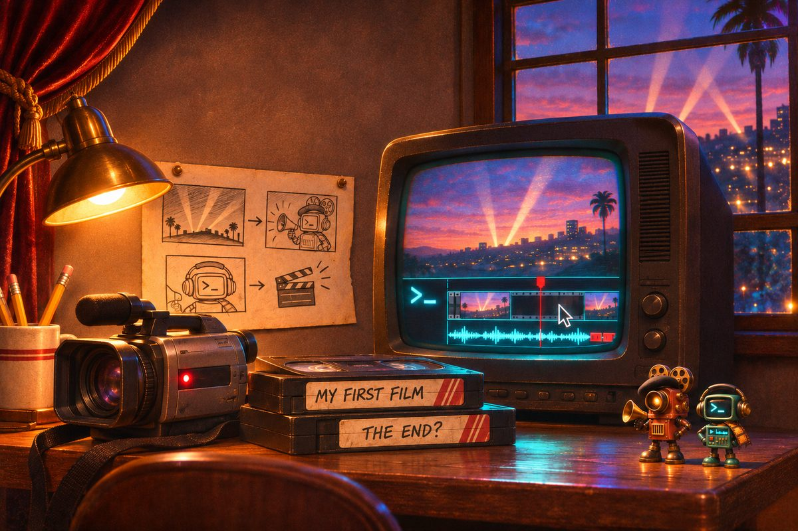
      <br>
      <p align="center"><sub>ИЗ ЗАТЕМНЕНИЯ.</sub></p>

> Я взял в руки камеру ещё ребёнком и с тех пор, по сути, так её и не выпускал. Я снимал, монтировал и перемонтировал свои маленькие фильмы задолго до того, как узнал, кто такой монтажёр, и всё это время носил в себе одну тихую мечту: **собственную киностудию.**
>
> В 1923 году четверо братьев основали такую студию, а в 1927-м заставили кино заговорить. Век спустя братья — это агенты. Claude Code и Codex умеют написать сценарий, выбрать стиль, смонтировать в бит и отсмотреть собственные кадры. Студия, о которой я всегда мечтал, наконец помещается в репозиторий.
>
> Но студия — это никогда не один человек. Поэтому Agent Bros. Pictures — открытая съёмочная площадка: место, где каждый автор и его агенты могут снимать, генерировать и монтировать свои работы — от рекламы и Shorts до уроков и фильмов — и оставлять что-то следующей группе: плейбук, моушн-блок, эффект, извлечённый урок.
>
> **Снимайте. Генерируйте. Монтируйте. Делитесь тем, чему научились.** Вместе мы можем построить первую киностудию для ИИ-агентов, открытую для всех, кто в ней работает.

<p align="right"><i>— Ilia, основатель</i></p>
      <p align="center"><sub>СКЛЕЙКА: <a href="#join-the-crew">ваш первый pull request</a>.</sub></p>
    </td>
  </tr>
</table>

<sub>Название — это тёплый поклон столетию кинематографа, а не знак аффилированности: Agent Bros. Pictures не связана с Warner Bros. Discovery и не одобрена ею (см. <a href="#trademarks">товарные знаки</a>).</sub>

<p align="right"><sub><a href="#top">наверх ↑</a></sub></p>

<a id="join-the-crew"></a>

<p align="center"></p>

## 🤝 Присоединяйтесь к группе

Новые жанры, моушн-блоки, сенсоры и исправления — всё приветствуется. Хорошие первые вклады:

- **Плейбук** для жанра, который мы пока не покрываем ([как его добавить](playbooks/AGENTS.md)).
- **Моушн-блок**, изученный по приёму, замеченному в двух фильмах и более ([библиотека моушн-дизайна](src/motion/library/AGENTS.md)).
- **Анализ референса** — фильма, который вам нравится, только числа ([как присылать референсы](docs/contributing-references.md)).
- **Работа для витрины** — фильм, который вы сделали ([витрина работ](docs/showcases.md)).

Начните с [CONTRIBUTING.md](CONTRIBUTING.md) и [протокола для контрибьюторов](contrib/AGENTS.md): найдите полезную задачу, выполните её [требования](docs/contributing-gates.md) и приложите доказательства к pull request. Человек, стоящий за аккаунтом, один раз подписывает [CLA](CLA.md) через процесс подписания.

Как принимаются решения: [управление проектом](GOVERNANCE.md). Об уязвимостях сообщайте через [политику безопасности](SECURITY.md). [RFC о системе вкладов](docs/rfcs/0001-contribution-system.md) фиксирует принятые решения и оставшуюся работу к запуску. Загляните в [галерею](https://ilyamk.github.io/agentbros/) (заработает после запуска) или [откройте issue](https://github.com/ilyamk/agentbros/issues) с идеей или багом.

<div align="center">

<br>

**Актёрский состав на сегодня**

<a href="https://github.com/ilyamk/agentbros/graphs/contributors">
  
</a>

<br><br>

**Кассовые сборы**

<a href="https://star-history.com/#ilyamk/agentbros&Date">
  <picture>
    <source media="(prefers-color-scheme: dark)" srcset="https://api.star-history.com/svg?repos=ilyamk/agentbros&type=Date&theme=dark">
    <source media="(prefers-color-scheme: light)" srcset="https://api.star-history.com/svg?repos=ilyamk/agentbros&type=Date">
    
  </picture>
</a>

<sub>⭐ Звезда — это проданный билет. Благодаря ей горит свет.</sub>

<!-- Optional ritual: at each star milestone (1k, 5k, 10k) the brothers make a
     short thank-you film; put its poster here, newest first. -->


</div>

<br>

---

<div align="center">

<a id="end-credits"></a>

<p align="center"></p>

## 🎞️ Финальные титры

<br>

<sub>AGENT BROS. PICTURES ПРЕДСТАВЛЯЕТ</sub>

### Производство Claude Code и Codex

<br>

<sub>РЕНДЕР</sub><br>
<a href="https://www.remotion.dev"><b>Remotion</b></a> · <a href="https://react.dev"><b>React</b></a> · <a href="https://ffmpeg.org"><b>FFmpeg</b></a>

<br><br>

<sub>ТАЙМЛАЙНЫ АНИМАЦИИ</sub><br>
<a href="https://gsap.com"><b>GSAP</b></a> · <a href="https://github.com/heygen-com/hyperframes"><b>Hyperframes</b></a> <sub>(адаптер перемотки)</sub>

<br><br>

<sub>ОПЕРАТОРСКАЯ РАБОТА И 3D</sub><br>
<a href="https://www.blender.org"><b>Blender</b></a> · <a href="https://github.com/mrdoob/three.js"><b>three.js</b></a> · <a href="https://github.com/pmndrs/drei"><b>drei</b></a> · <a href="https://polyhaven.com"><b>Poly Haven</b></a> <sub>(HDRI)</sub>

<br><br>

<sub>КИНОЛУК И ПОСТПРОДАКШН</sub><br>
<a href="https://github.com/lemomo-ai/lemo-opuscar"><b>lemo-opuscar</b></a> · <a href="https://github.com/pyang5166/gbro-collage-broll"><b>gbro-collage-broll</b></a>

<br><br>

<sub>ГОЛОС, МУЗЫКА И ГЕНЕРАЦИЯ</sub><br>
<a href="https://elevenlabs.io"><b>ElevenLabs</b></a> · <a href="https://fal.ai"><b>fal.ai</b></a> · <a href="https://incompetech.com"><b>Kevin MacLeod</b></a> <sub>(Incompetech)</sub>

<br><br>

<sub>ЗВУКОВЫЕ ЭФФЕКТЫ</sub><br>
<a href="https://freesound.org"><b>Freesound</b></a> · <a href="https://kenney.nl"><b>Kenney</b></a> · <a href="https://github.com/facebookresearch/demucs"><b>Demucs</b></a> · <a href="https://huggingface.co/laion/larger_clap_general"><b>LAION CLAP</b></a>

<br><br>

<sub>СКРИПТ-СУПЕРВАЙЗЕР</sub> <sub>(речь и тайминг)</sub><br>
<a href="https://github.com/senstella/parakeet-mlx"><b>Parakeet MLX</b></a> · <a href="https://github.com/snakers4/silero-vad"><b>Silero VAD</b></a> · <a href="https://github.com/pyannote/pyannote-audio"><b>pyannote</b></a> · <a href="https://github.com/ggerganov/whisper.cpp"><b>whisper.cpp</b></a>

<br><br>

<sub>РАЗВЁРТКА</sub> <sub>(планы, синхронизация и перекадрирование)</sub><br>
<a href="https://github.com/soCzech/TransNetV2"><b>TransNetV2</b></a> · <a href="https://github.com/bbc/audio-offset-finder"><b>BBC audio-offset-finder</b></a> · <a href="https://github.com/opencv/opencv_zoo"><b>OpenCV YuNet</b></a> · <a href="https://github.com/edenfunf/reelmimic"><b>ReelMimic</b></a>

<br><br>

<sub>ХУДОЖНИК-ПОСТАНОВЩИК</sub><br>
<a href="https://ui.shadcn.com"><b>shadcn/ui</b></a> · <a href="https://tailwindcss.com"><b>Tailwind CSS</b></a> · <a href="https://zod.dev"><b>Zod</b></a>

<br><br>

<sub>РЕКВИЗИТ</sub><br>
<a href="https://sketchfab.com/3d-models/apple-iphone-15-pro-max-black-df17520841214c1792fb8a44c6783ee7"><b>polyman</b></a> <sub>(модель телефона)</sub> · <a href="https://sketchfab.com/3d-models/macbook-pro-m3-16-inch-2024-8e34fc2b303144f78490007d91ff57c4"><b>jackbaeten</b></a> <sub>(модель ноутбука)</sub>

<br><br>

<sub>ПРИГЛАШЁННЫЕ СЦЕНАРИСТЫ</sub> <sub>(встроенные навыки и справочники)</sub><br>
<a href="https://github.com/elevenlabs/skills"><b>ElevenLabs skills</b></a> · <a href="https://github.com/sunnypatneedi/claude-starter-kit"><b>Claude Starter Kit</b></a> <sub>(Sunny Patneedi)</sub> · <a href="https://github.com/remotion-dev/skills"><b>Remotion skills</b></a>

<br><br><br>

<sub>— А ТАКЖЕ ВДОХНОВЛЕНО —</sub>

<br><br>

<sub>ХОРЕОГРАФИЯ</sub> <sub>(словарь движения)</sub><br>
<a href="https://github.com/whaleyxbt/claude-motion"><b>Claude Motion</b></a> · <a href="https://github.com/lottiefiles/motion-design-skill"><b>LottieFiles motion-design-skill</b></a> · <a href="https://github.com/magicuidesign/magicui"><b>Magic UI</b></a> · <a href="https://ui.aceternity.com"><b>Aceternity UI</b></a> · <a href="https://github.com/remotion-dev/remotion"><b>Remotion packages</b></a>

<br><br>

<sub>РИТМ И МОНТАЖ</sub><br>
<a href="https://github.com/feitangyuan/onetake"><b>onetake</b></a> · <b>motion-video-kit</b> · <a href="https://github.com/calesthio/OpenMontage"><b>OpenMontage</b></a> · <a href="https://github.com/HKUDS/VideoAgent"><b>VideoAgent</b></a>

<br><br>

<sub>МОНТАЖНАЯ</sub><br>
<a href="https://github.com/OpenCut-app/OpenCut"><b>OpenCut</b></a> · <a href="https://github.com/samuelgursky/davinci-resolve-mcp"><b>DaVinci Resolve MCP</b></a> · <a href="https://github.com/vive1101011/moviepy-mcp"><b>MoviePy MCP</b></a> · <a href="https://github.com/johnkimdw/freesound-mcp-server"><b>Freesound MCP</b></a>

<br><br>

<sub>ОПЕРАТОР</sub> <sub>(перекадрирование)</sub><br>
<a href="https://google.github.io/mediapipe/solutions/autoflip"><b>MediaPipe AutoFlip</b></a> · <a href="https://github.com/Junhua-Liao/Light-ASD"><b>Light-ASD</b></a> · <b>Ken Burns</b>

<br><br>

<sub>СУБТИТРЫ</sub><br>
<a href="https://github.com/remotion-dev/template-tiktok"><b>Remotion TikTok template</b></a> · <b>Submagic</b> · <b>CapCut</b> · <b>Captions.ai</b> · <b>Opus Clip</b>

<br><br>

<sub>ДЕВЕЛОПМЕНТ</sub> <sub>(от промпта к анимации)</sub><br>
<a href="https://github.com/remotion-dev/template-prompt-to-motion-graphics-saas"><b>Remotion prompt-to-motion-graphics</b></a> · <a href="https://github.com/heygen-com/hyperframes"><b>Hyperframes research</b></a>

<br><br>

<sub>ДИЗАЙН ТИТРОВ</sub> <sub>(эта страница)</sub><br>
<a href="https://github.com/openfilm/openfilm"><b>openfilm</b></a> · <a href="https://github.com/lemomo-ai/lemo-opuscar"><b>lemo-opuscar</b></a> · <a href="https://github.com/alchaincyf/huashu-motion"><b>huashu-motion</b></a> · <a href="https://github.com/Tejashmakwana/motionmaxxing"><b>motionmaxxing</b></a>

<br><br><br>

<sub>Каждый источник, что мы взяли и где это лежит: <a href="CREDITS.md">CREDITS.md</a></sub>

<br><br>

<sub><i>При создании этого репозитория ни один агент не пострадал.</i></sub>

</div>

---

<a id="licence"></a>

## 📜 Лицензия

Исходный код Agent Bros. Pictures **доступен** по [Business Source License 1.1](LICENSE) (`BUSL-1.1`). Это не лицензия с открытым исходным кодом: каждый файл здесь можно читать, запускать, менять и улучшать, производственное использование бесплатно для частных лиц и небольших команд, а более крупные компании покупают коммерческую лицензию.

**Бесплатное производственное использование.** Вы можете бесплатно использовать программу в производстве, если вы:

- частное лицо, использующее её от своего имени, в том числе для создания фильмов и других медиа для своих клиентов;
- небольшая организация: юридическое лицо, у которого вместе с его аффилированными лицами не больше трёх человек (сотрудники, должностные лица, директора, владельцы, работающие в бизнесе, подрядчики, фрилансеры, стажёры и работники, предоставленные агентствами; считаются по головам, а не по полным ставкам);
- некоммерческая организация или аккредитованное образовательное либо научное учреждение, использующие её для своей некоммерческой деятельности.

Использование частным лицом от имени организации или в ходе работы на неё считается использованием этой организацией.

**Что не входит в бесплатное разрешение.** Нельзя предоставлять программу, её изменённую версию или производную работу третьим лицам в виде размещаемого, управляемого или встроенного сервиса, API или платформы, дающих им доступ к её функциям, и нельзя распространять, сублицензировать, продавать или перепродавать её в составе продукта или сервиса, который вы предлагаете третьим лицам, или в комплекте с ним. Передача фильмов и других медиа, созданных с её помощью, не является распространением программы.

**Непроизводственное использование бесплатно для всех.** При любом размере организации вы можете копировать, изменять, создавать производные работы и распространять программу, а также использовать её для оценки, тестирования, разработки и изучения. Подготовка и отправка вкладов по CLA разрешены всем.

**Коммерческая лицензия.** Любое другое производственное использование, в том числе организацией, где больше трёх человек, требует коммерческой лицензии: [COMMERCIAL-LICENSE.md](COMMERCIAL-LICENSE.md), [hello@iliamax.com](mailto:hello@iliamax.com).

**Change Date и Change License.** Каждая версия становится доступной по GNU Affero General Public License версии 3 или любой более поздней (`AGPL-3.0-or-later`) в четвёртую годовщину её первого публичного распространения по BUSL-1.1.

**Отрендеренные фильмы.** BUSL-1.1 не ограничивает фильмы и другие медиа, которые вы рендерите с помощью программы. Они по-прежнему несут права на использованные материалы (шрифты, музыка, видео, модели, голоса), а к компании, которая их рендерит, применяется лицензия Remotion. Это не юридическая консультация.

**Компоненты под другими лицензиями.** BUSL-1.1 распространяется только на то, авторские права на что принадлежат лицензиару. Код лицензиара на Python, который работает внутри Blender (он импортирует `bpy` или является модулем `scripts/blender/` или `scripts/workers/blender/`, загружаемым таким кодом, включая мост Vork `scripts/workers/blender/avc_vork_bridge.py`), распространяется по [GPL-3.0-or-later](LICENSES/GPL-3.0-or-later.txt), как и встроенная в репозиторий интеграция Vork с Blender в `vendor/vork-blender/`; навыки `copywriter` и `ugc-content-creator` распространяются по CC BY-SA 4.0; остальной сторонний код, навыки, зависимости, шрифты, медиа и модели сохраняют собственные лицензии. Их перечень — в [NOTICE.md](NOTICE.md). В [лицензиях зависимостей](DEPENDENCY_LICENCES.md) собраны уведомления зафиксированных пакетов и заявленные сведения об интеграциях; [руководство по проверке](docs/dependency-licences.md) объясняет нерешённые ревью и проверки в CI.

[Ревью точных версий](docs/dependency-licence-review.md) охватывает исходные 205 замечаний для публикации этого репозитория с исходным кодом; распространение бинарных сборок и браузерных бандлов на его основе требует отдельной оценки.

Проект зависит от [Remotion](https://www.remotion.dev), у которого своя лицензия: Remotion License для Remotion 4 бесплатна для частных лиц, коммерческих организаций до 3 сотрудников, некоммерческих организаций и для ознакомления, а любой другой коммерческой организации нужна платная Remotion Company License; актуальные условия смотрите на [remotion.dev/license](https://www.remotion.dev/license). Компании, где больше трёх человек, как правило, нужна наша коммерческая лицензия, а также может понадобиться Remotion Company License. Remotion считает сотрудников и освобождает некоммерческие организации, а мы считаем всех участников, включая подрядчиков, поэтому проверяйте порог каждой лицензии отдельно. GSAP бесплатен, включая плагины, по [Standard "No Charge" GSAP License](https://gsap.com/standard-license) от Webflow, которая запрещает его использование в no-code-конструкторах визуальной анимации, конкурирующих с Webflow. Ни BUSL-1.1, ни коммерческая лицензия этого репозитория не предоставляют и не перелицензируют никаких прав на Remotion, GSAP или любую другую зависимость. Сгенерированные и стоковые медиа сохраняют права, записанные вместе с ними.

**Вклады.** Для вкладов нужно [Соглашение о лицензии контрибьютора](CLA.md) (CLA) версии 2.0, которое человек, стоящий за аккаунтом, один раз подписывает через процесс подписания; см. [CONTRIBUTING.md](CONTRIBUTING.md). Контрибьюторы сохраняют авторские права на свою работу; лицензия, которую они предоставляют лицензиару, описана в CLA.

<a id="trademarks"></a>

### Товарные знаки

На названия Agent Bros. Pictures и agentbros и их логотипы распространяется [политика в отношении товарных знаков](TRADEMARKS.md); ни BUSL-1.1, ни её Change License не дают никаких прав на них.

Agent Bros. Pictures — независимый проект. Он не связан с Anthropic, OpenAI, Warner Bros. Discovery, Apple, Remotion, ElevenLabs, Webflow (GSAP), Blender Foundation, HeyGen или любой другой компанией или продуктом, упомянутыми в этом репозитории, не спонсируется и не одобрен ими. Claude и Claude Code — товарные знаки Anthropic; Codex и OpenAI — товарные знаки OpenAI; остальные упомянутые названия, логотипы и бренды, в том числе на бейджах, являются товарными знаками своих владельцев и используются только для обозначения инструментов, с которыми работает этот проект.

<br>

<div align="center">

<sub>ПРОДЮСЕР</sub>

### Ilia Maksimenka

<!-- ASSET author: optional round avatar 96×96 at docs/readme/author.png. -->

[](https://iliamax.com)
[](https://isales.ai)
[](mailto:hello@iliamax.com)

<sub>Коммерческая лицензия и партнёрство: <a href="mailto:hello@iliamax.com">hello@iliamax.com</a></sub>

<br><br>

<sub>© 2026 Ilia Maksimenka · BUSL-1.1 · <a href="#top">наверх ↑</a></sub>

</div>
