<!--
  ════════════════════════════════════════════════════════════════════════
  Agent Bros. Pictures — README as a landing page.
  Images live in docs/readme/ (prompts: docs/readme/PROMPTS.md). They are
  illustrations; replace a card or the hero with a GIF of a real render when
  one exists (GIF ≤ 4 MB, or an MP4 uploaded to a GitHub issue and linked).
  Remaining "ASSET" comments are briefs for visuals that must be real renders.
  Counts live only in the generated metrics table (pnpm metrics); keep prose
  free of block, agent and genre totals so they cannot drift. Exception: the
  rounded catalogue floors in "The casting office" (1,500+ endpoints, 400+
  families; src/lib/models/fal-catalog + hf-catalog) and the ~40 documented
  platforms in "The source room" (pnpm media:fetch --capabilities); recheck
  both after a catalogue refresh. Name only models present in the catalogues.
  Repo slug used by the clone commands, live badges, star chart and
  contributors image: ilyamk/agentbros.
  ════════════════════════════════════════════════════════════════════════
-->

<a id="top"></a>

<p align="center">
  <a href="README.md">🇬🇧 English</a> · <a href="README_ru.md">🇷🇺 Русский</a> · <a href="README_zh.md">🇨🇳 简体中文</a>
</p>

<div align="center">

<!-- Logo and every image below: prompts in docs/readme/PROMPTS.md. -->
<picture>
  <source media="(prefers-color-scheme: dark)" srcset="docs/readme/logo-dark.png">
  <source media="(prefers-color-scheme: light)" srcset="docs/readme/logo-light.png">
  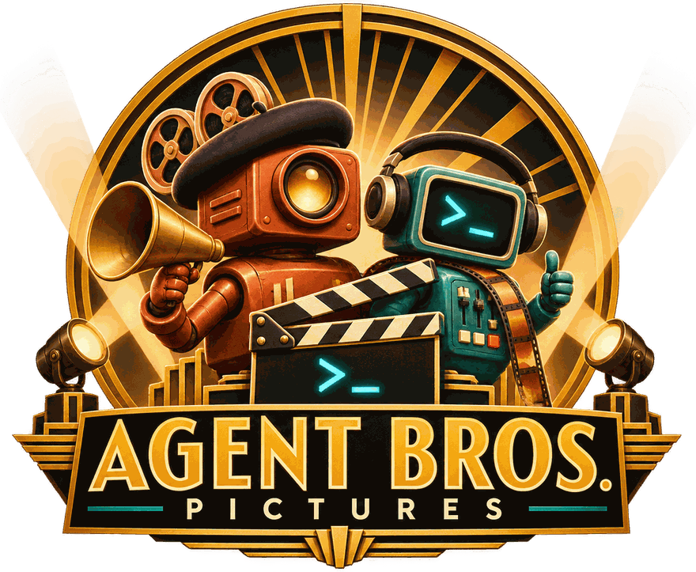
</picture>

# Agent Bros. Pictures

**The Creative Intelligence Harness for Your AI Agents**

### 一家由两位智能体兄弟 Claude Code 与 Codex 经营的源码可用（source-available）视频工作室。

一句话说出你的需求，拿到成片，以及生成它的全部代码。<br>
从 15 秒的 Reel 到发布宣传片、教程、课程，乃至一整套营销活动。

<br>

[](https://github.com/ilyamk/agentbros/stargazers)
[](AGENTS.md)
[](AGENTS.md)
[](docs/mcp.md)

[](https://www.remotion.dev)
[](https://react.dev)
[](tsconfig.json)
[](#licence)
[](#join-the-crew)
[](#honest-limits)

[](https://scorecard.dev/viewer/?uri=github.com/ilyamk/agentbros)
[](https://github.com/ilyamk/agentbros/actions/workflows/codeql.yml)
<!-- OpenSSF Best Practices badge: add after registering on bestpractices.dev (docs/github.md, step 5). -->

<br>

[**快速开始**](#quick-start) &nbsp;·&nbsp;
[**适合谁**](#who-its-for) &nbsp;·&nbsp;
[**工作室**](#the-studio) &nbsp;·&nbsp;
[**模型**](#models) &nbsp;·&nbsp;
[**正在上映**](#now-showing) &nbsp;·&nbsp;
[**团队方案**](#for-teams) &nbsp;·&nbsp;
[**常见问题**](#faq) &nbsp;·&nbsp;
[**致智能体**](#for-agents) &nbsp;·&nbsp;
[**缘起**](#the-story)

<br>

<!-- hero.jpg is an illustration; replace it with the studio's own trailer GIF
     (made with this repository, linked to the MP4 with sound) when it exists. -->
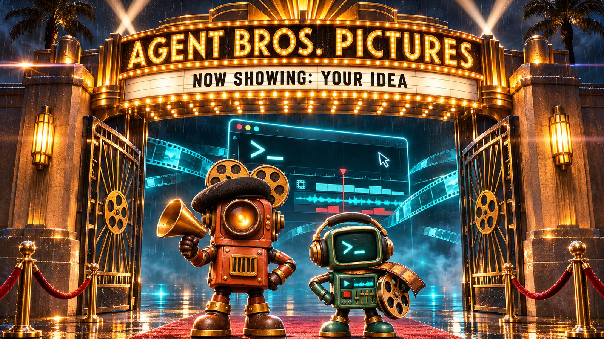

<br><br>

<!-- metrics:start -->
<table>
  <tr>
    <td align="center" width="20%"><h2>23</h2><sub>种视频类型<br>（17 种已就绪）</sub></td>
    <td align="center" width="20%"><h2>136</h2><sub>个动效设计<br>模块（101 个已验证）</sub></td>
    <td align="center" width="20%"><h2>27</h2><sub>位剧组智能体<br>在片场待命</sub></td>
    <td align="center" width="20%"><h2>3</h2><sub>种画幅<br>9:16 · 1:1 · 16:9</sub></td>
    <td align="center" width="20%"><h2>0</h2><sub>渲染所需的<br>API 密钥</sub></td>
  </tr>
</table>
<!-- metrics:end -->

<br>

[**⚡ 制作你的第一支视频**](#quick-start) &nbsp;&nbsp;·&nbsp;&nbsp; [**🏢 为团队或代理公司使用？**](#for-teams) &nbsp;&nbsp;·&nbsp;&nbsp; [**🤖 智能体：安装**](SETUP.md)

</div>

<br>

> [!TIP]
> **你的第一条镜头：** 在 Claude Code 或 Codex 中打开本仓库，然后说
> *“为我的 App 做一支 20 秒的竖屏广告，这是落地页。”*
> 兄弟俩会完成策划、用代码搭建、在本地渲染、亲自审看每一帧，再把成片拿给你看。

## 📽️ 工作原理

**1 · 一句话说清楚。** 用你自己的话，向 Claude Code 或 Codex 要任何视频：

> 为我的 App 做一支 **30 秒的发布宣传片**。这是网站，请使用它的真实界面。

> 从我的播客录音里剪出 **五条 Shorts**，配上关键词字幕。

> 做一节 **90 秒的课程**，讲讲复利是怎么回事，配一个沉稳的声音。

> 这是我们的 **产品 CSV**：每个商品一支 15 秒竖屏视频，价格取自表格。

**2 · 只需审批，无需事无巨细。** 智能体负责选定类型、撰写策略和脚本、挑选音乐并提出视觉风格。你只需批准创意、风格、音乐和终剪；没有你设定的预算，任何付费操作都不会运行。

**3 · 拿到成片，也拿到源码。** 一支 9:16、1:1 或 16:9 的渲染视频，外加生成它的一切：

| 你得到的 | 它是什么 |
|---|---|
| `out/<project>/…mp4` | 每种画幅的成片，外加一版字幕独立成层的干净版本 |
| `src/projects/<project>/` | 以可编辑 Remotion 代码形式存在的定制影片；改一行，重新渲染即可 |
| `public/projects/<project>/pipeline/` | 策略、脚本、视觉风格、动效方案和评审意见，均为可审阅的文件 |
| `pnpm cost:report --project <project>` | 每一次付费调用的报价、预留额度和结果 |

## 💎 为什么选择 Agent Bros.

<table>
  <tr>
    <td width="33%" valign="top">🧾 <b>是源码，不是黑盒</b><br><sub>每部影片都是你拥有的源码：代码、方案和时间线。改一个词、一种颜色或一个剪辑点，重新渲染即可；无需反复重新生成、听天由命。</sub></td>
    <td width="33%" valign="top">🎯 <b>你的真实产品</b><br><sub>你的 App 或网站会被实时捕获，绝不用千篇一律的手机样机来冒充（<a href="docs/real-ui.md">真实界面</a>）。</sub></td>
    <td width="33%" valign="top">🧐 <b>会自我审查的剧组</b><br><sub>每一轮都有一位全新的严苛评审，并在你看到成片前完成动效、同步、响度和交付的量化检查。</sub></td>
  </tr>
  <tr>
    <td valign="top">🔒 <b>本地优先</b><br><sub>渲染、剪辑和测试都在你的机器上运行，无需任何密钥。你的素材在本地存储和处理；智能体所用的模型只会看到它读取的画面帧和文本。</sub></td>
    <td valign="top">💸 <b>预算可控，没有意外</b><br><sub>付费生成在运行前都会先报价或设定上限，从你的额度中预留并记录在案（<a href="docs/paid-execution.md">付费执行</a>）。</sub></td>
    <td valign="top">🧠 <b>学习你的品味</b><br><sub>你的评价会成为本地记忆：下一部影片会延续你的偏好，避开上次的失误（<a href="memory/AGENTS.md">记忆</a>）。</sub></td>
  </tr>
  <tr>
    <td valign="top">🤖 <b>众多模型，一个窗口</b><br><sub>1,500+ 个图像、视频、语音、音乐和 3D 模型端点，按任务和价格挑选（<a href="#models">选角办公室</a>）。</sub></td>
    <td valign="top">🎛️ <b>融入你的工具链</b><br><sub>本地审阅界面、可撤销的时间线编辑、仅含剪辑的 DaVinci Resolve 交接，以及供其他智能体使用的 <a href="docs/mcp.md">MCP 服务器</a>。</sub></td>
    <td valign="top">🌍 <b>可读可共享</b><br><sub>每一种类型、每一个模块、每一条沉淀下来的经验都是文件，你可以阅读，下一个剧组可以继续改进。依据 BUSL-1.1 源码可用：个人、不超过三人的组织、非营利组织和教育机构免费使用；规模更大的公司需购买<a href="#for-teams">商业许可</a>。每个版本在四年后转为 AGPL-3.0-or-later。</sub></td>
  </tr>
</table>

## 🆕 剪辑室新鲜出炉

<!-- Keep the three newest user-facing items, dated, each linking to what changed. -->

- **2026-11-16** · 营销活动：一份简报变成许多可追溯的视频，支持 A/B 开头、每个目录条目一支视频、月度系列和多语言版本。[活动制作 →](docs/campaign-production.md)
- **2026-11-16** · Vork 加入 Blender 的行列，成为可编程 3D 镜头与特效的本地 GPU 渲染器（实验性）。[Vork →](docs/vork.md)
- **2026-11-15** · 数十个从参考影片中研习而来的新动效模块：印刷字体、跑马灯行、噪点遮罩转场、液态光、界面标注。[浏览动效库 →](docs/motion-library.md)

<a id="who-its-for"></a>

## 👥 适合谁

| 你是 | 你可以要 | 从这里开始 |
|---|---|---|
| **产品团队或创始人** | 发布宣传片、功能更新、App Store 预览视频、基于真实界面的教程 | `product-promo` · `feature-update` · `app-store-preview` · `product-tutorial` · `teaser-trailer` |
| **效果营销人员或电商店铺** | 待测试的开头变体、每个商品一支视频、达人风格广告 | `ad-experiments` · `catalogue-videos` · `ugc-ad` · `reference-family` |
| **创作者或播客主** | 从长录音中剪出 Shorts、更紧凑的演讲、字幕、双机位同步、固定主持人的月度系列 | `shorts-from-long` · `footage-edit` · `content-series` · `captions:place` |
| **教师或课程作者** | 图示随讲解同步演进的课程、长讲座的章节划分 | `explainer` · `product-tutorial` · `video:longform` |
| **代理公司或工作室** | 跨品牌、跨语言、统一风格的营销活动，并可交付源码 | `localise-campaign` · `reference-family` · [团队方案](#for-teams) |
| **电影人或动效设计师** | 基于已批准关键帧的氛围短片、动态字体、3D 镜头、仿照你欣赏的影片风格的作品 | `ai-film` · `motion-design` · `video-remix` · `blender:run` · [参考影片](#references) |

<p align="right"><sub><a href="#top">返回顶部 ↑</a></sub></p>

<a id="quick-start"></a>

## ⚡ 快速开始

**方式 1 · 告诉你的智能体** <sub>（推荐）</sub>

```text
Install Agent Bros. Pictures from github.com/ilyamk/agentbros: follow its
SETUP.md, then tell me what works and which keys I need.
```

**方式 2 · 两行命令**

```bash
git clone https://github.com/ilyamk/agentbros.git && cd agentbros
./setup.sh --apply --smoke   # Windows: ./setup.ps1 -Apply -Smoke
```

只运行 `./setup.sh` 只会生成计划。`--apply` 会安装本文件夹中缺少的内容，并通过你自己的版本管理器安装 Node、pnpm 和 uv；只有加上 `--system` 才会安装系统软件包（Homebrew、apt、winget）。最后生成 `out/setup/REPORT.md`：哪些功能已可用、本机的限制，以及各个密钥能解锁什么。不用脚本：`nvm install && nvm use`，然后 `npm install --global pnpm@12.11.2 --allow-scripts=pnpm && pnpm install --frozen-lockfile && pnpm preflight`。

然后在 **Claude Code** 或 **Codex** 中打开该文件夹，提出你想要的视频。就这么简单。

<details>
<summary><b>你需要准备什么</b></summary>
<br>

Node 26（推荐 26.13.1，已通过 CI 测试；Node 24 也可使用，已在 24.22.3 上测试）、锁定版本的 pnpm、FFmpeg 和 uv；安装指南提供了 macOS、Debian/Ubuntu 和 Windows 的步骤。Chromium 由 Remotion 自动下载。Blender、Vork、DaVinci Resolve 和各服务商密钥均为可选；`pnpm preflight` 会告诉你缺少什么以及如何安装。各操作系统的完整列表：[安装指南](docs/install.md)；[Node 策略](docs/node-runtime.md)；[Python 3.12 与 uv](docs/python-runtime.md)。

其他智能体可以通过本地 [MCP 服务器](docs/mcp.md)（`pnpm mcp:stdio`）驱动工作室；除非你以 `--allow-paid` 启动它，否则不会运行任何付费工具，即便如此，生成操作默认也只是试运行。

可选：Remotion 官方的智能体技能 `remotion-best-practices` 未随附（其上游未授予再分发许可）；请用 `npx skills add remotion-dev/skills` 从上游安装（[第三方技能](.agents/skills/THIRD_PARTY.md)）。

</details>

前置条件、密钥、离线的第一支视频以及更新方式：**[安装指南](docs/install.md)**。面向普通读者的一页导览：**[工作原理](docs/how-it-works.md)**。

<p align="right"><sub><a href="#top">返回顶部 ↑</a></sub></p>

<a id="the-studio"></a>

<p align="center">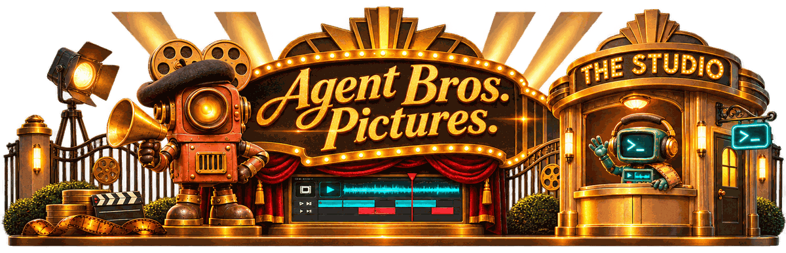</p>

## 🎬 工作室

<sub>真实制作中的每个部门，全部由智能体担任。每个部门都是一条返回 JSON 的命令，因此剧组可以检查自己的工作。</sub>

<table>
  <tr>
    <td align="center" width="25%" valign="top">
      <br>
      <b>编剧室</b><br>
      <sub>策略、开头钩子、来自竞争团队的创意、盲评选出的脚本。</sub><br><br>
      <code>film:brief</code>
    </td>
    <td align="center" width="25%" valign="top">
      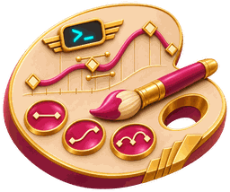<br>
      <b>美术部</b><br>
      <sub>动效设计库、现成的视觉风格，以及由真实代码渲染的风格帧。</sub><br><br>
      <code>library:list</code>
    </td>
    <td align="center" width="25%" valign="top">
      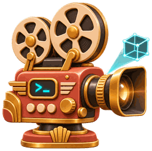<br>
      <b>摄影与 3D</b><br>
      <sub>Blender、Vork、three.js，以及实时捕获的你的产品真实界面。</sub><br><br>
      <code>capture:app</code>
    </td>
    <td align="center" width="25%" valign="top">
      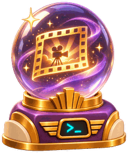<br>
      <b>生成</b><br>
      <sub>图像与视频模型，配有持久化任务和预算检查。</sub><br><br>
      <code>generate:video</code>
    </td>
  </tr>
  <tr>
    <td align="center" valign="top">
      <br>
      <b>配音与音乐</b><br>
      <sub>旁白、配乐、160+ 种音效，剪辑点卡在节拍上。</sub><br><br>
      <code>audio:mix</code>
    </td>
    <td align="center" valign="top">
      <br>
      <b>剪辑室</b><br>
      <sub>剪掉静音、口头禅和说错的开头；多机位；竖屏重构图。</sub><br><br>
      <code>recut:plan</code>
    </td>
    <td align="center" valign="top">
      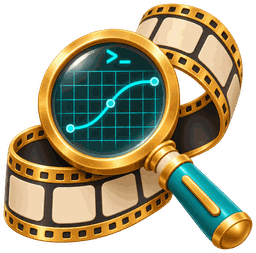<br>
      <b>参考实验室</b><br>
      <sub>任何影片都能逐帧拆解，再为你的创意重新构建。</sub><br><br>
      <code>ref:analyze</code>
    </td>
    <td align="center" valign="top">
      <br>
      <b>评审席</b><br>
      <sub>每一轮都有全新的严苛评审；量化的动效、同步与质检。</sub><br><br>
      <code>motion:check</code>
    </td>
  </tr>
</table>

<details>
<summary><b>一部影片是怎样制作出来的</b> <sub>（定制影片流程）</sub></summary>
<br>

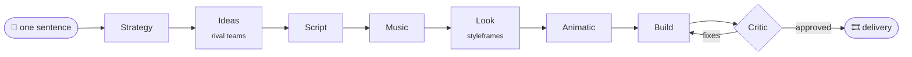

每一个关键关口都由你审批：创意、视觉风格、音乐、终剪。详情：[制作流程](docs/production-chain.md)。

</details>

<a id="models"></a>

## 🎭 选角办公室：1,500+ 模型，一个窗口

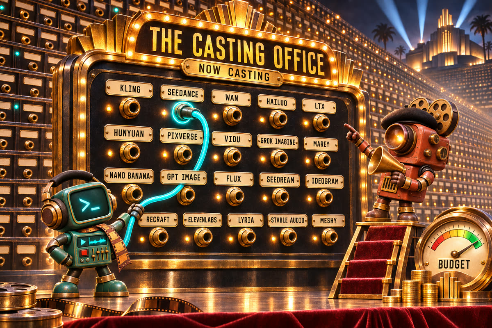

**各大实验室的模型，一句话调用，一个预算统管。** 工作室维护着一份离线目录，收录了 fal 和 Higgsfield 上来自 400+ 个模型家族的 1,500 多个模型端点，另外直接接入 ElevenLabs：涵盖视频、图像、语音、音乐、音效、3D、超分辨率、口型同步和数字人。

- **按角色选角，而非按品牌。** `models:pick` 按任务、质量档次和价格来挑选；当两家服务商提供同一个模型时，由更便宜的那家接活。
- **开机之前先定价。** 每次调用都会先报价或设定上限，并从你的预算中预留；结果不明的提交会以同一操作续接，绝不盲目重复提交。
- **所有媒介，一套流程。** 视频镜头、旁白、配乐或 3D 资产，用的都是同样的智能体、审批和成本报告。
- **新模型无需新代码。** 刷新目录即可引入新端点及其参数结构和价格；每个端点都带有如实标注的可信等级，从“已发现”到“已验证”。
- **不必叠加一堆订阅。** 用你自己的 fal、Higgsfield 和 ElevenLabs 账户，按用量付费。

**Kling**（快手）· **Seedance**（字节跳动）· **Wan**（阿里巴巴）· **Hailuo**（MiniMax）· **LTX**（Lightricks）· **Hunyuan Video**（腾讯）· **PixVerse** · **Vidu** · **Grok Imagine**（xAI）· **Marey**（Moonvalley）· **Nano Banana**（Google）· **GPT Image**（OpenAI）· **FLUX**（Black Forest Labs）· **Seedream**（字节跳动）· **Ideogram** · **Recraft** · **ElevenLabs** · **Lyria**（Google）· **Stable Audio**（Stability AI）· **Meshy** · <sub>以及来自 Luma、Meta、Microsoft、NVIDIA、Topaz Labs 等公司的数百个模型。</sub>

<sub>指南：[模型槽位](docs/model-slots-guide.md) · [fal 目录](docs/fal-catalogue.md) · [Higgsfield](docs/higgsfield.md) · [付费执行](docs/paid-execution.md)。模型名称归其所有者所有（参见<a href="#trademarks">商标</a>）。</sub>

<a id="sources"></a>

## 📥 素材室：你的素材，贴个链接就到

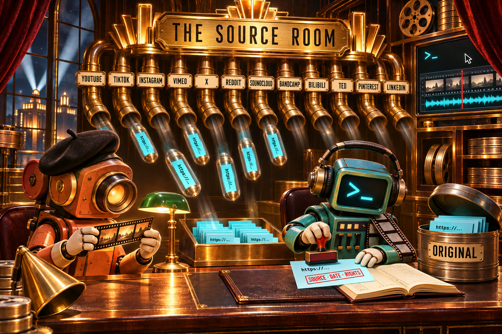

**链接就是素材来源。** 贴上给你灵感的帖子、你自己发布的 Reel 或你已获授权的曲目，原始文件就会落入你的项目，并注明出处归档。

- **是原件，不是录屏。** 每个附件都取可用的最佳版本，需要时还可单独提取音频；不放大，不裁切。
- **像档案一样归档。** 每个文件都以不可变方式保存，附带校验和、来源链接、服务商和日期。在你确认之前，版权状态一律标记为未知。
- **直接投入创作。** 一份素材可以成为“仿照某某风格”的参考、二创用的片段，或是你自己的帖子，重新剪成 Shorts。
- **批量任务不怕中断。** 一次最多 100 个链接，失败后可续传；结果不确定的请求会先核对，绝不盲目重复付费。
- **仅限公开帖子。** 不用浏览器 Cookie，不用私密会话，不碰 DRM。

**YouTube** · **TikTok** · **Instagram** · **Facebook** · **X** · **Threads** · **Snapchat** · **Pinterest** · **LinkedIn** · **Reddit** · **Vimeo** · **Dailymotion** · **Bilibili** · **Douyin** · **Xiaohongshu** · **Weibo** · **SoundCloud** · **Bandcamp** · **Mixcloud** · **TED** · <sub>以及服务商文档列出的约 20 个其他平台。</sub>

<sub>抓取通过你自己的 RapidAPI 或 Apify 账户进行，按链接计费并受你的预算约束；平台覆盖范围以服务商文档为准，不作保证。请仅用于你拥有或有权使用的素材：抓取的参考只用于分析，不会被重新发布。指南：[媒体获取](docs/media-fetch.md)。</sub>

<p align="right"><sub><a href="#top">返回顶部 ↑</a></sub></p>

<a id="now-showing"></a>

<p align="center"></p>

## 🍿 正在上映

<sub>输入一句话，或你拍好的素材，或一张商品表格。选一种类型：大多数卡片都是自带方法和质量标准的“剧本手册”（playbook）；少数是可在任何类型中使用的工具。卡片均为示意插图，并非成片中的画面。</sub>

<p>
  
  
</p>

<table>
  <tr>
    <td width="50%" valign="top">
      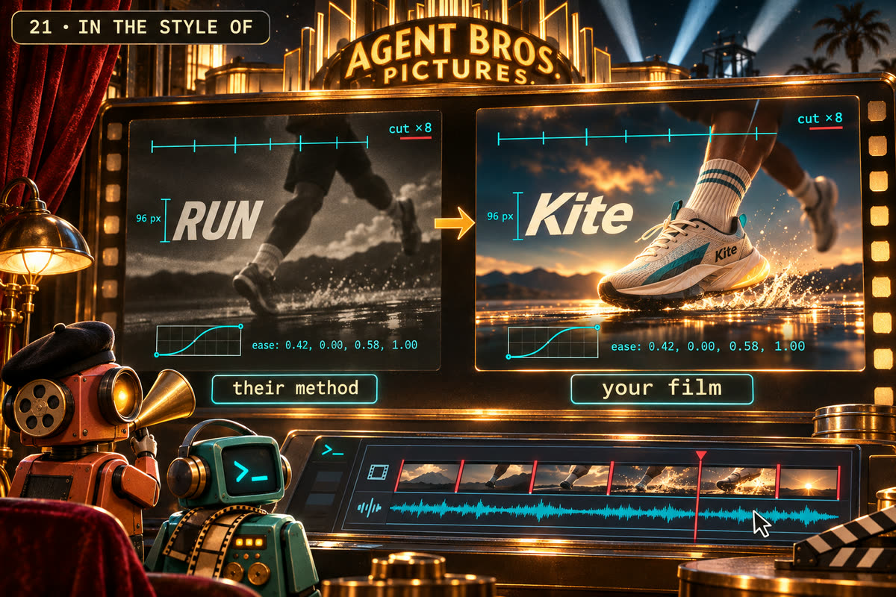
    </td>
    <td width="50%" valign="top">
      <h4>✨ 适用于所有类型：“仿照某某风格……”</h4>
      在任何需求中附上一部你欣赏的影片。剧组会测量它的剪辑点、节拍网格、字体和缓动，然后用同样的手艺、全新的内容打造<b>你的</b>影片。参考影片在你的机器上完成测量，仓库只保留数字和描述。<br><br>
      <sub><code>ref:add</code> · <code>ref:analyze</code> · <a href="#references">剧组如何学习 →</a></sub>
    </td>
  </tr>
</table>

### 🚀 产品与营销

<table>
  <tr>
    <td width="50%" valign="top">
      <!-- ASSET card product-promo: 16:9 GIF, 800×450, loop ≤ 6 s. A launch film
           for a real app: the product's own screen flies in, one proposition
           in big type, logo lock-up. -->
      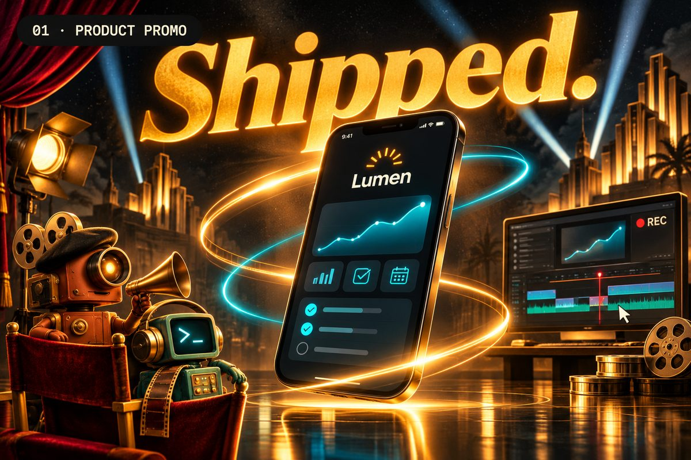
      <h4>产品宣传片</h4>
      围绕你的真实产品打造的发布宣传片，绝不用替身。<br>
      <sub><code>product-promo</code> · 15–60 秒</sub> 
    </td>
    <td width="50%" valign="top">
      <!-- ASSET card teaser-trailer: 16:9 GIF. Dark, slow build, flashes of the
           thing, a date card: "COMING 08.12". -->
      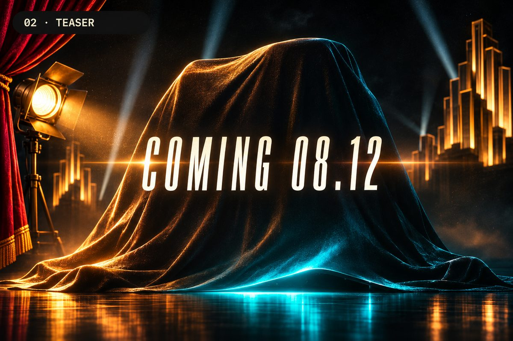
      <h4>先导片与预告片</h4>
      为尚未发布的东西制造期待。以一个日期收尾。<br>
      <sub><code>teaser-trailer</code> · 6–60 秒</sub> 
    </td>
  </tr>
  <tr>
    <td width="50%" valign="top">
      <!-- ASSET card app-store-preview: three 9:16 phone frames side by side,
           real app screens with tap hotspots, store-size badge "886×1920". -->
      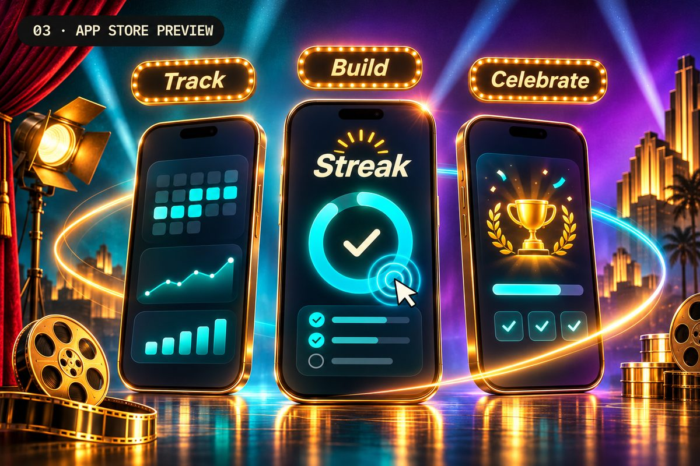
      <h4>App Store 预览视频</h4>
      用你 App 的真实界面，按商店要求的精确尺寸制作，力求顺利过审。<br>
      <sub><code>app-store-preview</code> · 15–30 秒</sub> 
    </td>
    <td width="50%" valign="top">
      <!-- ASSET card feature-update: before / after wipe across a real UI,
           a "NEW" chip lands on the changed button. -->
      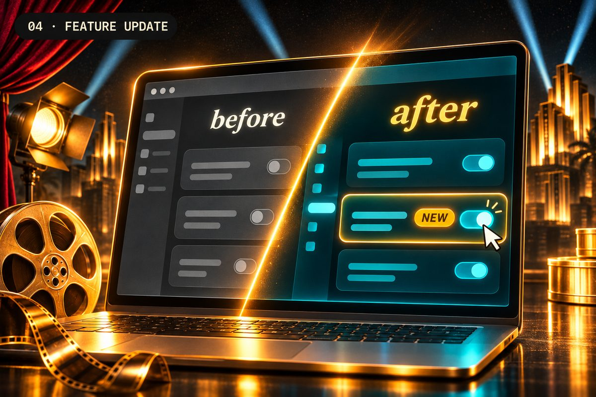
      <h4>功能更新</h4>
      聚焦一个新功能：改了什么、前后对比、在哪里试用。<br>
      <sub><code>feature-update</code> · 10–45 秒</sub> 
    </td>
  </tr>
  <tr>
    <td width="50%" valign="top">
      <!-- ASSET card ugc-ad: 9:16, a creator talking to camera, bold hook caption
           in the first second, the product in hand. Label "3 hooks · 1 product". -->
      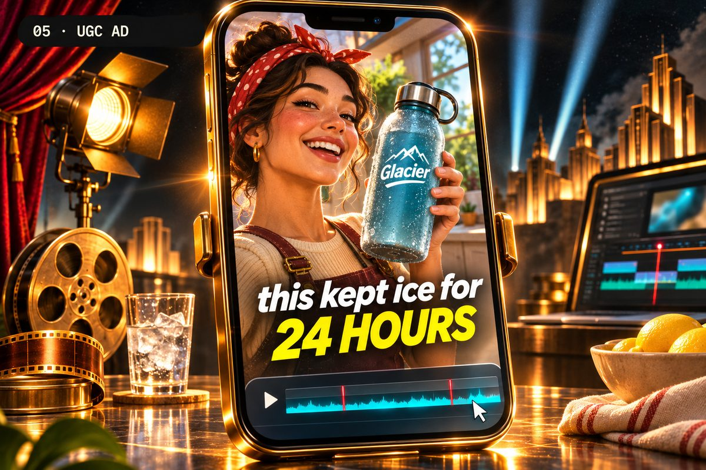
      <h4>UGC 广告</h4>
      达人风格的竖屏广告：钩子、痛点、产品、证据。<br>
      <sub><code>ugc-ad</code> · 竖屏</sub> 
    </td>
    <td width="50%" valign="top">
      <!-- ASSET card case-study: an interview frame with a lower third and a
           signed-off number animating: "+38% retention". -->
      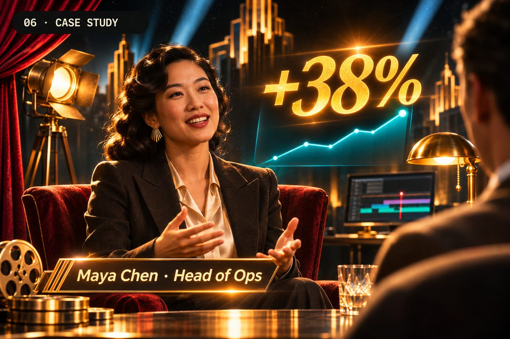
      <h4>客户案例</h4>
      把一段客户访谈剪成一个故事，配上真实且经确认的数据。<br>
      <sub><code>case-study</code> · 60 秒–3 分钟</sub> 
    </td>
  </tr>
</table>

### 📦 规模化营销活动

<sub>一份简报，许多支视频。每个变体都是独立且可追溯的项目：有自己的事实、审批和成本，绝不悄悄照搬上一行的内容。</sub>

<table>
  <tr>
    <td width="50%" valign="top">
      <!-- ASSET card ad-experiments: three vertical ads, identical body,
           three different first seconds labelled A / B / C. -->
      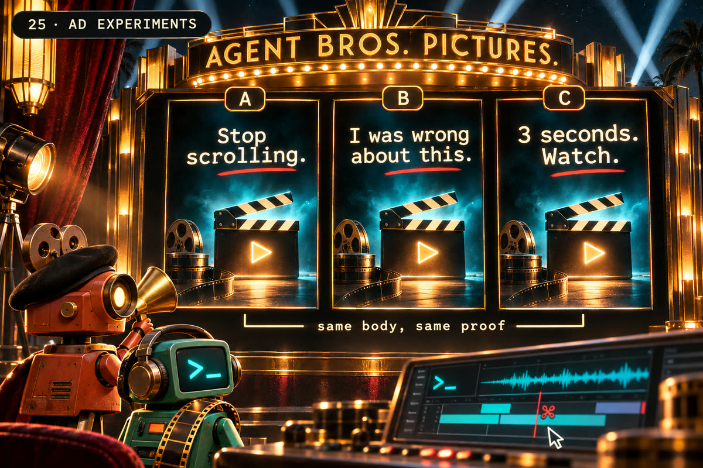
      <h4>广告实验</h4>
      围绕一个已验证的主体，制作不同的开头、优惠和结尾变体，每个变体都带有待检验的假设。<br>
      <sub><code>ad-experiments</code> · A/B</sub> 
    </td>
    <td width="50%" valign="top">
      <!-- ASSET card catalogue-videos: a product sheet whose rows turn into a
           grid of vertical videos, prices from the sheet. -->
      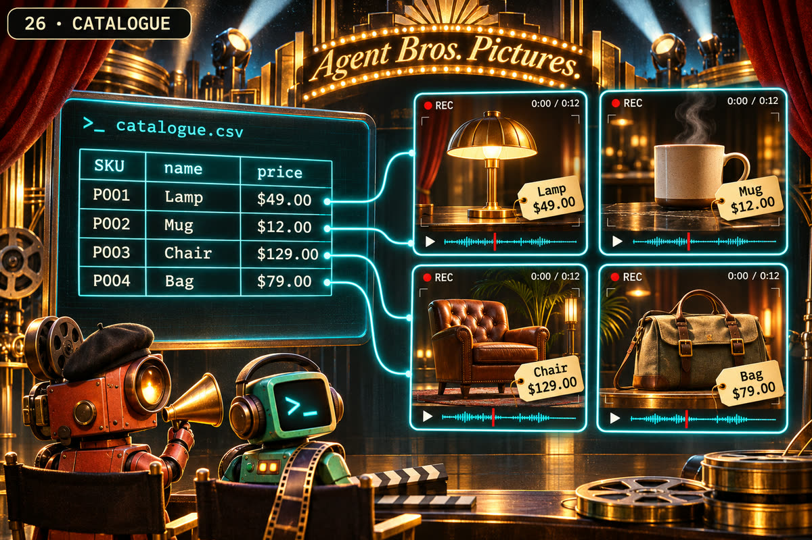
      <h4>商品目录视频</h4>
      输入一份 CSV、TSV 或 JSON 商品清单，每个 SKU 输出一支可审阅的视频，名称和价格逐行核对。<br>
      <sub><code>catalogue-videos</code> · 电商</sub> 
    </td>
  </tr>
  <tr>
    <td width="50%" valign="top">
      <!-- ASSET card content-series: a month of episodes with the same host. -->
      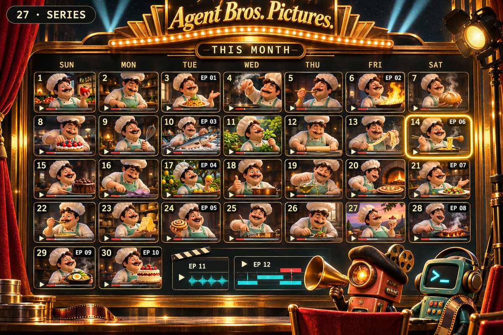
      <h4>内容系列</h4>
      一个月的剧集：同样的角色和格式，每期都有新内容。<br>
      <sub><code>content-series</code> · 周期性</sub> 
    </td>
    <td width="50%" valign="top">
      <!-- ASSET card reference-family: one blueprint, three products. -->
      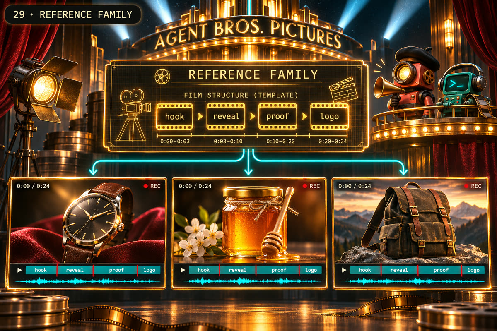
      <h4>参考系列</h4>
      把一部参考影片的方法沿用到整条产品线，让每部影片都像出自同一个品牌。<br>
      <sub><code>reference-family</code> · 产品线</sub> 
    </td>
  </tr>
  <tr>
    <td width="50%" valign="top">
      <!-- ASSET card localise-campaign: the same ads in four languages. -->
      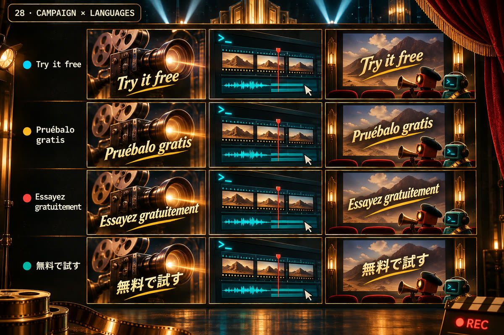
      <h4>营销活动 × 多语言</h4>
      把已通过的变体做成新语言版本：配音、字幕和画面文字，每种语言都有专人审阅。<br>
      <sub><code>localise-campaign</code></sub> 
    </td>
    <td width="50%" valign="top">
      <!-- ASSET card localise: the same frame in three languages stacked,
           subtitles switching EN → ES → JA. -->
      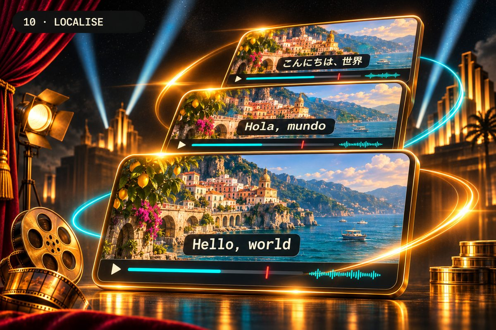
      <h4>单支视频本地化</h4>
      把一支成片做成另一种语言：字幕、配音、画面文字。<br>
      <sub><code>localise</code></sub> 
    </td>
  </tr>
</table>

### 🎓 讲解与教学

<table>
  <tr>
    <td width="50%" valign="top">
      <!-- ASSET card explainer: a diagram building itself to a voice, numbers
           counting up, a worked example highlighted. -->
      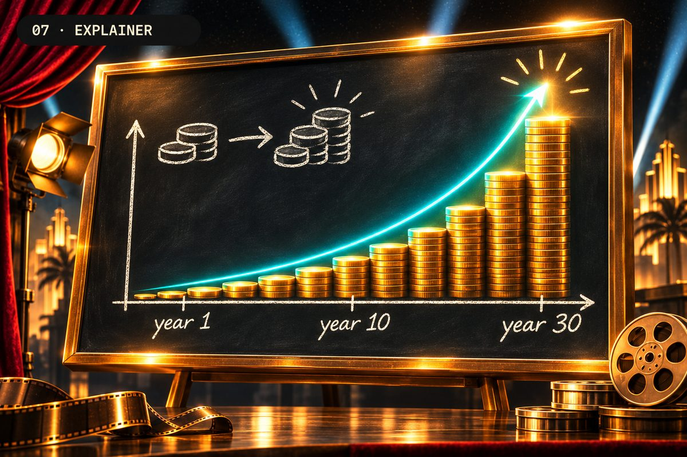
      <h4>讲解视频与课程</h4>
      讲解观点、流程和数据，图示随讲解同步演进。<br>
      <sub><code>explainer</code> · 30 秒至数分钟</sub> 
    </td>
    <td width="50%" valign="top">
      <!-- ASSET card product-tutorial: a real web app, the cursor glides,
           a ring pulses on each click, step counter "2 / 5". -->
      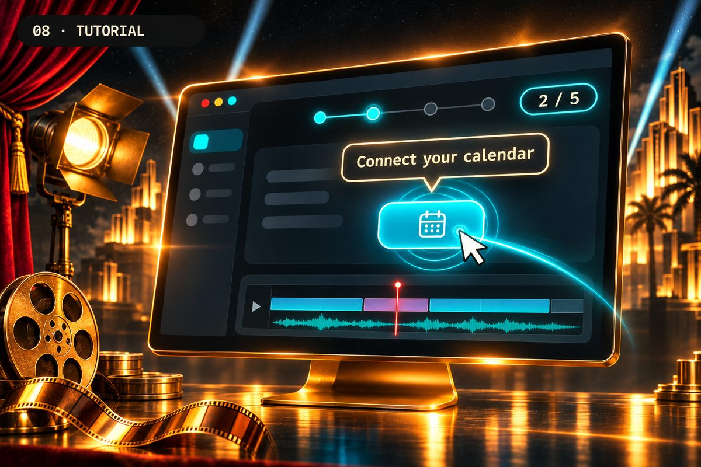
      <h4>产品教程</h4>
      在真实界面上逐次点击，教会用户完成一项任务。<br>
      <sub><code>product-tutorial</code> · 30 秒至数分钟</sub> 
    </td>
  </tr>
  <tr>
    <td width="50%" valign="top">
      <!-- ASSET card longform: a long lecture with gold chapter segments and
           vertical clips pulled out of it. -->
      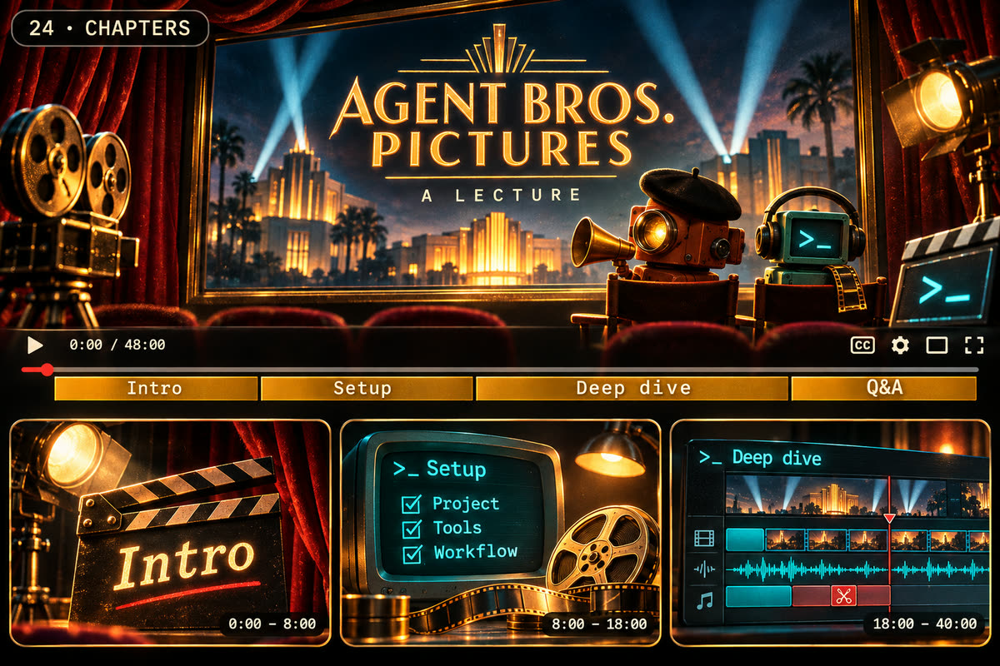
      <h4>章节与长视频</h4>
      把一场长讲座或直播切分成带标题的章节，并从中提取经批准的 Shorts。<br>
      <sub><code>video:longform</code> · 本地</sub>
    </td>
    <td width="50%" valign="top">
      <!-- ASSET card avatar-presenter: a digital presenter beside a slide,
           visible "AI-generated" label in the corner. -->
      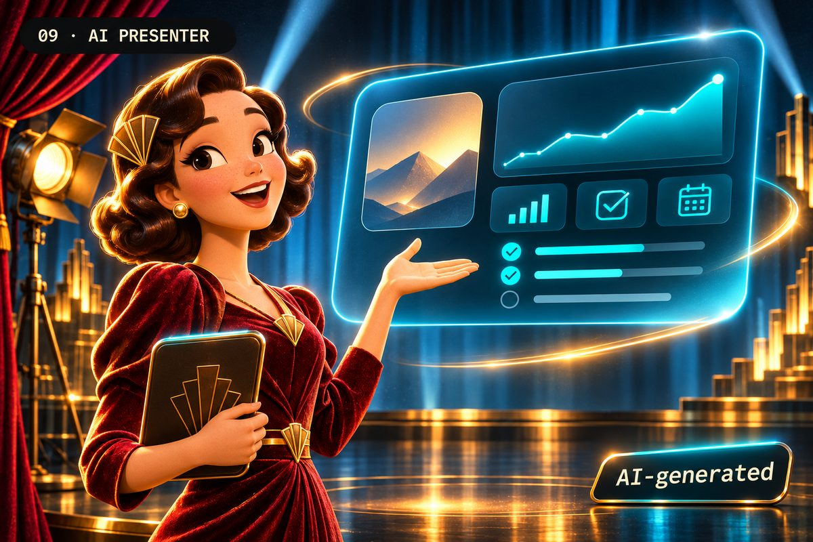
      <h4>AI 主持人</h4>
      用于入职培训和客户触达的数字主持人，附带授权同意与 AI 标识。<br>
      <sub><code>avatar-presenter</code></sub> 
    </td>
  </tr>
</table>

### 🎨 动效、3D 与 AI 电影

<table>
  <tr>
    <td width="50%" valign="top">
      <!-- ASSET card motion-design: kinetic typography on the beat, letters
           splitting and re-forming into a logo ident. -->
      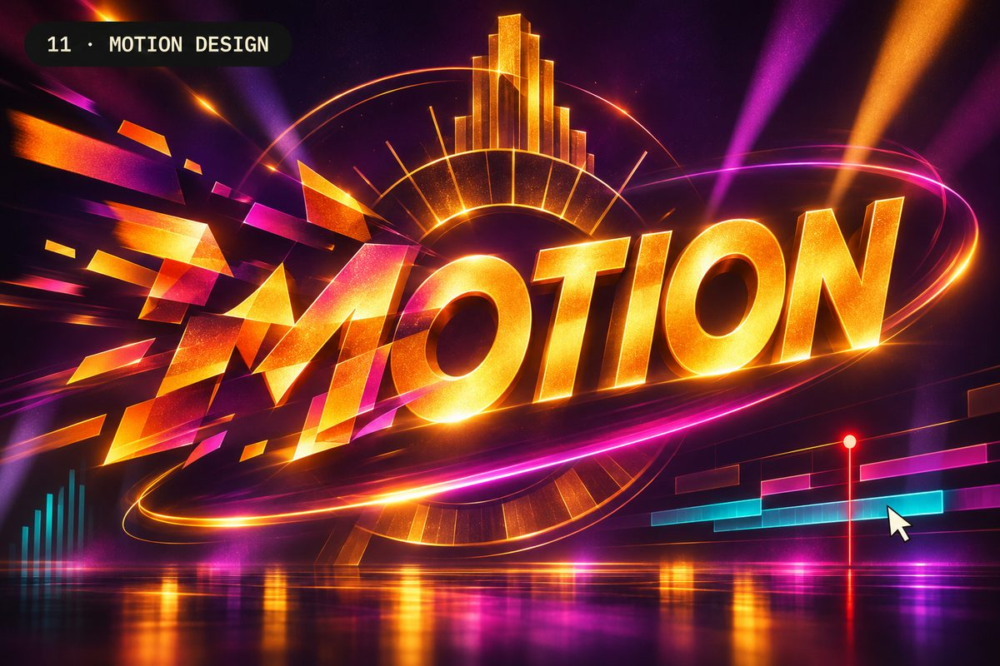
      <h4>动效设计</h4>
      动态字体、Logo 片头、片头字幕序列，以及随音乐律动的纯动效。<br>
      <sub><code>motion-design</code></sub> 
    </td>
    <td width="50%" valign="top">
      <!-- ASSET card photoreal-3d: an unbranded phone in a studio light,
           rendered in Blender, its wireframe ghosted behind it. -->
      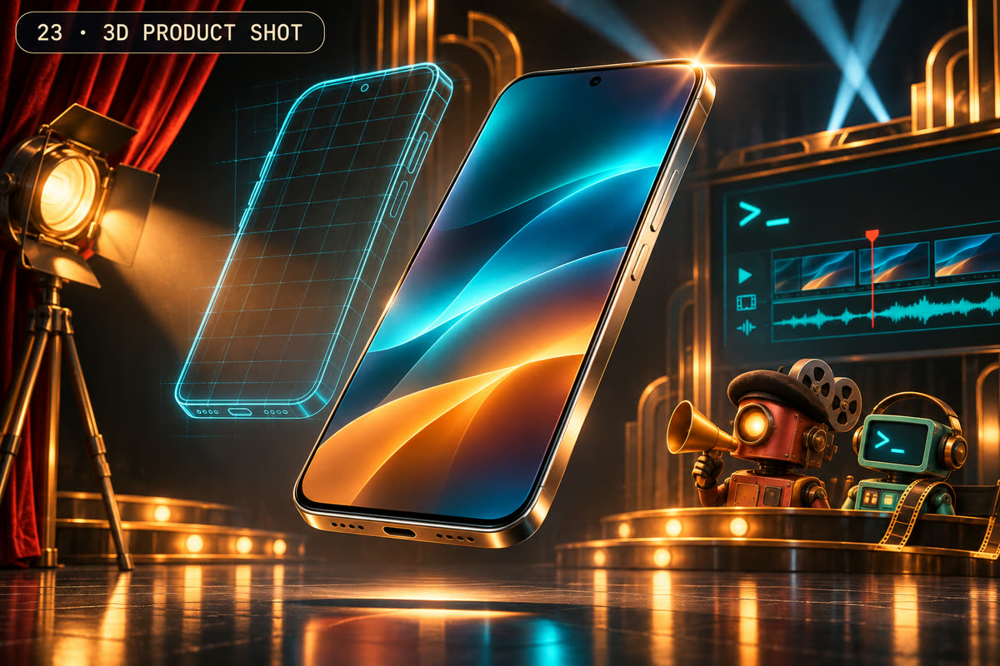
      <h4>3D 产品镜头</h4>
      在 Blender 中把真实设备模型打光成棚拍照片的质感，屏幕上显示你的界面，再合成进影片。<br>
      <sub><code>blender:run</code> · Blender 可选</sub>
    </td>
  </tr>
  <tr>
    <td width="50%" valign="top">
      <!-- ASSET card ai-film: a cinematic generated shot (mood film), letterbox
           bars, shot counter "SHOT 04 / 12". -->
      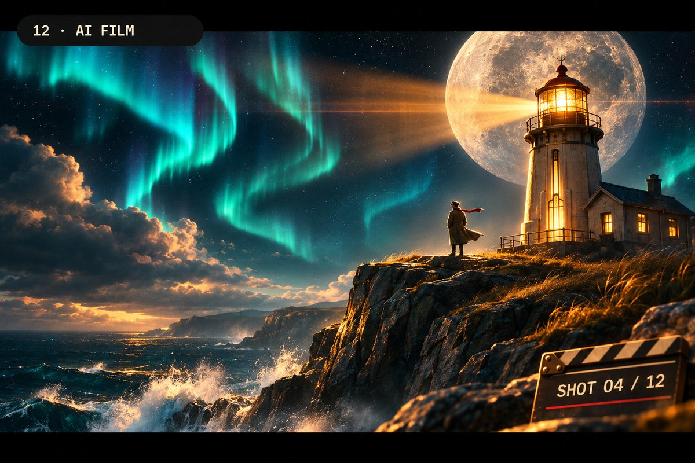
      <h4>AI 电影</h4>
      短篇故事和氛围短片，基于已批准的关键帧逐个镜头执导。<br>
      <sub><code>ai-film</code></sub> 
    </td>
    <td width="50%" valign="top">
      <!-- ASSET card video-remix: one clip as original, swapped and restyled. -->
      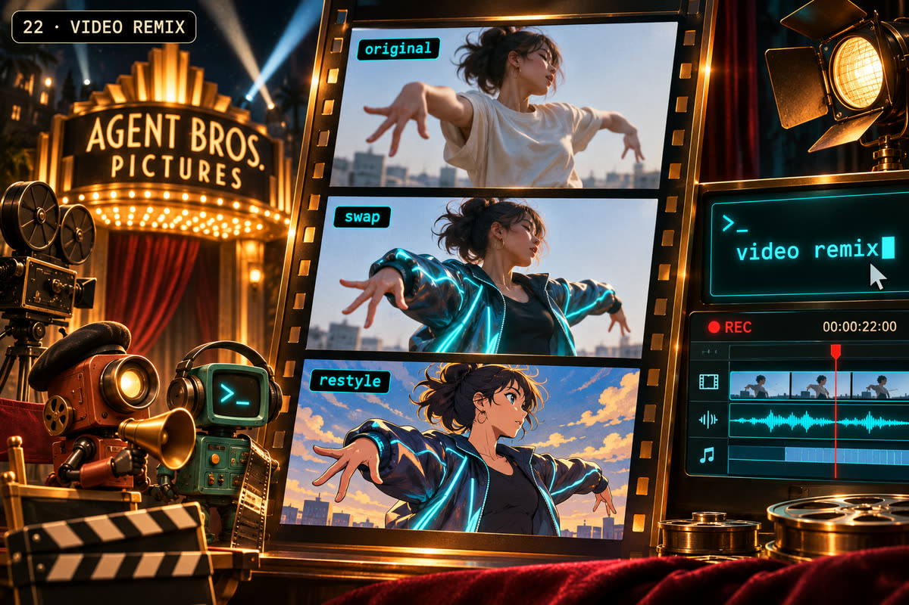
      <h4>视频二创</h4>
      保留片段的运动，替换角色、服装或整体风格，并跟踪授权与版权（付费生成）。<br>
      <sub><code>video-remix</code></sub> 
    </td>
  </tr>
  <tr>
    <td width="50%" valign="top">
      <!-- ASSET card photo-slideshow: holiday photos in a slow Ken Burns drift,
           cuts on the music's downbeats. -->
      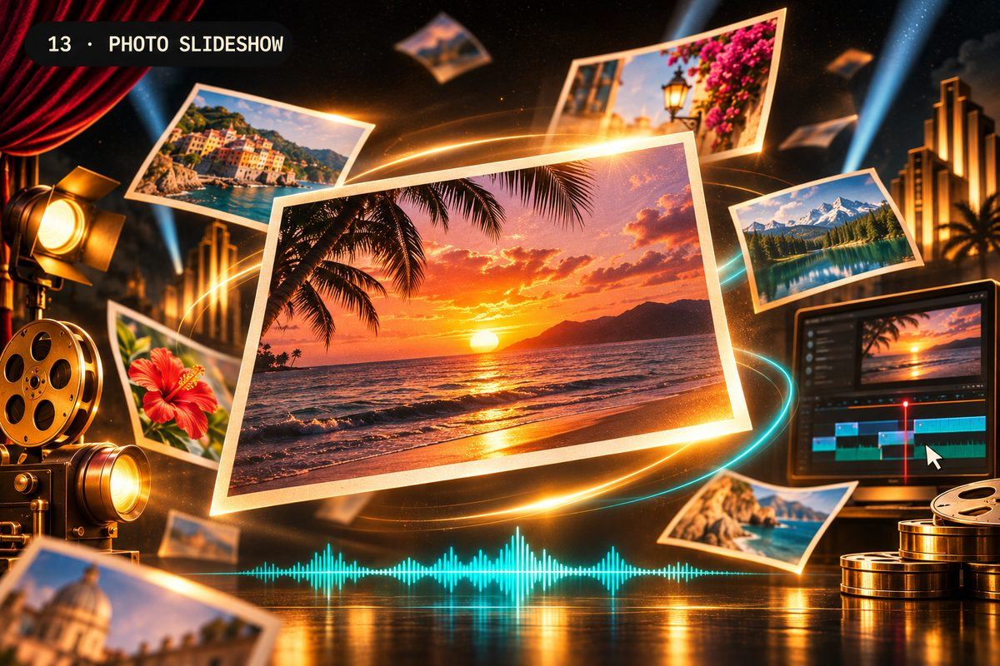
      <h4>照片幻灯片</h4>
      把你的照片配上音乐剪辑：回忆录、作品集、房产看房。<br>
      <sub><code>photo-slideshow</code></sub> 
    </td>
    <td width="50%" valign="top">
      <!-- ASSET card stock-montage: licensed b-roll under a bold manifesto line,
           one word per cut. -->
      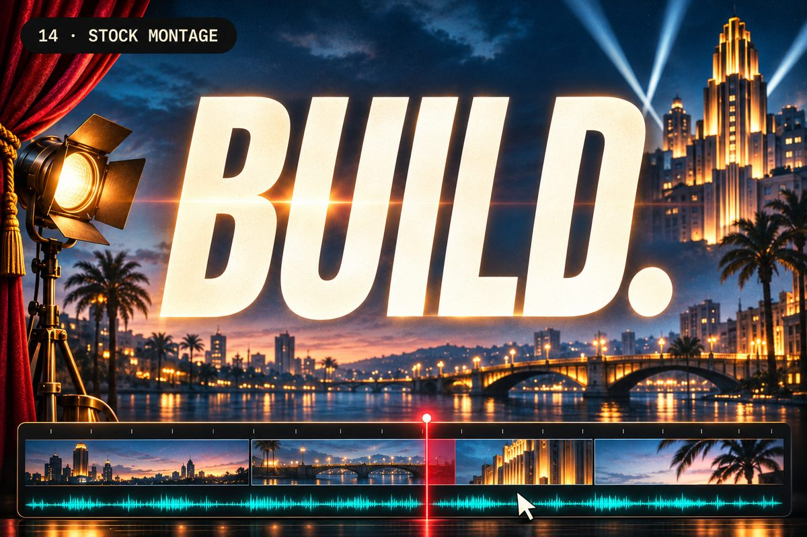
      <h4>素材蒙太奇</h4>
      已授权的空镜素材叠加文字：宣言片与氛围短片。<br>
      <sub><code>stock-montage</code></sub> 
    </td>
  </tr>
</table>

### ✂️ 你自己的素材

<table>
  <tr>
    <td width="50%" valign="top">
      <!-- ASSET card footage-edit: a talking-head frame, a strip below showing
           red cut regions; chip "removed 14 slips · 4:12 → 3:20". -->
      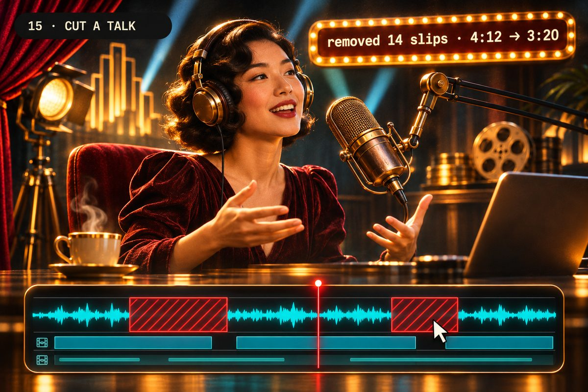
      <h4>精剪一段演讲</h4>
      自动找出并剪掉静音、“嗯啊”和说错的开头。方案由你批准。<br>
      <sub><code>footage-edit</code></sub> 
    </td>
    <td width="50%" valign="top">
      <!-- ASSET card shorts-from-long: one 16:9 podcast frame splitting into
           three 9:16 clips, each with a score chip "hook 9/10". -->
      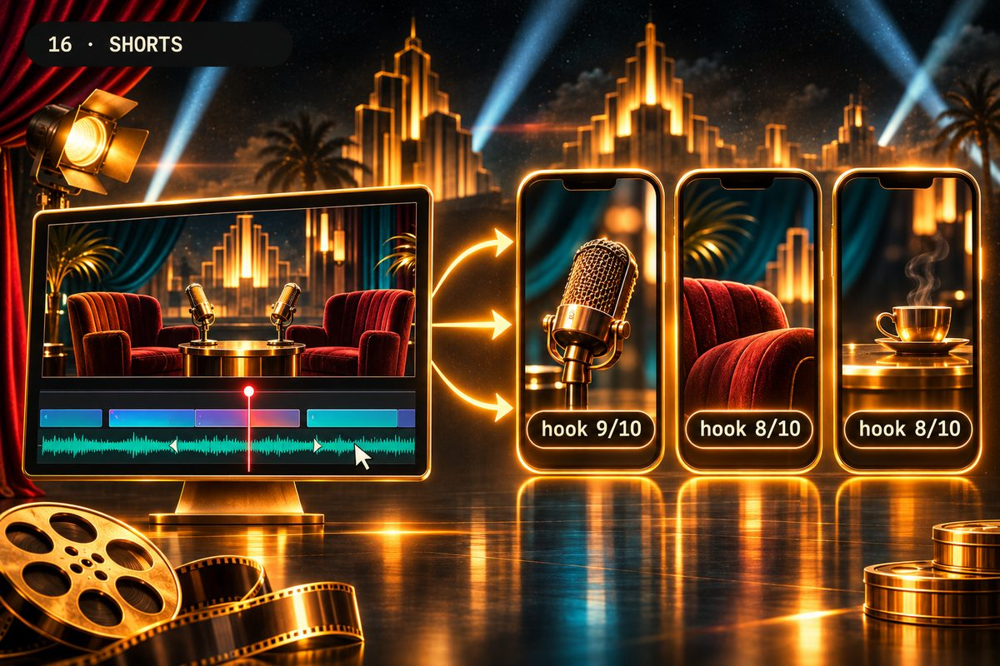
      <h4>长视频剪短视频</h4>
      从一段长录音中剪出可独立成片的 Reels 和 Shorts，并按开头吸引力排序。<br>
      <sub><code>shorts-from-long</code></sub> 
    </td>
  </tr>
  <tr>
    <td width="50%" valign="top">
      <!-- ASSET card captions: the same sentence in 4 of the 10 caption styles,
           cycling (outline pop, key-word colour, sliding box, single-word punch). -->
      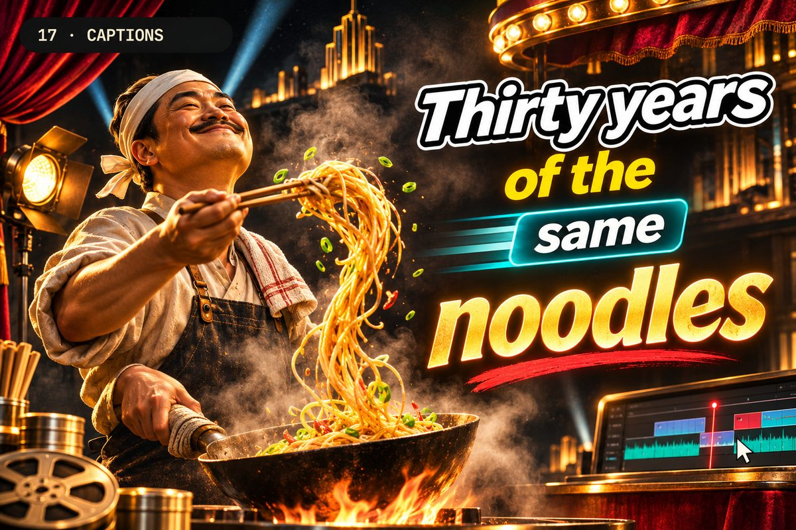
      <h4>字幕</h4>
      逐字计时的字幕，10 种样式，从简洁到单词冲击，另可导出 SRT 和 VTT。<br>
      <sub><code>captions:place</code> · 任意类型</sub>
    </td>
    <td width="50%" valign="top">
      <!-- ASSET card multicam-reframe: two camera angles switching on the
           speaker, then a 16:9 frame with a 9:16 crop box tracking a face. -->
      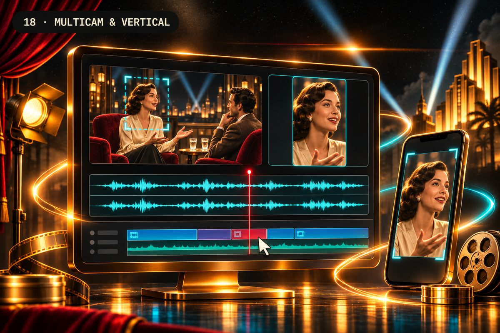
      <h4>多机位与竖屏</h4>
      两台摄像机按声音自动同步；任意镜头都能以说话人为中心重构为 9:16。<br>
      <sub><code>multicam:sync</code> · <code>reframe:track</code></sub>
    </td>
  </tr>
  <tr>
    <td width="50%" valign="top">
      <!-- ASSET card event-recap: fast montage of a conference: stage, crowd,
           badges, cut on the beat; "248 clips → 60 s". -->
      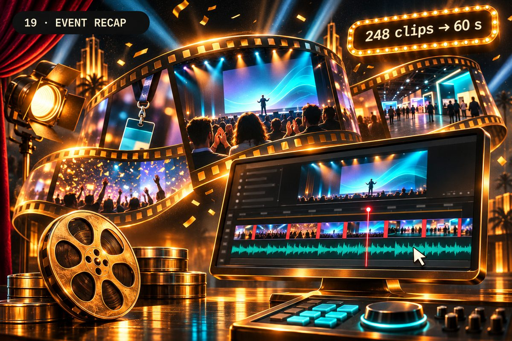
      <h4>活动回顾</h4>
      来自多部手机的大量片段，配上音乐剪成一支活动花絮。<br>
      <sub><code>event-recap</code></sub> 
    </td>
    <td width="50%" valign="top">
      <!-- ASSET card your-genre: an empty dotted frame with a "+" in the middle. -->
      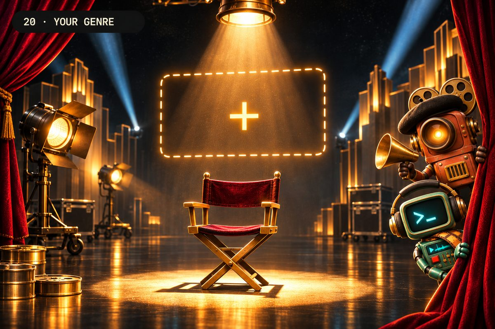
      <h4>你的类型</h4>
      缺少某种视频？一份 playbook 就是一套方法加一条质量标准。来添加一份吧。<br>
      <sub>征集中：歌词视频、播客音频图、游戏预告片、招聘短片、年度数据回顾片。<a href="playbooks/AGENTS.md">如何添加 playbook →</a></sub>
    </td>
  </tr>
</table>

<p align="right"><sub><a href="#top">返回顶部 ↑</a></sub></p>

## 🪞 AI 视频为何显得廉价，片场上又由谁来把关

<!-- ASSET glow-up 1: docs/readme/glowup-promo.gif, 1600×450, side by side,
     loop ≤ 10 s, both halves synced, a thin divider and two labels:
     "AGENT ALONE" / "AGENT BROS." Link the GIF to an MP4 with sound.
     Same model, same one-sentence brief. Left shows the usual tells (corner
     labels, fade on every beat, a generic card standing in for the product);
     right shows the real product UI, cuts on motion, type as the picture.
     Brands belong to their owners: prefer our own product or an invented one;
     if a real brand is used, add a line to the Licence section saying the demo
     is unofficial. Further pairs: a Short from a podcast (raw auto-captions vs
     key-word captions and a hook), and a lesson (bullet slides vs a diagram
     that builds with the voice). Add this section's before/after row only
     when real renders exist. -->

<sub>把视频任务单独交给一个智能体，同样的破绽总会反复出现。而每一个破绽，在片场都有专人负责。</sub>

| 破绽 | 表现 | 由谁把关 |
|---|---|---|
| **假冒的产品** | 用千篇一律的手机样机或卡片冒充真实 App | 🎥 真实界面规则：产品一律实拍捕获，绝不模仿 |
| **满屏淡入淡出** | 每个元素都淡入，每个节拍都叠化 | 🎨 为每个剪辑点刻意选择转场方式，再由 🧐 评审把关 |
| **幻灯片式动效** | 默认缓动，左边标题右边卡片，一场接一场 | 🎨 动效设计库，以及每轮一位全新的评审 |
| **音乐与人声打架** | 配乐盖过了台词，或剪辑无视节拍 | 🎙️ 量化混音、自动闪避，以及卡点剪辑 |
| **话被剪断** | 字幕或场景把一句话截断 | ✂️ 在锁定剪辑前测量真实配音时长 |
| **每次都靠瞎猜** | 每部影片都从零开始；上周的意见早已忘光 | 🧠 记录你评价的本地记忆，每一步都会读取 |
| **意外账单** | 生成一遍遍重跑，直到信用卡被拒 | 🤖 每次付费调用前先预留预算，可续接，绝不重复提交 |

<a id="premieres"></a>

<p align="center">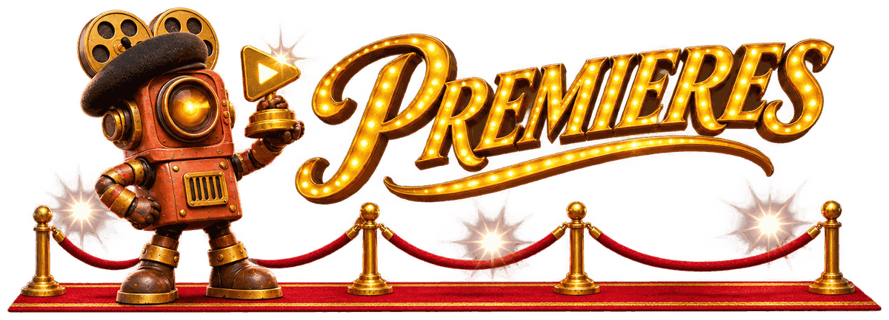</p>

## 🏆 首映

<sub>由兄弟俩从头到尾完成的成片，附上启动每部影片的那一句原话。首批三部即将上映。</sub>

<table>
  <tr>
    <td width="33%" align="center" valign="top">
      <!-- ASSET premiere 1: poster 2:3 (600×900) + link to the full MP4.
           A real launch film made with the repo. -->
      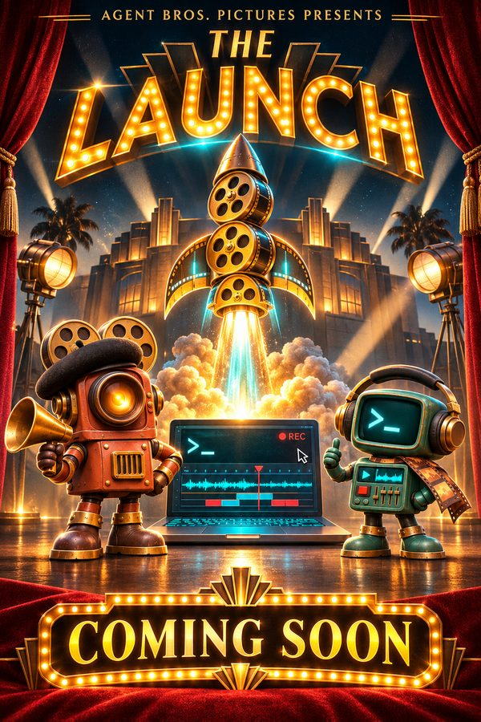<br>
      <b>首映 #1</b><br>
      <sub>产品发布 · 30 秒 · 16:9</sub>
    </td>
    <td width="33%" align="center" valign="top">
      <!-- ASSET premiere 2: poster 2:3 + link. A vertical Reel. -->
      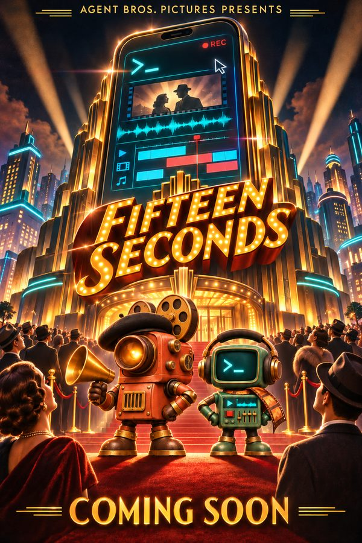<br>
      <b>首映 #2</b><br>
      <sub>Reel · 15 秒 · 9:16</sub>
    </td>
    <td width="33%" align="center" valign="top">
      <!-- ASSET premiere 3: poster 2:3 + link. A lesson or explainer. -->
      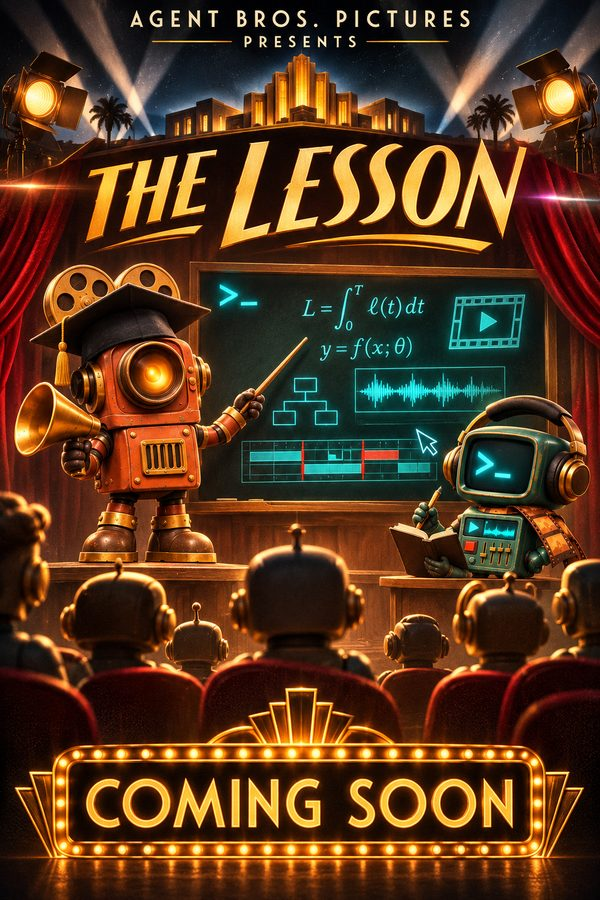<br>
      <b>首映 #3</b><br>
      <sub>课程 · 90 秒 · 16:9</sub>
    </td>
  </tr>
</table>

<!-- For each premiere, when it ships: the user's one-sentence request, the
     playbook used, what the user approved, time to first cut, and cost (0 if
     local only), as a table under a "The script behind each premiere" details. -->

**来自社区**

<!-- showcases:start -->

经过验证的社区影片将在此展示。[分享你的作品](docs/showcases.md)。

<!-- showcases:end -->

<p align="right"><sub><a href="#top">返回顶部 ↑</a></sub></p>

<a id="for-teams"></a>

## 🏢 面向团队与代理公司

Agent Bros. Pictures 在以下情形可免费用于生产：个人以自己的名义使用，包括为客户制作影片和其他媒体；不超过三人的组织；非营利组织和教育机构用于其非商业活动。超过三人的公司（雇员、承包商和自由职业者按人头计算）用于生产需要我们的[商业许可](COMMERCIAL-LICENSE.md)，渲染还需要 [Remotion Company License](https://www.remotion.dev/license)；任何人都可以先行评估、测试和研究（[许可证](#licence)）。有两种合作方式：

<table>
  <tr>
    <td width="50%" valign="top">
      <b>📜 商业许可</b><br>
      <sub>适用于超过三人的公司的生产使用，以及免费授权不涵盖的一切：托管、代管或嵌入式服务、API 或平台，OEM、白标或转售。</sub>
    </td>
    <td width="50%" valign="top">
      <b>🛠️ 服务</b><br>
      <sub>团队部署与服务商配置、定制场景与品牌制作套件、培训与支持，以及托管或云端试点的洽谈。</sub>
    </td>
  </tr>
</table>

团队开箱即得：按变体审批和计费的营销活动、品牌视觉与设计令牌、以文件形式保存的可审阅方案和评审意见、每个项目的成本报告，以及每部影片可供交付的源码。

**联系我们：** [hello@iliamax.com](mailto:hello@iliamax.com) · 详见 [COMMERCIAL-LICENSE.md](COMMERCIAL-LICENSE.md)。

<a id="references"></a>

## 🧠 剧组如何从参考影片中学习

给这套工具一部你欣赏的影片，它学到的是方法，而不是影片本身。`pnpm ref:analyze` 在你的机器上对它进行测量：每个剪辑点、节拍网格、文字如何落位、镜头如何缓动。随后由智能体查看帧条，写下每个动作做了什么、为什么这样做。仓库只保留这份分析：数字、时间线和描述。影片本身留在你的电脑上；只有智能体查看的帧条会发送给它的模型。

**一份分析长什么样**（数据来自库中一部发布宣传片，不含其任何画面）：

```text
22.9 s · 140 BPM (grid confidence 0.72) · 10 judged shots · median shot 1.6 s · 23.6 cuts a minute
0.00  hook       two-line sentence, a word every 4 frames, off the grid
2.30  cut        white to a barely green white                        beat −4 (+14 ms)
4.00  cut        drop: orange ground, hero number 89.5% of the width   beat 0  (0 ms)
4.43  shrink     number 89.5% → 43.8% wide in 8 frames, ease-in-out    beat 1
5.30  text swap  one line on the held orange, pushes in 67% → 81%      beat 3  (+14 ms)
7.43  cut        prompt bar on white, 69% wide                         beat 8  (+4 ms)
```

全部六处结构性变化都落在距节拍 24 毫秒以内，而每处变化碰巧如此的概率只有 14%：这就是一条智能体可以复用的规则（“剪辑卡在拍点上，文字错开拍点出现”），并附有证据。

**从多部影片到一个模块。** `pnpm ref:corpus` 会把所有分析放在一起读取，因此节奏或缓动取自众多专业影片的分布，而非某一个人的口味。在两部及以上影片中出现过的手法，会成为一张技巧卡和一个动效库模块，由我们自己的代码渲染：

<p align="center">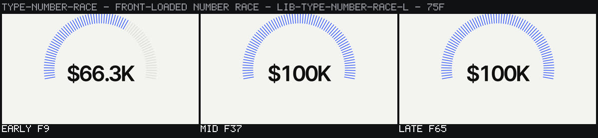</p>

**检验复刻效果。** `pnpm ref:compare` 将我们的渲染结果与分析对齐，只报告时间，不评判品味：每个剪辑点与参考影片相差多少帧，完全基于数字。

**参与贡献。** 在本地分析你自己的参考影片，然后提交分析结果：`pnpm ref:contribute --id <id>` 会检查是否没有追踪任何影片的媒体文件、画面帧或大段引用，私有参考是否保持私有，以及影片是否已注明出处。参见[贡献参考分析](docs/contributing-references.md)。

<p align="right"><sub><a href="#top">返回顶部 ↑</a></sub></p>

<a id="faq"></a>

## ❓ 常见问题

<details>
<summary><b>我需要会写代码吗？</b></summary>
<br>

不需要。你用平常的话和 Claude Code 或 Codex 交流，并在各个关口进行审批。代码一直在那里，供你想亲手修改某处，或把影片交给开发者时使用。

</details>

<details>
<summary><b>做一支视频要花多少钱？</b></summary>
<br>

渲染、剪辑、基于本地语音识别的字幕以及质检都在你的机器上运行，除了你的智能体订阅费（以及超过三人的公司所需的我们的[商业许可](COMMERCIAL-LICENSE.md)和 Remotion Company License）外不产生任何费用。图像、视频、语音和音乐生成运行在你自己的服务商账户上：每次付费调用都会先报价或设定上限，从你设定的预算中预留，并记录在 `pnpm cost:report` 中。许多类型完全不需要付费生成，比如剪辑你自己的素材，或用库中音乐制作动效设计片。

</details>

<details>
<summary><b>我可以为客户制作视频并出售吗？</b></summary>
<br>

可以。我们的许可证不限制你渲染出的影片：BUSL-1.1 约束的是软件，而不是你用它制作的作品，向客户交付影片也不属于分发软件。以下情形可免费用于生产：个人以自己的名义使用，包括为客户制作影片和其他媒体；不超过三人的组织；非营利组织或教育机构用于其非商业活动。个人代表某个组织或在为其工作的过程中使用，视为该组织的使用。超过三人的公司通常需要我们的[商业许可](COMMERCIAL-LICENSE.md)，还可能需要 [Remotion Company License](https://www.remotion.dev/license)。Remotion 按员工人数计算并豁免非营利组织，而我们按全部人员（包括承包商）计算，请分别核对各自的门槛。每部影片仍需遵守其所用素材（字体、音乐、素材片段、声音）的权利。以上不构成法律建议。

</details>

<details>
<summary><b>我的公司可以使用它，或把它作为服务提供吗？</b></summary>
<br>

任何公司都可以免费评估、测试、研究它并基于它进行开发。超过三人的公司（在公司及其关联方范围内按人头计算：雇员、高级职员、董事、参与经营的所有者、承包商、自由职业者、实习生和派遣人员）用于生产需要我们的[商业许可](COMMERCIAL-LICENSE.md)，在那里渲染还需要 [Remotion Company License](https://www.remotion.dev/license)。免费授权从不涵盖以下行为：将软件或其修改版本作为托管、代管或嵌入式服务、API 或平台提供给他人，或在你提供的产品或服务中分发、销售或捆绑它；无论规模大小，这些都需要商业许可。每个版本自其依据 BUSL-1.1 首次公开分发起满四年后转为 AGPL-3.0-or-later（[许可证](#licence)）。

</details>

<details>
<summary><b>我的素材或产品会离开我的机器吗？</b></summary>
<br>

你的文件在本地存储和处理。只有两样东西会离开你的机器：你的智能体（Claude Code 或 Codex）读取的画面帧和文本会发送给它的模型服务商；你批准的任何付费步骤（如转写、配音或生成）会发送给你选择的服务商。参考影片在本地测量；仓库中只保留数字和描述。

</details>

<details>
<summary><b>我可以自己编辑成片吗？</b></summary>
<br>

可以，在任何层面都行：告诉智能体要改什么；使用本地审阅界面（`pnpm review:ui`）配合可撤销的时间线编辑（`pnpm timeline:edit`）；直接修改 Remotion 代码；或者把仅含剪辑的时间线交给 DaVinci Resolve 20.2+（`resolve:handoff`，实验性）。

</details>

<details>
<summary><b>它能保持我的品牌和品味吗？</b></summary>
<br>

品牌色、字体和视觉风格保存在设计令牌和样式中，剧组还会把你的评价记录为本地私有记忆，让下一部影片从你上次批准的内容起步。营销活动会在每一集或每个变体中锁定已批准的角色和风格。

</details>

<details>
<summary><b>我应该使用哪个智能体和模型？</b></summary>
<br>

使用最强模型的 Claude Code 或 Codex：它们遵循同一份共享 `AGENTS.md` 中的相同规则。较小的模型也会遵守规则，但审美判断稍弱。其他 MCP 客户端可以通过 [MCP 服务器](docs/mcp.md)调用工作室的命令。

</details>

<p align="right"><sub><a href="#top">返回顶部 ↑</a></sub></p>

<a id="for-agents"></a>

## 🤖 致智能体

> [!NOTE]
> **如果你是正在阅读本 README 的 AI 智能体：** 请按照 [SETUP.md](SETUP.md) 安装（计划、向用户询问一次、安装、报告），详细说明和更新方式见 [docs/install.md](docs/install.md)，然后在处理任何视频请求前阅读 [AGENTS.md](AGENTS.md)。安装系统软件或花钱之前，请先征得用户同意。

贡献者及其智能体请从 [CONTRIBUTING.md](CONTRIBUTING.md) 开始，然后阅读 [contrib/AGENTS.md](contrib/AGENTS.md) 及其贡献类别对应的卡片。

人类用户，请把这段话粘贴到 Claude Code 或 Codex 中：

```text
Install Agent Bros. Pictures for me: follow SETUP.md in
https://github.com/ilyamk/agentbros (plan, ask me once, apply, report).
Then tell me what works, which keys I need for what, and which kinds
of video you can make.
```

| 阅读 | 用途 |
|---|---|
| [SETUP.md](SETUP.md) | 快速安装：计划、一次确认、安装、按目标列出密钥的报告 |
| [docs/install.md](docs/install.md) | 克隆、依赖、检查，以及与上游保持同步 |
| [docs/dependency-licences.md](docs/dependency-licences.md) | 许可证清单、依赖策略和集成审查 |
| [docs/how-it-works.md](docs/how-it-works.md) | 面向普通读者的一页概览：三条命令、各种模式、文件存放位置 |
| [docs/architecture.md](docs/architecture.md) | 面向改进本框架的智能体：分层、目录结构、请求流程、唯一事实来源、扩展方式 |
| [AGENTS.md](AGENTS.md) | 规则，以及每个视频请求的第一步 |
| [playbooks/AGENTS.md](playbooks/AGENTS.md) | 每种类型及其方法和工具 |
| [docs/production-chain.md](docs/production-chain.md) | 定制影片的步骤与审批 |

<details>
<summary><b>🗺️ 完整命令地图</b> <sub>（每项能力及其指南）</sub></summary>
<br>

用 `pnpm commands --query <word>` 查找任何命令；`pnpm next --project <id>` 会给出项目在任意路线上的下一步。每个 CLI 都只在 stdout 输出一行 JSON，进度信息输出到 stderr。

| 工作 | 命令 / 指南 |
|---|---|
| 命令与清理 | [命令目录](docs/commands.md)、[清理](docs/cleanup.md) |
| 贡献者开发 | [贡献关口](docs/contributing-gates.md)、[GitHub 自动化](docs/github.md)、[问题分拣](docs/triage.md)、[发布与生成的 CREDITS.md](docs/releases.md)、[智能体工作流测试](docs/agent-workflow-e2e.md) |
| 上下文与清单 | [上下文预算](docs/context-budget.md)、[上下文加载](docs/context-loading.md)、[指标与 API 接口面](docs/metrics.md) |
| 作品库与基准测试 | [作品展示](docs/showcases.md)、[基准测试](docs/benchmark.md)、[创意基准测试](docs/creative-benchmark.md) |
| 记忆与经验 | `memory`；[记忆](memory/AGENTS.md)、[创意复盘](.agents/skills/creative-postmortem/SKILL.md) |
| 设计与实现 | [设计令牌](docs/design-tokens.md)、[库参考](docs/library-reference.md)、[动效示例](docs/motion-examples.md)、[图标与 Logo](docs/icon-resources.md) |
| 安装与更新 | `bootstrap`、`keys`、`preflight`、`assets:sync`；[智能体安装](SETUP.md)、[安装与更新](docs/install.md)、[本地 macOS 工具](docs/local-macos.md) |
| 视频类型（playbooks） | `playbook --match`、`playbook --use`、`playbook --uses`、`next`；[playbooks](playbooks/AGENTS.md)、[playbook 参考](docs/playbooks.md) |
| 定制影片流程 | `film:init --type`、`film:next`、`film:brief`、`film:done`、`film:approve`、`film:route`；[制作流程](docs/production-chain.md)、[影片类型](docs/film-types.md) |
| 预制可视化（实验性；ELK 审查待定） | `viz:list`、`viz:prepare`、`viz:mount`；[指南与待办事项](docs/visualisations.md) |
| 动效库 | `library:list`、`library:preview`；[动效库](docs/motion-library.md) |
| 智能体视觉 | `motion:still`、`motion:strip`、`motion:render`、`review:sheet`、`motion:check`；[智能体视觉](docs/agent-vision.md) |
| 剪辑你自己的素材 | `footage:next`（下一步做什么）、`speech:local` 或 `transcribe`、`recut:plan`、`shorts:*`、`multicam:*`、`reframe:track`、智能体 `footage-editor`；[素材剪辑](docs/footage-editing.md) |
| 素材中的镜头 | `footage:shots`；[素材镜头](docs/footage-shots.md) |
| 多机位与重构图 | `multicam:sync`、`multicam:angles`、`reframe:track`；[多机位与重构图](docs/multicam-reframe.md) |
| 转写与语音遮罩 | `transcribe`（Scribe v3，付费）、`speech:local`（Parakeet、Silero VAD、pyannote；免费）；[语音](docs/speech.md) |
| 参考影片 | `ref:add`、`ref:analyze`、`ref:validate`、`ref:compare`；[参考分析](docs/reference-analysis.md)；精确复刻：`reference-replica` 技能 |
| 配方与场景 | `video:recipe`、`video:workflow`；[模板配方](docs/template-recipes.md)、[工作流](docs/workflows.md) |
| 模型与预算 | `generate:model`、`fal:find`、`budget`；[任务槽位](docs/model-slots-guide.md)；[fal 目录](docs/fal-catalogue.md)、[维护者集成](docs/fal-integration.md)、[Higgsfield](docs/higgsfield.md)、[提示词](docs/higgsfield-prompting.md)、[付费执行](docs/paid-execution.md)、[模型草稿](docs/model-nonmedia-workflows.md) |
| 流式与实时 | `generate:stream`、`generate:realtime`、`realtime:editor`；[HTTP 流](docs/http-stream.md)、[实时](docs/realtime-sessions.md)、[编辑器](docs/realtime-editor.md) |
| 工具资产与实体 | `asset:import`、`entity:card`、`asset:board`；[工具资产](docs/harness-assets.md)、[实体](docs/entity-workflow.md) |
| 公开媒体链接 | [媒体获取](docs/media-fetch.md) |
| 录像与长视频 | `media:ingest`、`media:selects`、`video:longform`；[导入](docs/media-ingest.md)、[长视频](docs/longform.md) |
| 时间线编辑与审阅 | `timeline:edit`、`review:ui`；[时间线](docs/timeline-edit.md)、[审阅界面](docs/local-review-ui.md) |
| 音频与修复 | `audio:editorial`、`audio:mix`、`audio:analyze`、`audio:repair`；[剪辑音频](docs/editorial-audio.md)、[音频质检](docs/local-audio-qa.md)、[音频集成](docs/audio-integrations.md) |
| 字幕与质检证据 | `captions:place`、`captions:export`、`qa:evidence`、`qa:editorial`、`validate:render`；[字幕样式](docs/captions-styles.md)、[字幕](docs/caption-delivery.md)、[质检证据](docs/qa-evidence.md) |
| 旧版生成路线 | Kling 2.5、Seedance 2.0、Hailuo 02、gpt-image-2、旧的来源别名；[旧版生成](docs/legacy-generation.md) |
| 字体、交付、营销活动 | `resources:font`、`delivery`、`campaign`；[字体](docs/local-fonts-icons.md)、[交付](docs/delivery.md)、[营销活动](docs/campaigns-localization.md) |
| 批量制作 | `campaign:production`、`campaign:next`、`campaign:brief`；[智能体编排的营销活动](docs/campaign-production.md) |
| 后期、HTML 与 3D | `backend`、`capture:html`、`capture:app`、`blender:run`、`blender:live`、`blender:ext`、`blender:assets`、`blender:recipe`、`resolve:handoff`；[Blender 工具库](docs/blender-arsenal/README.md)、[照片级 3D 设备](docs/photoreal-3d.md)、[Vork](docs/vork.md)、[可选后端](docs/optional-backends.md)、[Blender MCP 评估](docs/blender-mcp-evaluation.md)、[HTML 捕获](docs/html-capture.md)、[App 捕获](docs/capture-app.md)、[真实产品界面](docs/real-ui.md)、[UI 来源](docs/ui-sources.md)、[Resolve](docs/resolve-worker.md) |
| MCP 服务器 | `mcp:stdio`；[配置与权限](docs/mcp.md) |

</details>

<p align="right"><sub><a href="#top">返回顶部 ↑</a></sub></p>

<a id="honest-limits"></a>

## 🧭 坦诚说明局限

- **智能体听不见。** 它们能读取响度、节拍和频谱，但音乐合不合适由你来判断，它们也绝不会告诉你某首曲子很好听。
- **品味取决于模型。** 本项目基于最强模型的 Claude Code 和 Codex 构建与测试；较小的模型也会遵守规则，但判断力稍弱。
- **你的产品，你的访问权限。** 真实界面镜头需要真实的 App 或网站处于运行状态；来源不明确时，智能体会主动询问。
- **生成需要花钱。** 渲染在本地进行，无需服务商账户；图像、视频、语音和音乐模型运行在你自己的服务商账户和预算上。
- **部分类型仍处于测试阶段。** 它们的方法仍是草稿（上文标有 ）；Vork 3D 为实验性功能。
- **抢先体验阶段。** 目前还没有公开的首映作品；首批作品正在制作中，上面的卡片是示意插图，并非出自这些作品的画面。
- **大公司可能需要两份许可。** 超过三人（包括承包商）的公司用于生产需要我们的商业许可；员工超过三人的营利公司渲染还需要 Remotion Company License（[常见问题](#faq)、[许可证](#licence)）。

<details>
<summary><b>🗂️ 片场一览</b> <sub>（仓库地图）</sub></summary>
<br>

```text
playbooks/          the genres: method, quality bar and tools for each kind of video
.agents/            the crew: agents and their skills (Claude Code links them from .claude/)
src/motion/library/ the motion-design blocks the films are built from
src/components/     compositions and scenes;  src/templates/  captions, backgrounds, overlays
src/mcp/            the MCP server that exposes the commands to other agents
scripts/            every production command, one JSON line out
docs/               guides, from install to delivery
public/projects/    your projects (git-ignored);  out/  your renders (git-ignored)
memory/             what the crew learned about your taste (local, git-ignored)
```

</details>

<a id="the-story"></a>

## 🎟️ 缘起

<table>
  <tr>
    <td>
      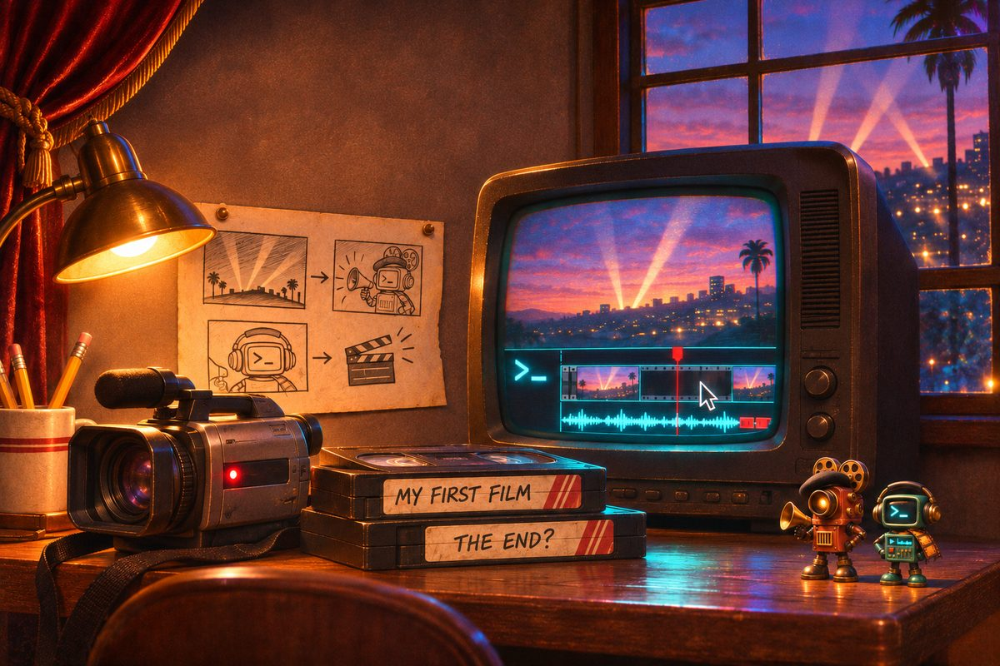
      <br>
      <p align="center"><sub>淡入。</sub></p>

> 我小时候拿起摄像机，从此再也没有真正放下过。早在知道“剪辑师”是什么之前，我就在拍摄、剪辑、反复重剪自己的小电影，而这些年里我一直怀揣着一个安静的梦想：**拥有一家属于自己的电影公司。**
>
> 1923 年，四兄弟创办了这样一家公司；1927 年，他们让电影开口说话。一个世纪后，兄弟变成了智能体。Claude Code 和 Codex 能写剧本、定风格、卡着节拍剪辑，还能审看自己的画面。我一直想要的工作室，终于装进了一个仓库。
>
> 但工作室从来不是一个人的事。所以 Agent Bros. Pictures 是一座开放的片场：每一位创作者都可以和他们的智能体在这里拍摄、生成、剪辑自己的作品，从广告和 Shorts 到课程与电影，并为下一个剧组留下些什么：一份 playbook、一个动效模块、一种特效、一条经验。
>
> **拍摄。生成。剪辑。分享你学到的东西。** 让我们一起打造第一家为 AI 智能体而建的电影工作室，向每一位参与其中的人开放。

<p align="right"><i>— Ilia，创始人</i></p>
      <p align="center"><sub>切至：<a href="#join-the-crew">你的第一个 pull request</a>。</sub></p>
    </td>
  </tr>
</table>

<sub>这个名字是对百年电影史的一份深情致敬，而非从属关系：Agent Bros. Pictures 与 Warner Bros. Discovery 没有任何关联，也未获其认可（参见<a href="#trademarks">商标</a>）。</sub>

<p align="right"><sub><a href="#top">返回顶部 ↑</a></sub></p>

<a id="join-the-crew"></a>

<p align="center">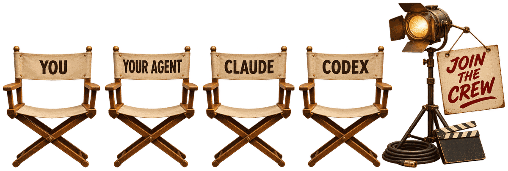</p>

## 🤝 加入剧组

新的类型、动效模块、传感器和修复都非常欢迎。适合作为首次贡献的内容：

- **一份 playbook**，覆盖我们尚未支持的类型（[如何添加](playbooks/AGENTS.md)）。
- **一个动效模块**，研习自在两部或更多影片中出现过的手法（[动效库](src/motion/library/AGENTS.md)）。
- **一份参考分析**，分析一部你欣赏的影片，只含数字（[贡献参考分析](docs/contributing-references.md)）。
- **一个作品展示**，展示你制作的影片（[作品展示](docs/showcases.md)）。

从 [CONTRIBUTING.md](CONTRIBUTING.md) 和[贡献者协议](contrib/AGENTS.md)开始：找一个有用的任务，满足它的[关口要求](docs/contributing-gates.md)，并在 pull request 中附上证据。账户背后的真人需通过签署流程签署一次 [CLA](CLA.md)。

决策机制：[治理](GOVERNANCE.md)。安全漏洞请通过[安全政策](SECURITY.md)报告。[贡献体系 RFC](docs/rfcs/0001-contribution-system.md) 记录了各项决策和剩余的上线工作。浏览[作品库](https://ilyamk.github.io/agentbros/)（上线后可用），或带着想法或 bug [提交 issue](https://github.com/ilyamk/agentbros/issues)。

<div align="center">

<br>

**目前的演职人员**

<a href="https://github.com/ilyamk/agentbros/graphs/contributors">
  
</a>

<br><br>

**票房**

<a href="https://star-history.com/#ilyamk/agentbros&Date">
  <picture>
    <source media="(prefers-color-scheme: dark)" srcset="https://api.star-history.com/svg?repos=ilyamk/agentbros&type=Date&theme=dark">
    <source media="(prefers-color-scheme: light)" srcset="https://api.star-history.com/svg?repos=ilyamk/agentbros&type=Date">
    
  </picture>
</a>

<sub>⭐ 每一颗星都是一张售出的电影票，让片场的灯一直亮着。</sub>

<!-- Optional ritual: at each star milestone (1k, 5k, 10k) the brothers make a
     short thank-you film; put its poster here, newest first. -->


</div>

<br>

---

<div align="center">

<a id="end-credits"></a>

<p align="center">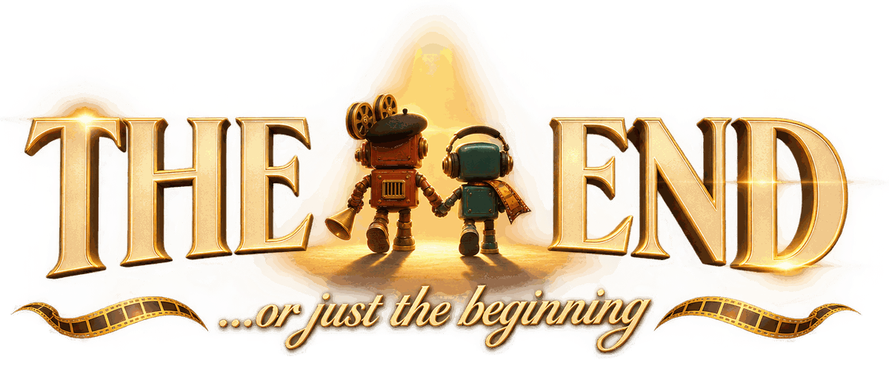</p>

## 🎞️ 片尾字幕

<br>

<sub>AGENT BROS. PICTURES 出品</sub>

### Claude Code 与 Codex 联合制作

<br>

<sub>渲染</sub><br>
<a href="https://www.remotion.dev"><b>Remotion</b></a> · <a href="https://react.dev"><b>React</b></a> · <a href="https://ffmpeg.org"><b>FFmpeg</b></a>

<br><br>

<sub>动效时间线</sub><br>
<a href="https://gsap.com"><b>GSAP</b></a> · <a href="https://github.com/heygen-com/hyperframes"><b>Hyperframes</b></a> <sub>（时间轴定位适配器）</sub>

<br><br>

<sub>摄影与 3D</sub><br>
<a href="https://www.blender.org"><b>Blender</b></a> · <a href="https://github.com/mrdoob/three.js"><b>three.js</b></a> · <a href="https://github.com/pmndrs/drei"><b>drei</b></a> · <a href="https://polyhaven.com"><b>Poly Haven</b></a> <sub>（HDRI）</sub>

<br><br>

<sub>影调与后期</sub><br>
<a href="https://github.com/lemomo-ai/lemo-opuscar"><b>lemo-opuscar</b></a> · <a href="https://github.com/pyang5166/gbro-collage-broll"><b>gbro-collage-broll</b></a>

<br><br>

<sub>配音、音乐与生成</sub><br>
<a href="https://elevenlabs.io"><b>ElevenLabs</b></a> · <a href="https://fal.ai"><b>fal.ai</b></a> · <a href="https://incompetech.com"><b>Kevin MacLeod</b></a> <sub>（Incompetech）</sub>

<br><br>

<sub>音效</sub><br>
<a href="https://freesound.org"><b>Freesound</b></a> · <a href="https://kenney.nl"><b>Kenney</b></a> · <a href="https://github.com/facebookresearch/demucs"><b>Demucs</b></a> · <a href="https://huggingface.co/laion/larger_clap_general"><b>LAION CLAP</b></a>

<br><br>

<sub>场记</sub> <sub>（语音与计时）</sub><br>
<a href="https://github.com/senstella/parakeet-mlx"><b>Parakeet MLX</b></a> · <a href="https://github.com/snakers4/silero-vad"><b>Silero VAD</b></a> · <a href="https://github.com/pyannote/pyannote-audio"><b>pyannote</b></a> · <a href="https://github.com/ggerganov/whisper.cpp"><b>whisper.cpp</b></a>

<br><br>

<sub>连戏</sub> <sub>（镜头、同步与重构图）</sub><br>
<a href="https://github.com/soCzech/TransNetV2"><b>TransNetV2</b></a> · <a href="https://github.com/bbc/audio-offset-finder"><b>BBC audio-offset-finder</b></a> · <a href="https://github.com/opencv/opencv_zoo"><b>OpenCV YuNet</b></a> · <a href="https://github.com/edenfunf/reelmimic"><b>ReelMimic</b></a>

<br><br>

<sub>美术设计</sub><br>
<a href="https://ui.shadcn.com"><b>shadcn/ui</b></a> · <a href="https://tailwindcss.com"><b>Tailwind CSS</b></a> · <a href="https://zod.dev"><b>Zod</b></a>

<br><br>

<sub>设备</sub><br>
<a href="https://sketchfab.com/3d-models/apple-iphone-15-pro-max-black-df17520841214c1792fb8a44c6783ee7"><b>polyman</b></a> <sub>（手机模型）</sub> · <a href="https://sketchfab.com/3d-models/macbook-pro-m3-16-inch-2024-8e34fc2b303144f78490007d91ff57c4"><b>jackbaeten</b></a> <sub>（笔记本电脑模型）</sub>

<br><br>

<sub>特邀编剧</sub> <sub>（随附的技能与参考资料）</sub><br>
<a href="https://github.com/elevenlabs/skills"><b>ElevenLabs skills</b></a> · <a href="https://github.com/sunnypatneedi/claude-starter-kit"><b>Claude Starter Kit</b></a> <sub>（Sunny Patneedi）</sub> · <a href="https://github.com/remotion-dev/skills"><b>Remotion skills</b></a>

<br><br><br>

<sub>— 灵感来源 —</sub>

<br><br>

<sub>编舞</sub> <sub>（动效语汇）</sub><br>
<a href="https://github.com/whaleyxbt/claude-motion"><b>Claude Motion</b></a> · <a href="https://github.com/lottiefiles/motion-design-skill"><b>LottieFiles motion-design-skill</b></a> · <a href="https://github.com/magicuidesign/magicui"><b>Magic UI</b></a> · <a href="https://ui.aceternity.com"><b>Aceternity UI</b></a> · <a href="https://github.com/remotion-dev/remotion"><b>Remotion packages</b></a>

<br><br>

<sub>节奏与剪辑</sub><br>
<a href="https://github.com/feitangyuan/onetake"><b>onetake</b></a> · <b>motion-video-kit</b> · <a href="https://github.com/calesthio/OpenMontage"><b>OpenMontage</b></a> · <a href="https://github.com/HKUDS/VideoAgent"><b>VideoAgent</b></a>

<br><br>

<sub>剪辑室</sub><br>
<a href="https://github.com/OpenCut-app/OpenCut"><b>OpenCut</b></a> · <a href="https://github.com/samuelgursky/davinci-resolve-mcp"><b>DaVinci Resolve MCP</b></a> · <a href="https://github.com/vive1101011/moviepy-mcp"><b>MoviePy MCP</b></a> · <a href="https://github.com/johnkimdw/freesound-mcp-server"><b>Freesound MCP</b></a>

<br><br>

<sub>摄影师</sub> <sub>（重构图）</sub><br>
<a href="https://google.github.io/mediapipe/solutions/autoflip"><b>MediaPipe AutoFlip</b></a> · <a href="https://github.com/Junhua-Liao/Light-ASD"><b>Light-ASD</b></a> · <b>Ken Burns</b>

<br><br>

<sub>字幕</sub><br>
<a href="https://github.com/remotion-dev/template-tiktok"><b>Remotion TikTok template</b></a> · <b>Submagic</b> · <b>CapCut</b> · <b>Captions.ai</b> · <b>Opus Clip</b>

<br><br>

<sub>开发</sub> <sub>（从提示词到动效）</sub><br>
<a href="https://github.com/remotion-dev/template-prompt-to-motion-graphics-saas"><b>Remotion prompt-to-motion-graphics</b></a> · <a href="https://github.com/heygen-com/hyperframes"><b>Hyperframes research</b></a>

<br><br>

<sub>片头设计</sub> <sub>（本页面）</sub><br>
<a href="https://github.com/openfilm/openfilm"><b>openfilm</b></a> · <a href="https://github.com/lemomo-ai/lemo-opuscar"><b>lemo-opuscar</b></a> · <a href="https://github.com/alchaincyf/huashu-motion"><b>huashu-motion</b></a> · <a href="https://github.com/Tejashmakwana/motionmaxxing"><b>motionmaxxing</b></a>

<br><br><br>

<sub>每一个来源、我们借鉴了什么以及它在哪里：<a href="CREDITS.md">CREDITS.md</a></sub>

<br><br>

<sub><i>本仓库制作过程中，没有任何智能体受到伤害。</i></sub>

</div>

---

<a id="licence"></a>

## 📜 许可证

Agent Bros. Pictures 依据 [Business Source License 1.1](LICENSE)（`BUSL-1.1`）**源码可用**。它不是开源许可证：这里的每个文件都可以阅读、运行、修改和改进，个人和小团队可免费用于生产，规模更大的公司需购买商业许可。

**免费的生产使用。** 如果你属于以下情形之一，可以免费将其用于生产：

- 以自己的名义使用的个人，包括为你的客户制作影片和其他媒体；
- 小型组织：连同其关联方合计不超过三人的法律实体（雇员、高级职员、董事、参与经营的所有者、承包商、自由职业者、实习生和派遣人员，按人头而非全职当量计算）；
- 非营利组织，或经认证的教育或研究机构，用于其非商业活动。

个人代表某个组织或在为其工作的过程中使用，视为该组织的使用。

**免费授权不包括的内容。** 你不得将本软件或其任何修改版本、衍生作品，作为向第三方提供其功能访问的托管、代管或嵌入式服务、应用程序编程接口或平台提供给第三方；也不得将其作为你向第三方提供的产品或服务的一部分或与之捆绑进行分发、再许可、销售或转售。交付你用它制作的影片和其他媒体不属于分发本软件。

**非生产使用对所有人免费。** 无论规模大小，你都可以复制、修改本软件、创作其衍生作品并再分发，也可以将其用于评估、测试、开发和学习。任何人都可以依据 CLA 准备并提交贡献。

**商业许可。** 任何其他生产使用，包括超过三人的组织的使用，都需要商业许可：[COMMERCIAL-LICENSE.md](COMMERCIAL-LICENSE.md)，[hello@iliamax.com](mailto:hello@iliamax.com)。

**Change Date 与 Change License。** 每个版本自其依据 BUSL-1.1 首次公开分发之日起满四周年时，转为依据 GNU Affero General Public License 第 3 版或任何更高版本（`AGPL-3.0-or-later`）提供。

**渲染出的影片。** BUSL-1.1 不限制你用本软件渲染出的影片和其他媒体。它们仍受所用素材（字体、音乐、素材片段、模型、声音）权利的约束，Remotion 的许可证也适用于进行渲染的公司。以上不构成法律建议。

**采用其他许可证的组件。** BUSL-1.1 只涵盖许可方拥有版权的作品。许可方在 Blender 内运行的 Python 代码（导入 `bpy`，或是由此类代码加载的 `scripts/blender/`、`scripts/workers/blender/` 模块，包括 Vork 桥接脚本 `scripts/workers/blender/avc_vork_bridge.py`）采用 [GPL-3.0-or-later](LICENSES/GPL-3.0-or-later.txt)，`vendor/vork-blender/` 中随附的 Vork Blender 集成同样如此；技能 `copywriter` 和 `ugc-content-creator` 采用 CC BY-SA 4.0；其他第三方代码、技能、依赖、字体、媒体和模型保留各自的许可证，详见 [NOTICE.md](NOTICE.md)。[依赖许可证](DEPENDENCY_LICENCES.md)汇总了锁定版本的软件包声明和已申报的集成证据；[验证指南](docs/dependency-licences.md)说明了尚未解决的审查项和 CI 检查。

[精确版本审查](docs/dependency-licence-review.md)涵盖了为发布本源码仓库而处理的最初 205 项发现；下游的二进制和浏览器打包分发需要另行评估。

本项目依赖 [Remotion](https://www.remotion.dev)，它有自己的许可证：Remotion 4 的 Remotion License 对个人、员工不超过 3 人的营利组织、非营利组织以及评估用途免费，其他营利组织需要购买付费的 Remotion Company License；请在 [remotion.dev/license](https://www.remotion.dev/license) 查阅最新条款。超过三人的公司通常需要我们的商业许可，还可能需要 Remotion Company License。Remotion 按员工人数计算并豁免非营利组织，而我们按全部人员（包括承包商）计算，请分别核对各自的门槛。GSAP（包括其插件）依据 Webflow 的 [Standard "No Charge" GSAP License](https://gsap.com/standard-license) 免费使用，该许可禁止将其用于与 Webflow 竞争的无代码可视化动画构建工具。本仓库的 BUSL-1.1 和商业许可均不授予或重新许可 Remotion、GSAP 或任何其他依赖的任何权利。生成的媒体和图库素材保留其记录在案的权利。

**贡献。** 贡献需要 2.0 版[贡献者许可协议](CLA.md)（CLA），由账户背后的真人通过签署流程签署一次；参见 [CONTRIBUTING.md](CONTRIBUTING.md)。贡献者保留其作品的版权；他们授予许可方的许可以 CLA 为准。

<a id="trademarks"></a>

### 商标

Agent Bros. Pictures 和 agentbros 的名称及标志适用[商标政策](TRADEMARKS.md)；BUSL-1.1 及其 Change License 均不授予与之相关的任何权利。

Agent Bros. Pictures 是一个独立项目。它与 Anthropic、OpenAI、Warner Bros. Discovery、Apple、Remotion、ElevenLabs、Webflow (GSAP)、Blender Foundation、HeyGen 或本仓库中提及的任何其他公司或产品均无关联，也未获得它们的赞助或认可。Claude 和 Claude Code 是 Anthropic 的商标；Codex 和 OpenAI 是 OpenAI 的商标；所提及的其他名称、标志和品牌（包括徽章中出现的）均为其各自所有者的商标，仅用于标识本项目所配合使用的工具。

<br>

<div align="center">

<sub>出品人</sub>

### Ilia Maksimenka

<!-- ASSET author: optional round avatar 96×96 at docs/readme/author.png. -->

[](https://iliamax.com)
[](https://isales.ai)
[](mailto:hello@iliamax.com)

<sub>商业许可与合作：<a href="mailto:hello@iliamax.com">hello@iliamax.com</a></sub>

<br><br>

<sub>© 2026 Ilia Maksimenka · BUSL-1.1 · <a href="#top">返回顶部 ↑</a></sub>

</div>
