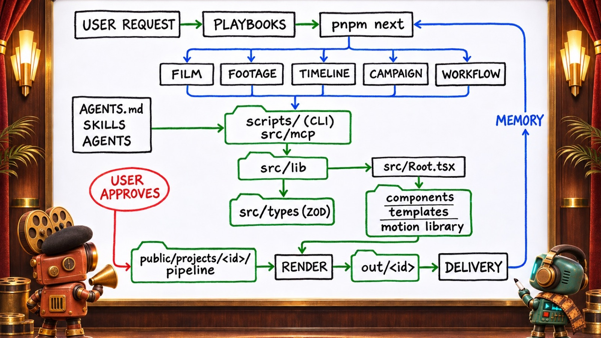

# Architecture

Last updated: 2026-11-20



The whole repository on one page, for an agent or a person about to change the harness: what each part is for, how the parts connect, where each fact is defined, and how to extend the system without breaking its shape. It links to the area `AGENTS.md` files for detail and never restates their tables. When this page and an area `AGENTS.md` disagree, the area file and the code win; fix this page.

Making a video is not covered here: that starts at the root [AGENTS.md](../AGENTS.md) ("Start here"). A shorter tour for people: [how it works](how-it-works.md).

## What the system is

Agent Bros. Pictures is a **harness**, not an app. Coding agents (Claude Code, Codex, Cursor, Copilot and others, wired by `pnpm harness:setup`: [harnesses](harnesses.md)) are the runtime: they read instructions, call CLIs and dispatch leaf subagents, and the repository supplies everything else:

- **Instructions**: `AGENTS.md` files, playbooks, skills and agent definitions, which tell an agent what to do and what to read.
- **Deterministic tools**: CLIs in `scripts/` over libraries in `src/lib/`. Each emits one JSON line, and the code decides state, gates and the next step.
- **A renderer**: Remotion compositions in React, where every frame is a pure function of the frame number.
- **Contracts**: Zod schemas in `src/types/` for every artefact a step writes.

Projects may opt into a versioned experiment at a named step. The selection is pinned to the project and enters the step answer and its owner brief. The same checkout can compare independently rendered control and candidate projects. [Project experiments](experiments.md)

The design rule behind all four: **decisions that can be computed live in code and data; judgement lives with agents; approvals belong to the user.** An agent never works out the next step from prose. It asks `pnpm next`, which reads the project's files and answers.

A project can pin a [film style card](film-styles.md). The film chain includes bounded guidance for each owning step, and render receipts retain the exact version.

Speech follows this boundary from script line through provider take and timing
receipt to a reference pack or a reversible timeline edit. The voice profile
is shared by validation and capability discovery. A listening decision binds
the exact voice, model, language and take hashes. [Audio integrations](audio-integrations.md)

Portable local draft voices use pinned CPU models and bind a take and its readback to the existing narration receipt. Project renders can use a verified previous master for local picture edits. The renderer compares the rebuilt picture and audio with its two sources before issuing a complete receipt. [Speech](speech.md#portable-narration) · [Delivery](delivery.md)

## Layers

```
            user request
                 │
   ┌─────────────▼──────────────┐   instructions (read, not executed)
   │ AGENTS.md · playbooks/     │   root rules → playbook → step "read" lists
   │ .agents/skills · agents    │   skills = craft, agents = one role each
   └─────────────┬──────────────┘
                 │ agent runs CLIs, or the MCP bridge runs them for it
   ┌─────────────▼──────────────┐
   │ scripts/*.ts  (CLI layer)  │   one JSON line on stdout, typed error codes
   │ src/mcp/      (MCP bridge) │   whitelisted CLIs with scoped paths and spend
   └─────────────┬──────────────┘
                 │ import
   ┌─────────────▼──────────────┐
   │ src/lib/  (domain logic)   │   routes, film chain, providers, jobs, budget,
   │                            │   audio, delivery, sensors, memory ...
   └──────┬──────────────┬──────┘
          │ validate     │ render (Remotion CLI / bundler)
   ┌──────▼──────┐ ┌─────▼────────────────────────────────┐
   │ src/types/  │ │ src/Root.tsx → src/components/        │
   │ Zod schemas │ │ src/templates/, src/motion/ (library)  │
   └─────────────┘ │ src/projects/<id>/ (per-film code)     │
                   └────────────────────────────────────────┘
   data: public/projects/<id>/ (inputs and pipeline/ artefacts) → out/<id>/ (renders, QA)
```

Dependency direction is one way: `scripts/` → `src/lib/` → `src/types/`. Rendering code (`src/components`, `src/templates`, `src/motion`, `src/projects`) may use pure helpers from `src/lib` such as tokens, timeline and project props, but `src/lib` never imports a scene. Pure maths in `src/motion` (`timing`, `text-split`, `series`, `camera-math`) and the block plans stay browser-free so tests can import them.

Shot-level 3D techniques are discoverable through the motion library catalogue. An opted-in film receives a short search instruction in the affected owner briefs. Selection uses the existing shot plan and the renderer samples the scene from the frame. [3D techniques](drei-techniques.md)

## Directory map

| Path                                 | Responsibility                                                                                                                                                                                                                                                                              | Rules                                                        |
| ------------------------------------ | ------------------------------------------------------------------------------------------------------------------------------------------------------------------------------------------------------------------------------------------------------------------------------------------- | ------------------------------------------------------------ |
| `AGENTS.md`, `CLAUDE.md`             | Root rules and index; `CLAUDE.md` only imports `AGENTS.md`                                                                                                                                                                                                                                  | [root](../AGENTS.md)                                         |
| `playbooks/<id>/`                    | One kind of video: method, quality bar, triggers, route, per-step reads (`playbook.json` + `AGENTS.md`)                                                                                                                                                                                     | [playbooks](../playbooks/AGENTS.md)                          |
| `.agents/agents/`                    | Leaf subagents, one role each (depth 1, never spawn others)                                                                                                                                                                                                                                 | [index](../.agents/agents/README.md)                         |
| `.agents/skills/`                    | Craft knowledge and procedures; `.claude/` only links here                                                                                                                                                                                                                                  | [vendored](../.agents/skills/THIRD_PARTY.md)                 |
| `scripts/`                           | Every CLI (`package.json` alias), plus `workers/` (native helpers) and `blender/` (Blender kit)                                                                                                                                                                                             | [scripts](../scripts/AGENTS.md)                              |
| `src/lib/`                           | Domain libraries, one folder per concern                                                                                                                                                                                                                                                    | [lib](../src/lib/AGENTS.md)                                  |
| `src/lib/film/`                      | Bespoke film chain: steps, routes per film type, briefs, gates                                                                                                                                                                                                                              | [film](../src/lib/film/AGENTS.md)                            |
| `src/lib/audio/`                     | Analysis, mixing, sync maps, music structure, SFX                                                                                                                                                                                                                                           | [audio](../src/lib/audio/AGENTS.md)                          |
| `src/lib/memory/`                    | Code of the user's local memory                                                                                                                                                                                                                                                             | [memory code](../src/lib/memory/AGENTS.md)                   |
| `src/types/`                         | Zod schema of every artefact                                                                                                                                                                                                                                                                | [types](../src/types/AGENTS.md)                              |
| `src/mcp/`                           | Local MCP server exposing whitelisted CLIs (toolsets, `avc_call`, `avc_guide`)                                                                                                                                                                                                              | [mcp](../src/mcp/AGENTS.md)                                  |
| `src/lib/harness/`                   | Per-harness wiring: links, converted agents, MCP configs (`harness:setup`)                                                                                                                                                                                                                  | [harnesses](harnesses.md)                                    |
| `src/Root.tsx`, `src/index.ts`       | Remotion entry; generic compositions `ProjectVertical/Square/Landscape`                                                                                                                                                                                                                     | [components](../src/components/AGENTS.md)                    |
| `src/components/`                    | Compositions and scene components (`GenericProject`, timeline renderer)                                                                                                                                                                                                                     | [components](../src/components/AGENTS.md)                    |
| `src/templates/`                     | Reusable frame-driven parts: text, backgrounds, talking head, left panels, registered templates                                                                                                                                                                                             | [templates](../src/templates/AGENTS.md)                      |
| `src/motion/`                        | Motion primitives, sync (beat grid, audio curves), GSAP gateway `gsap.ts`, `lab/` examples                                                                                                                                                                                                  | [motion](../src/motion/AGENTS.md)                            |
| `src/motion/library/`                | Catalogued blocks agents compose (`defineItem`, registry, previews)                                                                                                                                                                                                                         | [library](../src/motion/library/AGENTS.md)                   |
| `src/projects/<id>/`                 | A bespoke film's own scene code (git-ignored)                                                                                                                                                                                                                                               | `pnpm lint --project <id>`                                   |
| `public/projects/<id>/`              | A project's config, media and `pipeline/` artefacts (git-ignored)                                                                                                                                                                                                                           | [cleanup](cleanup.md)                                        |
| `public/shared/`                     | Shared fonts, images, music, SFX, 3D; binaries via manifests and `assets:sync`                                                                                                                                                                                                              | [assets](assets.md)                                          |
| `out/<id>/`, `out/qa/`               | Renders, versions, delivery receipts; QA evidence (git-ignored)                                                                                                                                                                                                                             | [delivery](delivery.md)                                      |
| `memory/`                            | The user's local memory (entries git-ignored)                                                                                                                                                                                                                                               | [memory](../memory/AGENTS.md)                                |
| `tests/`                             | `node:test` suites and synthetic fixtures; no paid APIs                                                                                                                                                                                                                                     | [tests](../tests/AGENTS.md)                                  |
| `docs/`                              | Guides, plans, RFCs, generated catalogues                                                                                                                                                                                                                                                   | [docs](AGENTS.md)                                            |
| `design-reference/`                  | Design system, reference library and corpus, slop catalogue                                                                                                                                                                                                                                 | [design-reference](../design-reference/AGENTS.md)            |
| `contrib/`, `.changes/`, `credits/`  | Contribution gates, release entries, credit sources                                                                                                                                                                                                                                         | [contrib](../contrib/AGENTS.md)                              |
| `bench/`, `community/`, `site/`      | Benchmark suites, contributor profiles, Pages site builder                                                                                                                                                                                                                                  | [benchmark](benchmark.md), [showcases](showcases.md)         |
| `blender-arsenal/`                   | Blender recipes, extensions and proofs                                                                                                                                                                                                                                                      | [arsenal](../blender-arsenal/AGENTS.md)                      |
| `ui-sources/`, `workers/`, `vendor/` | shadcn scratch for real UI; Resolve worker; vendored Hyperframes and Vork                                                                                                                                                                                                                   | [UI sources](ui-sources.md), [Resolve](resolve-worker.md)    |
| `apps/console/`                      | Studio console UI (Vite, React, shadcn/ui): shell, route panels, media viewer, timeline review; built to `out/console/dist/`; never imported from `src/`, no determinism law                                                                                                                | [console](../apps/console/AGENTS.md), [guide](console.md)    |
| `src/lib/console/`                   | Console server and daemon; event journal (`journal.ts`); projector `view/` (read model from the project's files); decisions (`actions.ts`, `apply.ts`, `inbox.ts`, `grant.ts`, `intent.ts`), control, cards, ratings, notifications, metrics, snapshot; `review/` hosts the review services | [guide](console.md), [RFC 0004](rfcs/0004-studio-console.md) |
| `src/lib/local-server/`              | Loopback HTTP security shared by the console and the review servers: token, Host and Origin checks, bodies, CSP, path confinement, Range                                                                                                                                                    | [guide](console.md#security-model)                           |
| `scripts/hooks/`                     | Harness hooks for Claude Code and Codex (`agentbros-hook.mjs`: observe, guard, orient, relay, present, surface, wake) and the console status line; plain Node                                                                                                                                        | [harnesses](harnesses.md#hooks)                              |
| `examples/`                          | Schema-tested workflow requests                                                                                                                                                                                                                                                             | [workflows](workflows.md)                                    |
| `.github/`                           | CI, bots, release provenance                                                                                                                                                                                                                                                                | [GitHub](github.md)                                          |

## How a request flows

1. **Playbook.** `pnpm playbook --match` ranks `playbooks/*/playbook.json` against the request. Binding writes `public/projects/<id>/pipeline/playbook.json`. Code: `src/lib/playbooks/`.
2. **Route.** `pnpm next --project <id>` calls `detectRoute` (`src/lib/pipeline/route.ts`). The route comes from markers in the project folder:
   - **campaign**: `pipeline/campaign-production/owner.json`. Work goes to the `campaign*` CLIs in `src/lib/campaigns/`.
   - **film**: `pipeline/brief.json`, the bespoke chain. Work goes to `film:next` in `src/lib/film/`.
   - **footage**: the user's own recording. Work goes to `footage:next` in `src/lib/footage/`.
   - **timeline**: `project.json` from a recipe, `project:new` or a campaign child. Work goes through render, `qa:editorial` and `delivery` (`src/lib/pipeline/timeline-next.ts`).
   - **workflow**: started by its own command, `video:workflow`, in `src/lib/workflows/`.
3. **Step loop.** Each next-step answer is one action: `dispatch` an agent, `run` a script, `ask` the user or `stop`. It comes with the `read` list (the bound playbook first), the user's `memory`, orchestrator checks and forbidden moves. For a film, `film:brief` writes the subagent's prompt from `FILM_CHAIN`. The step lease (`src/lib/step-lease/`) restricts which commands a step may run.
4. **Artefacts.** Every step writes into `public/projects/<id>/pipeline/`, validated by its schema (`ARTEFACT_SCHEMAS` in `src/lib/film/chain.ts`). The status of a film step is _derived_ from files and hashes (`src/lib/film/state.ts`), not stored. Approvals are bound to output hashes, so a changed artefact reopens its gate.
5. **Render.** A `project.json` renders through `GenericProject`, which `render` invokes. A bespoke film renders its own composition from `src/projects/<id>/` with `film:render`. Versions are kept in `out/<id>/versions/`.
6. **Checks and delivery.** Sensors (`src/lib/sensors/`), `film:measure`, critics and QA. Then `delivery --action snapshot` and `--action check` (`src/lib/delivery/`). Only a passing check is production-ready.
7. **Learning.** User verdicts become memory entries (`pnpm memory --add`). A problem seen twice becomes a proposed change to a rule, sensor or playbook ([creative-postmortem](../.agents/skills/creative-postmortem/SKILL.md)).

**Studio console.** Beside this loop, every CLI run appends to the project's journal (`pipeline/events.jsonl`) and the next-step answers start the console (`src/lib/console/`), which projects the project's files into a read model and applies the user's decisions by spawning the same CLIs with the user's words (`AGENTBROS_CHANNEL=console`, signed grant). A paused project refuses every non-control CLI with `PAUSED` ([console](console.md)).

Paid generation inside any step goes `providers/` → `jobs/` (durable, resumable by operation ID) → `budget/` admission, with prices from `pricing.ts` and the model registry ([paid execution](paid-execution.md)).

## Single sources of truth

Change the fact here. Everything else reads it or is generated from it.

| Fact                                                        | Defined in                                          | Read or generated by                                                  |
| ----------------------------------------------------------- | --------------------------------------------------- | --------------------------------------------------------------------- |
| Film chain steps, owners, gates, outputs                    | `FILM_CHAIN` in `src/lib/film/chain.ts`             | `film:next`, `film:brief`, [production chain](production-chain.md)    |
| Steps and tools per film type                               | `FILM_ROUTES` in `src/lib/film/routes.ts`           | `film:route --write-doc` → [film types](film-types.md)                |
| Artefact shapes                                             | `src/types/*.ts` (strict Zod, versioned literals)   | every writer and reader                                               |
| Project routes and next-step answers                        | `src/lib/pipeline/route.ts`                         | `next`                                                                |
| CLI commands: section, spend, MCP exposure                  | `src/lib/cli/commands.ts` + `package.json`          | `commands --write-doc` → [commands](commands.md), MCP catalogue       |
| MCP tools                                                   | `src/mcp/catalog.ts` (named by the registry entry)  | `src/mcp/server.ts`                                                   |
| Motion blocks                                               | `src/motion/library/<category>/index.ts`            | `library:catalogue` → `docs/library/catalogue.json`                   |
| Playbooks                                                   | `playbooks/<id>/playbook.json`                      | `playbook --write-doc` → index in [playbooks](../playbooks/AGENTS.md) |
| Prices and endpoints                                        | `src/lib/pricing.ts`, `src/lib/models/`             | budget admission, quotes                                              |
| What a project owns on disk                                 | `projectFootprint()` in `src/lib/pipeline/paths.ts` | `project:remove`, `workspace:clean`                                   |
| Design defaults                                             | `src/lib/design-tokens.ts`                          | scenes, templates, [tokens](design-tokens.md)                         |
| Service keys                                                | `src/lib/setup/keys.ts`                             | doctor, `keys`, `bootstrap`                                           |
| Credits                                                     | `credits/<id>.json`                                 | `credits:write-doc` → `CREDITS.md`                                    |
| Agent definitions                                           | front matter in `.agents/agents/*.md`               | the index README (test-checked)                                       |
| Colour grade evaluation order                               | `apply_grade` in `scripts/workers/colour_maths.py`  | `.cube` bake for `colour:grade`, [colour grading](colour-grading.md)  |
| Console contract (journal, view, decisions, cards, control) | `src/types/console.ts`                              | console server, projector, CLIs, UI (`apps/console/`)                 |

Studio Console API key settings use the setup provider registry and a local override file loaded by each CLI. The key reveal and batch save routes require a capability distinct from the regular console session. The in-app editor handoff passes that capability to the default browser through the operating system.

Generated files are never edited by hand: `docs/commands.md`, `docs/film-types.md` and `docs/film-types/`, `docs/library/`, `docs/dependency-licence-review.md`, `CREDITS.md`, the playbook index.

Studio Console project settings use `project-display.json` for the display title and the guarded `project:remove` CLI for confirmed deletion. The console keeps project IDs stable when a title changes.

## Invariants

These hold across every area. Breaking one is a design change, not a fix.

- **Determinism.** Every animated value is a pure function of the frame. Randomness is seeded. There is no own clock (CSS animation, timers, `Date.now`, R3F `useFrame`). GSAP is allowed only through `src/motion/gsap.ts`. Enforced by `pnpm lint` in `src/` and by `lint --project` in `src/projects/`.
- **CLI contract.** One JSON line on stdout and progress on stderr, with a non-zero exit on failure. Errors use the typed `ERROR_CODES` from `src/lib/cli/`. Callers parse the whole line.
- **The user approves.** Gates record only the user's own words (`film:approve --answer`), or a policy the user granted within its limits. Approval commands are never MCP tools.
- **Spend is admitted, not assumed.** Reserve before submit and resume by operation ID. An unknown price is not free. Raising a ceiling needs the user's words.
- **The console uses the project's files and journal as its source.** Decisions run the owning CLI with the user's words and the hashes they reviewed (`--expect`). The strategy document editor writes the pending artefact and records its new hashes through the film engine's step validation, leaving approval to the user.
- **Originals are immutable.** Ingest, repair and import write new files with provenance.
- **Media through Remotion.** Use ``, `<Video>`, `<Audio>` and `staticFile()`. Media binaries stay out of git (manifests only).
- **Locked Python workers.** `src/lib/python.ts` selects Python 3.13.18 and isolated uv groups; only the NumPy-1.x offset worker retains 3.12.16. Blender keeps its bundled interpreter. [Runtime contract](python-runtime.md).
- **The repository is the harness, not a project store.** `public/projects/`, `src/projects/`, `out/` and `memory/` entries are git-ignored. Tracked files carry no machine paths (`repo:hygiene --check`).
- **Instructions are layered and budgeted.** Root `AGENTS.md` ≤ 15 KiB, the four large areas ≤ 24 KiB, others ≤ 12 KiB (`tests/agents-md.test.ts`). Detail moves down a level, never into the root.

## Extending the system

Each change below has a fixed path. Follow it, and the tests that guard the registries pass.

| To add                                 | Steps                                                                                                                                                           | Governing file                                                            |
| -------------------------------------- | --------------------------------------------------------------------------------------------------------------------------------------------------------------- | ------------------------------------------------------------------------- |
| A CLI command                          | Script on `runScript`/`parseArgs`; alias in `package.json`; entry in `src/lib/cli/commands.ts`; `pnpm commands --write-doc`; name it in the playbooks it serves | [scripts](../scripts/AGENTS.md)                                           |
| An MCP tool                            | Registry entry's `mcp` name; `define()` in `src/mcp/catalog.ts` with typed fields, path fields and spend mode; a case in `tests/mcp.test.ts`                    | [mcp](../src/mcp/AGENTS.md)                                               |
| A schema or artefact field             | Change the schema first (strict), then the writers, readers and any agent or skill that documents it, in one commit; breaking changes add a version literal     | [types](../src/types/AGENTS.md)                                           |
| A film chain step or film type         | Edit `FILM_CHAIN` / `FILM_ROUTES` (data, not agent prose); `pnpm film:route --write-doc`                                                                        | [film](../src/lib/film/AGENTS.md)                                         |
| A kind of video                        | New `playbooks/<id>/` with `playbook.json` and `AGENTS.md`; regenerate the index                                                                                | [playbooks](playbooks.md#adding-or-changing-a-playbook)                   |
| A motion block                         | One component plus zod schema in `src/motion/library/<category>/`, `defineItem`, honest `formats`, `inspiredBy`; `pnpm library:catalogue`                       | [library](../src/motion/library/AGENTS.md)                                |
| A provider or model route              | Through `providers/`, `jobs/`, `budget/` and the pricing registry, never an ad hoc SDK call                                                                     | [lib](../src/lib/AGENTS.md), [model routing](production-model-routing.md) |
| An agent or skill                      | A file in `.agents/agents/` (front matter, leaf only) or a folder in `.agents/skills/`; update the agents index                                                 | [agents index](../.agents/agents/README.md)                               |
| A new area (folder with its own rules) | Its own `AGENTS.md` with a `Last updated:` line; a row in the root instruction table; a row in this page's map                                                  | [docs](AGENTS.md#keeping-agentsmd-files-current)                          |

Before a pull request run `pnpm check` (hygiene, Python, format, lint, typecheck, tests). Instruction changes also run `pnpm instructions:lint`. Contribution categories and gates: [contrib](../contrib/AGENTS.md).

## Evolving the architecture well

- **Put the decision in code or data.** A rule that can be computed (a gate, a route, a step's inputs) belongs in a registry that `next` reads, not in an agent's instructions. Agents get a smaller, sharper brief.
- **Extend a registry before adding a path.** A new kind of video is usually a playbook over existing routes. A new look is usually blocks from the library. A new route or composition is the last resort.
- **One owner per fact.** If two files describe the same shape or list, make one generate or import the other and add a test that they agree.
- **Keep boundaries testable.** Pure logic sits apart from React and from network calls so `node:test` covers it without a browser or credentials. Slow or machine-specific suites are gated by `RUN_*`.
- **Measure before judging.** Prefer a sensor or a measured check (motion, flashes, loudness, safe zones) to an opinion. Calibrate thresholds on references and date them.
- **Remove instead of layering.** When a mode is replaced, delete it and its instructions (as the template stage pipeline was on 2026-11-17), leaving at most a read-only path for old projects.

## Keeping this page current

An agent that changes the architecture updates this page **in the same commit** and sets `Last updated:` to that day. Architecture means:

- a top-level folder or `src/` area being added, moved or removed;
- a route, or the chain's shape, changing;
- a single source of truth moving;
- an invariant changing;
- an extension path changing.

Changes inside an area that keep its role (a new command, block or schema field) belong in that area's `AGENTS.md`, not here.
