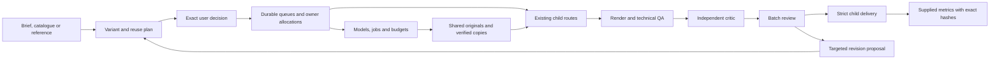

# Agent-orchestrated video campaigns

Last updated: 2026-11-17.

A campaign coordinates existing video projects. It owns an exact variant plan, shared assets, fixed allocations, source-bound task receipts and review packages. The existing film, workflow, localisation, renderer and delivery implementations remain authoritative. Agents make creative decisions using bounded briefs; this feature does not start another LLM service.



## Start and continue

```bash
pnpm playbook --match "20 hook variants for this product video"
pnpm campaign:production --project launch --action plan --request request.json
pnpm campaign:production --project launch --action init --request request.json
pnpm next --project launch
pnpm campaign:production --project launch --action review --purpose creative-plan
pnpm campaign:approve --project launch --package REVIEW.json --expected-hash HASH --reviewed-by PERSON --answer "THE USER'S WORDS"
pnpm campaign:production --project launch --action run-local
pnpm campaign:production --project launch --action status
```

`plan` writes nothing. `init` refuses occupied destinations and creates a non-renderable project container in `public/projects/<id>`. Production files live in its `pipeline/campaign-production/`; its budget and asset registry retain their standard paths. Children remain independent projects. All request files and nested files are confined to the workspace. Requests, matrices, catalogues and agent decisions are data, never executable code.

`CampaignProductionRequestSchema` in `src/types/campaign-production.ts` is the contract. Supply version, id, revision, scenario, brief and exactly one of `members`, `matrix` or `catalogue`. A member has an id, projectId, language and an adapter. Adapters accept an existing recipe request, canonical project configuration, source-bound workflow request, supplied translation, bespoke-film scaffold or existing project. Existing workflow validators still require real source media, timed speech, proof and rights.

```json
{
  "version": 1,
  "id": "launch",
  "revision": 1,
  "scenario": "ad-experiments",
  "brief": "Compare two explicitly authored openings; no paid work",
  "spend": "forbid",
  "members": [
    {
      "id": "opening-a",
      "projectId": "launch-opening-a",
      "language": "en",
      "factors": { "hook": "question" },
      "hypothesis": "A question makes the product problem easier to recognise",
      "adapter": {
        "kind": "recipe",
        "request": {
          "projectId": "launch-opening-a",
          "recipeId": "ad-direct",
          "topic": "Supplied product",
          "formats": ["vertical"]
        }
      }
    }
  ]
}
```

A recipe is an animatic, not an accepted advertisement. Its missing material and quality decisions still need real production. Select the `workflow` product-ad adapter for the maintained evidence-backed advertisement workflow, or let specialists author the film route. Recorded speech retains the existing recut/source-context rules.

## Five playbooks and explicit variants

`ad-experiments` includes creative refresh; `catalogue-videos` includes affiliate batches; `reference-family` requires a pinned reference blueprint; `localise-campaign` replaces language-dependent material; `content-series` stores episode identities and dates. Choose a child playbook and adapter for the material each actually needs.

A matrix contains named `axes`, explicitly selected `combinations`, optional partial `exclude` rules and a `memberTemplate`. It never invents a Cartesian product. Templates substitute `{{binding}}` in string values only. Each combination supplies all declared axes; duplicate combinations fail. `{{id}}` and `{{campaign}}` are available for project naming. Invalid generated member IDs fail before creation.

A catalogue supplies a pinned `file` (`path`, `sha256`), `format` (`csv`, `tsv`, `json`), `idColumn`, explicit `columns` mapping and `memberTemplate`. The stable row identifier becomes productId; mapped values and raw id/productId are available as bindings. Use memberId and projectId for safe stable internal identifiers, including SKUs with capitals, spaces or slashes; catalogue reordering preserves frozen ownership. Missing facts and duplicate rows fail rather than being silently skipped. XLSX and Google Sheets export to CSV. One request is bounded to 1,000 selected members.

## Materials, money and models

Each material has one owner (`shared` or a member), dependencies and either a supplied pinned original with provenance/rights or an exact generated request with useCase, output and reason. Refer to declared materials in template/recipe inputs as `material://ID`. Materials needed before a new child exists must use the shared owner. Member ownership is supported for existing children; unsupported ownership fails during planning. Consumers import verified immutable copies and retain separate cross-project owner/job/hash bindings; identical bytes do not merge unrelated provenance implicitly.

Allocations include the shared owner and every child. Their conservative micro-USD sum cannot exceed capUsd. Allocations are not spending. Existing projects cannot be adopted by silently reducing their previous budget. Budget bindings are versioned separately from creative revisions; a changed member allocation or participant set requires a new campaign. Cost reports include the shared owner exactly once and keep unknown actual billing unknown.

Use models:pick for the use case, then inspect the exact endpoint and schema and prepare its request-specific dry-run. The saved selection and directing reason remain evidence; a general planning price does not authorise an operation. Paid execution uses the existing generate:model/jobs/budget path and stable operation IDs. Interrupted or ambiguous submits retain their existing reconciliation semantics.

`run-local` never submits paid generation. A `spend: "forbid"` campaign also rejects new paid reservations through its child OperationStores; a larger quota or revision cannot grant itself authority. To execute a separately authorised campaign, approve its exact generation-request package and use `campaign:execute --allow-paid --max-total-usd N`. Every request must have a fitting bounded dry-run quote before submission, and per-operation admission still applies. Unknown prices need an authorised positive bound. No test or example creates that authority.

## Dependency and timing evidence

Task receipts bind the plan, task inputs, dependency receipts and actual output bytes. Rendering additionally binds the existing source identity, including code, media and timing. A full existing renderer receipt with identical source/props hashes and verified output bytes can be reused across creative revisions; QA, agent decisions and user review still bind the current plan. Tampering or changed dependencies makes results stale. Revise with `campaign:production --action revise --request FILE`; old plans and decisions remain retained. A no-spend plan cannot be revised into a spending plan. The immutable reusePlan lists each member’s source pins, project reuse/derivation, verified material imports and the timing, captions, events, render and QA work to recalculate. Receipt history retains earlier attempts; a changed agent decision requires a newly reviewed plan revision.

A changed template/recipe adapter in an existing campaign child requires `expectedProject` pinning that child's current project.json and a newly approved plan. This compare-and-swap preserves intervening edits; history is retained. Source-owned workflows require their existing edit/review process rather than generic text rewriting.

Optional supplied `speech` entries pin scene MP3 and word-alignment files. Word text must reproduce the scene's speech, intervals must be ordered and within measured audio. Localisation can use measured replacement durations before planning, and the resulting project still needs the normal localisation review. Changed native-audio presenter footage requires the existing replacement-presenter path and review; a still or empty script cannot validate old embedded speech.

Anchors name scene, pinned alignment and start/end/word with optional explicit occurrence and frame offset. Missing or ambiguous words fail. An overlayId and durationFrames resolve into a real existing TimelineIR update-overlay batch with revision checking. For bespoke films the film agent mounts timing through its existing build; the campaign does not rewrite arbitrary TSX. Alignment changes invalidate dependent events, captions and render work.

## Queue, agents and review

The local coordinator atomically records ownership in `.cache/campaign-production/`. Pools default to two generation tasks, two processing tasks, one render and two QA tasks. Remote waiting does not occupy local work. Live owners are not reclaimed by timeout; a proved-dead process can be recovered. Stable generation operations, not lease state, determine whether external work completed. Run again to advance ready work; failures block dependants while independent variants continue.

campaign:next emits dispatch/run/ask/stop. campaign:brief builds one input-bound specialist prompt. An agent writes declared outputs and a CampaignDecision with actual evidence/output pins, then registers it using `campaign:production --action decision --input FILE`. A fresh creative-critic reviews each rendered member. Fixture decisions demonstrate the protocol, never actual independent model judgement. Audio requires human listening evidence; agents do not infer that it sounds good.

`review:ui --project CAMPAIGN` opens the campaign view in the local studio console. Filter product/factors, compare exact videos and save keep/fix/reject review drafts. It does not grant approvals or spending. campaign:next turns current fix/reject drafts into a bounded campaign-producer repair handoff; campaign:brief --task review-repair specifies the exact revision proposal. Rejected members remain with excluded:true so ownership and quotas stay frozen, while production and final-review tasks omit them. Remove generation requests used only by rejected members, and reconcile any unsettled operations before revision. The revised plan needs a fresh user decision. APIs require the console session token, same-origin mutations and receipt-pinned output files.

Review packages have purposes creative-plan, generation-requests, child-gates and final-outputs. Each names a frozen member set and concrete file hashes. campaign:approve preflights the whole set, persists the user's statement and fans out through existing child approval APIs. A recoverable journal records partial application; it never pretends multi-project writes are atomic. Changed pending or committed inputs require a new reviewed package. A master decision never approves future material or renders.

For final delivery, include the member's existing strict delivery request. Snapshot precedes render. Final package approval supplies source/story/output-bound review fields; existing pipeline gates, claims, rights, audio and exact-output checks still decide readiness. A preview without those records remains a draft. Project removal refuses live campaign dependencies and unsettled jobs. Retention lasts until an explicit `campaign:production --action archive --reason "..."`. Archive refuses unsettled operations and closes production and approvals; it releases the campaign’s active references so children can be removed through project:remove. The shared owner remains protected while child bindings retain it. Remove children before the owner; archiving itself deletes no media.

Outcomes use `campaign:production --action outcomes --input FILE`: supplied metrics, source, timestamp, cohort and review are saved beside exact plan/factors/render hashes with causalAttribution not-inferred. Supply planHash and outputHashes when reporting on an earlier revision or particular exports. Historical receipt hashes remain attributable after exports expire; bytesPresent reports availability without claiming current delivery readiness. No analytics account, upload or publication API is called.

## Verification

Run campaign-production tests plus the existing campaigns, budgets/jobs, next/playbooks, film/state, workflow, MCP, rendering and delivery suites. Physical campaign acceptance uses temporary workspaces, supplied/synthetic media, local fonts and actual MP4 outputs; no paid APIs, downloads or extra LLM harnesses. Synthetic tones are diagnostic audio, not speech or language-quality evidence. Infrastructure acceptance never promotes a playbook to proven or certifies a live model.

Architectural reference: Hypit commit 6bacce093695ccc2bde5aa5d7de230e9682ffa79. All implementation and prompt wording here are original; no Hypit dependency or runtime is used.

Workflow contracts: `pnpm bench:workflow --action run --suite bench/workflows/v5/suite.json --mode contract` exercises all five public CLI plan-to-next handoffs. `RUN_CAMPAIGN_RENDER_TESTS=1 pnpm exec tsx --import ./tests/helpers/memory-root.ts --test tests/campaign-production-render.test.ts` renders the 100-member catalogue locally; `CAMPAIGN_ARTIFACTS_DIR` retains private evidence. Public campaign benchmark tasks deliberately measure planning only; their completion does not certify finished videos.

## Reliable orchestration and scenario checks

`campaign:next` distinguishes `run`, `dispatch`, `ask`, `wait` and `stop`. Its `reasonCode` describes the condition, and `wait` includes a bounded polling delay. A running or waiting specialist is not redispatched. Failed local tasks get three attempts for the same inputs by default; `policy.maxTaskAttempts` changes that bound. A dead local owner is recoverable and counts as a failed attempt. Durable provider operation IDs remain unchanged on recovery.

Agent decisions support `supersedes`, the exact hash of the previous decision. Updates retain immutable history and compare the current input hash, agent and outputs. Identical feedback cannot consume another attempt. `policy.maxAgentAttempts` defaults to three. A changed source still needs a fresh evidence-bound decision. Non-acceptance should include `issues`: category, optional sceneId, instruction, acceptance criterion and evidence pins. Agent tasks may declare `requirements.commands`, `requirements.modelUseCases` and `requirements.acceptance`; the brief includes registered command checks, current offline model selections and the previous verdict. A missing model pick remains an unresolved need, never permission to substitute a provider directly.

The user's own feedback on a watched variant can also arrive through `pnpm feedback --project CAMPAIGN --file items.json` (preview, then `--confirm`): it writes `fix` review drafts with their verbatim words for that variant, or for every member using a named material, and campaign:next continues with review-repair ([feedback](feedback-routes.md)). Presentation/timing feedback goes to the existing `fixer`, then back to the independent critic after fresh rendering and QA. `campaign:production --action repair --input FILE` accepts `CampaignRepairSchema`: memberId, decisionHash, expectedProject, reason and explicit scene duration/transition changes. It preserves words, products, media, entity versions, allocations and approvals. It supports template, recipe and localised children; speech-duration changes and other source-owned routes retain their existing reviewed workflow. Each feedback authorises one repair; retries reconcile a journalled partial write. Repair rounds are bounded. Business, rights, language or identity changes request a reviewed plan revision. A presentation repair does not grant output acceptance.

For a large batch, declare `policy.pilotMemberIds`. Only the selected members and their dependency closure run before the pilot decision; remaining work is held. After current technical QA and accepted critique, prepare `--action review --purpose pilot-outputs` and obtain the exact user decision with campaign:approve. This releases the remaining members. Pilot acceptance grants neither final delivery nor spending authority; changed pilot inputs invalidate it.

Use `policy.quality: "strict"` to block rendering on declared scenario contract violations. Advisory checks remain available for older plans. A member's optional `assurance` binds source facts, required/forbidden text and reference-slot mappings. Fact `jsonPointer` compares the declared value to that exact JSON source field. Catalogue checks require its original productId in the bound facts and authored text; other product identifiers are checked as tokens. Ad experiments declare a control, hypothesis and variable factors; `policy.variableSceneIds` identifies editable scenes while other scenes retain the control's text/media. Reference families map blueprint slots to real scenes. Localisation checks the route, target language, replacement speech and checked font context; terminology can be declared in policy. Series checks require approved entity pins, real dates and distinct authored episode text.

`campaign:production --action check` exposes the reports without changing approval state. These checks establish declared facts and structure; semantic correctness, likeness, translation and creative merit still require the named specialists and human evidence.

The opt-in `RUN_CAMPAIGN_FLOW_TESTS=1 pnpm exec tsx --import ./tests/helpers/memory-root.ts --test tests/campaign-business-e2e.test.ts` drives all five public CLI flows through scripted specialist decisions, critique, scoped repair, pilot approval, actual local rendering, technical QA and strict delivery. It uses isolated workspaces and installed fonts; no provider or live LLM is invoked. `CAMPAIGN_FLOW_ARTIFACTS` retains private evidence. `campaign-reliability.test.ts` covers attempt limits, no-progress detection, stale feedback, journal recovery and pilot isolation.

Supplied word arrays are normalised into the existing `{words:[...]}` renderer contract. Source pins remain unchanged; anchor receipts cover the derived alignment, copied audio and project. Deleted or edited speech copies invalidate that stage and are restored from its pinned originals. A stale language review must be renewed before production rendering. Strict delivery blockers include their exact reports; approving unchanged outputs does not retry unmet requirements automatically.
